# 🧬 OVN 实践：OVN 在 OpenStack 中的集成与流表分析

## 文档目录

- [🧬 OVN 实践：OVN 在 OpenStack 中的集成与流表分析](#-ovn-实践ovn-在-openstack-中的集成与流表分析)
  - [文档目录](#文档目录)
  - [文档说明](#文档说明)
  - [1. OpenStack 网络相关命令示例](#1-openstack-网络相关命令示例)
    - [1.2 OVN-ML2 插件与 OpenStack 集成的配置说明](#12-ovn-ml2-插件与-openstack-集成的配置说明)
    - [1.3 创建 OpenStack 供应商网络](#13-创建-openstack-供应商网络)
    - [1.4 创建 OpenStack 逻辑路由器](#14-创建-openstack-逻辑路由器)
    - [1.5 查看 Podman 容器中 OVN 组件的网络详细信息](#15-查看-podman-容器中-ovn-组件的网络详细信息)
    - [1.6 OVN DHCP 服务](#16-ovn-dhcp-服务)
    - [1.7 OVN 安全组服务](#17-ovn-安全组服务)
  - [2. OVN 常用命令汇总](#2-ovn-常用命令汇总)
    - [2.1 OVN 北向数据库命令](#21-ovn-北向数据库命令)
    - [2.2 OVN 南向数据库命令](#22-ovn-南向数据库命令)
    - [2.3 OVS 与 OpenFlow 命令](#23-ovs-与-openflow-命令)
  - [3. Open Virtual Network（OVN）概述与分析](#3-open-virtual-networkovn概述与分析)
  - [4. OVN 在 OpenStack 中的网络模式](#4-ovn-在-openstack-中的网络模式)
  - [🔥 5. **OVN 自服务网络与供应商网络拓扑示例**](#-5-ovn-自服务网络与供应商网络拓扑示例)
  - [🧪 6.**OVN 自服务网络模式的 OVS 流表分析**](#-6ovn-自服务网络模式的-ovs-流表分析)
    - [6.1 场景分析1：同一租户内不同实例的跨节点间 Geneve 隧道通信](#61-场景分析1同一租户内不同实例的跨节点间-geneve-隧道通信)
      - [6.1.1 **发送过程：compute0 节点**](#611-发送过程compute0-节点)
      - [6.1.2 **接收过程：compute1 节点**](#612-接收过程compute1-节点)
      - [6.1.3 两节点间的 tcpdump 与 Wireshark 抓包分析](#613-两节点间的-tcpdump-与-wireshark-抓包分析)
    - [🚀 6.2 场景分析2：使用租户内部 IP 地址与 OVN 网关路由器节点对外部网络的访问](#-62-场景分析2使用租户内部-ip-地址与-ovn-网关路由器节点对外部网络的访问)
    - [🔀 6.3 场景分析3：从外部直接访问计算节点以访问运行于计算节点之上的具有浮动 IP（fip）的实例](#-63-场景分析3从外部直接访问计算节点以访问运行于计算节点之上的具有浮动-ipfip的实例)
  - [7. 参考文档](#7-参考文档)

## 文档说明

- OVN 版本：ovn2.13-20.06.2-11.el8fdp.x86_64
- OpenStack 版本：Red Hat OpenStack Platform 16.1（以下简称 RHOSP 16.1）
- 以下 ovn 与 openstack 命令均在 RHOSP 16.1 平台上通过测试。
- 所有 OVN 相关组件全部运行于 `podman` 容器中。
- RHOSP 13.0 与 RHOSP 16.1 均使用 `OVN` 作为 SDN 控制平面，`OVS` 作为 SDN 数据转发平面。
- RHOSP 13.x 基于上游社区 `OpenStack Queens` 开发，而 RHOSP 16.x 基于上游社区 `OpenStack Train` 开发。
- 由于 Red Hat OpenShift Container Platform 4.x 中使用 `ovn-kubernetes` 作为基础 CNI 插件，因此有必要了解 OVN 的流量路径，以此对 ovn-kubernetes 在 OpenShift 4.x 中的使用实践提供思路。
- 虽然关于 OVN 具有一定数量的中文参考资料，但是将 OVN 与 OpenStack 整合并分析 OVS 流表的中文文档几乎没有，因此希望该文档的内容可为相关工作的展开提供思路。

## 1. OpenStack 网络相关命令示例

- RHOSP 13.x 与 RHOSP 16.x 中可将 OVN 作为 SDN 控制平面，而上游社区从 `OpenStack Stein` 开始默认使用 OVN。
- Neutron 在 OpenStack 的网络架构中不再提供 `Neutron L2/L3 Agent` 的功能，单纯只做 `neutron-server` 接收前端网络操作请求，将请求传递至 `OVN-ML2` 插件，再经由 OVN/OVS 实现逻辑网络到物理网络的映射。
- openstack 网络相关命令实则是发送 `RESTful` 请求至 neutron-server，真正的控制与流量转发由 OVN/OVS 实现。

> 📌注意：部署 OpenStack OVN 网络架构的思路
>
> 1. 创建与配置底层物理 underlay 网络
> 2. 创建各个控制节点与计算节点上用于连接至不同物理网络的 OVS 网桥，如 br-ex、br-eth*X*、br-prov*X* 等。
> 3. 在 Neutron ML2 插件配置文件中，可指定 flat、vlan 或 geneve 类型驱动的网络至指定的物理网络上（物理网络的名称可自定义）。
> 4. ovs-vsctl 映射由 ML2 定义的物理网络至指定的 OVS 网桥。
> 5. 使用 openstack 命令创建租户网络或供应商网络。

### 1.2 OVN-ML2 插件与 OpenStack 集成的配置说明

```bash
root@controller0:
  $ grep -Ev "^#|^$" /var/lib/config-data/puppet-generated/neutron/etc/neutron/plugins/ml2/ml2_conf.ini 
    [DEFAULT]
    [ml2]
    type_drivers=geneve,vlan,flat
    tenant_network_types=geneve
    mechanism_drivers=ovn
    path_mtu=0
    extension_drivers=qos,port_security,dns
    overlay_ip_version=4
    [securitygroup]
    firewall_driver=iptables_hybrid
    [ml2_type_geneve]
    max_header_size=38
    vni_ranges=1:65536
    [ml2_type_vlan]
    network_vlan_ranges=datacentre:1:1000,vlanprovider1:101:104,vlanprovider2:101:104,storage:30:30
    [ml2_type_flat]
    flat_networks=datacentre
    [ovn]
    ovn_nb_connection=tcp:172.24.1.52:6641
    ovn_sb_connection=tcp:172.24.1.52:6642
    ovsdb_connection_timeout=180
    neutron_sync_mode=log
    ovn_l3_mode=True
    vif_type=ovs
    ovn_metadata_enabled=True
    enable_distributed_floating_ip=True
    dns_servers=
  # define provider network name to be mapped to node ovs bridge in 
  # OVS Open_vSwitch table field external-ids:ovn-bridge-mappings
  
  $ ovs-vsctl list Open_vSwitch . 
    _uuid               : da52b817-899b-459f-b486-b529fcbd9275
    bridges             : [3d1b126b-9813-4ca9-ae2b-5098fe3e74f9, 7f8f97ad-3e56-4f76-b959-f76c62240d02, 9af29d0f-b6c1-43c7-a323-
                          a419cad11426, a7f0d8fa-8379-4e6d-ac29-231b27aa96b1, cfc40889-cae6-49bd-bb7d-16c777845fdd]
    cur_cfg             : 192
    datapath_types      : [netdev, system]
    datapaths           : {}
    db_version          : "8.2.0"
    dpdk_initialized    : false
    dpdk_version        : "DPDK 19.11.1"
    external_ids        : {hostname=controller0.overcloud.example.com, ovn-bridge=br-int, ovn-bridge-mappings="datacentre:br-
                          ex,vlanprovider1:br-prov1,vlanprovider2:br-prov2,storage:br-trunk", ovn-cms-options=enable-chassis-as-gw, 
                          ovn-encap-ip="172.24.2.1",ovn-encap-type=geneve, ovn-openflow-probe-interval="60", ovn-remote="tcp:
                          172.24.1.52:6642", ovn-remote-probe-interval="60000",rundir="/var/run/openvswitch", 
                          system-id="daeaae52-3df0-4531-a07d-0111be0edb42"}
    iface_types         : [erspan, geneve, gre, internal, ip6erspan, ip6gre, lisp, patch, stt, system, tap, vxlan]
    manager_options     : []
    next_cfg            : 192
    other_config        : {}
    ovs_version         : "2.13.0"
    ssl                 : []
    statistics          : {}
    system_type         : rhel
    system_version      : "8.2"

  $ ovs-vsctl get Open_vSwitch . external-ids:ovn-bridge-mappings
    "datacentre:br-ex,vlanprovider1:br-prov1,vlanprovider2:br-prov2,storage:br-trunk"
  # ovn logical network mapping to physical underlay network
```

### 1.3 创建 OpenStack 供应商网络

```bash
student@workstation:
  $ source admin-rc
  $ openstack network create \
    --external \
    --share \
    --provider-network-type vlan \
    --provider-physical-network vlanprovider1 \
    --provider-segment 103 \
    provider1-103
  # create external network mapping to physical network vlanprovider1

  $ openstack subnet create \
    --dhcp \
    --subnet-range=10.0.103.0/24 \
    --allocation-pool=start=10.0.103.100,end=10.0.103.149 \
    --network provider1-103 \
    subnet1-103

  $ source developer1-finance-rc
  $ openstack server create \
    --flavor default \
    --image rhel8 \
    --key-name example-keypair \
    --config-drive true \
    --network provider1-103 \
    --wait \
    finance-server1
  # create project vm instance
```

### 1.4 创建 OpenStack 逻辑路由器

```bash
student@workstation:
  $ source operator1-finance-rc 
  $ openstack router create finance-router1
  $ openstack router add subnet finance-router1 finance-subnet1
  $ openstack router set --external-gateway provider-datacentre finance-router1
  # If tenent network router doesn't exist, create the router to connect tenent
  # network and external network.

  * Note:
     1. Before creating ovn logical router there does not exist patch-provnet-<net_id>-to-br-int
        or patch-br-int-to-provnet-<net_id> patch port.
     2. Appear after creating ovn logical router.
     3. Of course you can install ovn2.13 rpm package through yum, then use ovn command
        to connect ovsdb directly. 

  $ openstack server create \
    --flavor m1.rhel8 \
    --image rhel8 \
    --nic net-id=finance-network1 \
    --config-drive true \
    --availability-zone nova:compute0.overcloud.example.com \
    --wait \
    finance-server1

  $ openstack server create \
    --flavor m1.rhel8 \
    --image rhel8 \
    --nic net-id=finance-network1 \
    --config-drive true \
    --availability-zone nova:compute1.overcloud.example.com \
    --wait \
    finance-server2

root@compute0:
  $ tcpdump -ten -i vlan20 | grep ICMP 
  # capture tenent geneve tunnel packets
```

### 1.5 查看 Podman 容器中 OVN 组件的网络详细信息

```bash
root@controller0:
  $ podman inspect ovn_controller | jq .[0].HostConfig.NetworkMode
    "host"
  # ovn_controller container use host network namespace

  $ podman exec ovn_controller \
    ovn-nbctl --db=tcp:172.24.1.52:6641 show > finance-network1-nb-logical.txt
  # verify ovn logical switch and router

  $ podman exec -it ovn_controller \
    ovn-sbctl --db=tcp:172.24.1.52:6642 lflow-list finance-network1 > finance-network1-sb-flow.txt
  # verify ovn logical datapath flow

  $ podman exec ovn-dbs-bundle-podman-0 \
    ovn-nbctl --db=tcp:172.24.1.52:6641 list acl > finance-network1-nb-acl.txt
  # verify ovn logical network security group rule
  
  $ podman exec ovn_controller \
    ovn-nbctl --db=tcp:172.24.1.52:6641 list Logical_Router
  # verify ovn logical router in ovn network
```

### 1.6 OVN DHCP 服务

```bash
student@workstation:
  $ source developer1-finance-rc
  $ openstack port list --server finance-server3 -f json
    [
      {
        "ID": "422b1242-39bb-4fb8-9809-772bf6cf0d63",
        "Name": "",
        "MAC Address": "fa:16:3e:e1:c8:09",
        "Fixed IP Addresses": [
         {
            "subnet_id": "b4df8042-184b-494f-8a72-2ec171327408",
            "ip_address": "192.168.1.184"
          }
        ],
        "Status": "ACTIVE"
      }
    ]
  # verify instance port which is on ovn logical switch
  # instance NIC mac address is the same as ovn logical switch port

  $ podman exec ovn_controller \
    ovn-sbctl --db=tcp:172.24.1.52:6642 lflow-list | \
    grep 422b1242-39bb-4fb8-9809-772bf6cf0d63 | grep dhcp
      table=14(ls_in_dhcp_options ), priority=100  , match=(inport == "422b1242-39bb-4fb8-9809-772bf6cf0d63" && 
    eth.src == fa:16:3e:e1:c8:09 && ip4.src == 0.0.0.0 && ip4.dst == 255.255.255.255 && udp.src == 68 && udp.dst == 67), 
    action=(reg0[3] = put_dhcp_opts(offerip = 192.168.1.184, classless_static_route = {169.254.169.254/32,192.168.1.2, 
    0.0.0.0/0,192.168.1.1}, dns_server = {172.25.250.254}, lease_time = 43200, mtu = 1442, netmask = 255.255.255.0, 
    router = 192.168.1.1, server_id = 192.168.1.1); next;)
      table=14(ls_in_dhcp_options ), priority=100  , match=(inport == "422b1242-39bb-4fb8-9809-772bf6cf0d63" && 
    eth.src == fa:16:3e:e1:c8:09 && ip4.src == 192.168.1.184 && ip4.dst == {192.168.1.1, 255.255.255.255} && 
    udp.src == 68 && udp.dst == 67), action=(reg0[3] = put_dhcp_opts(offerip = 192.168.1.184, classless_static_route =
    {169.254.169.254/32,192.168.1.2, 0.0.0.0/0,192.168.1.1}, dns_server = {172.25.250.254}, lease_time = 43200, mtu = 1442, 
    netmask = 255.255.255.0, router = 192.168.1.1, server_id = 192.168.1.1); next;)
      table=15(ls_in_dhcp_response), priority=100  , match=(inport == "422b1242-39bb-4fb8-9809-772bf6cf0d63" && 
    eth.src == fa:16:3e:e1:c8:09 && ip4 && udp.src == 68 && udp.dst == 67 && reg0[3]), action=(eth.dst = eth.src; 
    eth.src = fa:16:3e:d8:4a:6a; ip4.src = 192.168.1.1; udp.src = 67; udp.dst = 68; outport = inport; flags.loopback = 1; 
    output;)
  # ovn for instance dhcp request and response progress
```

### 1.7 OVN 安全组服务

```bash
student@workstation:
  $ openstack security group rule create --protocol tcp --dst-port 8080:8080 dev-web
  $ openstack security group list -f json
    {
      "ID": "3d8d9807-7f69-4b76-b8c1-5cd3f1168d81",
      "Name": "dev-web",
      "Description": "dev-web",
      "Project": "5d0b01fa01dc48d8b04e306d40edcaeb",
      "Tags": []
    }
  # create new security group rule
  $ echo 3d8d9807-7f69-4b76-b8c1-5cd3f1168d81 | tr - _
    3d8d9807_7f69_4b76_b8c1_5cd3f1168d81
  $ podman exec ovn_controller ovn-nbctl --db=tcp:172.24.1.52:6641 acl list
    ...
    _uuid               : 58a192c1-3eb4-4ac6-bc5d-8c01d57df9b1
    action              : allow-related
    direction           : to-lport
    external_ids        : {"neutron:security_group_rule_id"="f7d7a04d-045e-43a7-a3ae-16302bc6858d"}
    log                 : false
    match               : "outport == @pg_3d8d9807_7f69_4b76_b8c1_5cd3f1168d81 && ip4 && ip4.src == 0.0.0.0/0 && tcp && tcp.dst == 8080"
    meter               : []
    name                : []
    priority            : 1002
    severity            : []
    ...
```

```bash
### 创建的两个 OpenStack 供应商网络共享底层 VLAN underlay 网络（10.0.104.0/24）
student@workstation:
  $ source admin-rc
  $ openstack network create \
    --external \
    --share \
    --provider-network-type vlan \
    --provider-physical-network vlanprovider1 \
    --provider-segment 104 \
    provider1-104

  $ openstack subnet create \
    --dhcp \
    --subnet-range=10.0.104.0/24 \
    --allocation-pool=start=10.0.104.100,end=10.0.104.149 \
    --network provider1-104 \
    subnet1-104
  # vlanprovider1 mapped on br-prov1 ovs bridge which is attached by eth3
  # eth3 attached on kvm virbr1 linux bridge

  $ openstack network create \
    --external \
    --share \
    --provider-network-type vlan \
    --provider-physical-network vlanprovider2 \
    --provider-segment 104 \
    provider2-104

  $ openstack subnet create \
    --dhcp \
    --subnet-range=10.0.104.0/24 \
    --allocation-pool=start=10.0.104.150,end=10.0.104.199 \
    --network provider2-104 \
    subnet2-104
  # vlanprovider2 mapped on br-prov2 ovs bridge which is attached by eth4
  # eth4 attached on kvm virbr1 linux bridge

  $ source operator1-production-rc 
  $ openstack server create \
    --flavor default \
    --image rhel8 \
    --nic net-id=provider1-104 \
    --config-drive true \
    --key-name example-keypair \
    --security-group networking \
    --wait \
    production-server1

  $ openstack server create \
    --flavor default \
    --image rhel8 \
    --nic net-id=provider2-104 \
    --config-drive true \
    --key-name example-keypair \
    --security-group networking \
    --wait \
    production-server2
  # production-server{1,2} can communicate with each other through vlan 104 network.
```

## 2. OVN 常用命令汇总

### 2.1 OVN 北向数据库命令

```bash
# OpenStack 中使用 OVN 命令时，需指定如下环境变量，或使用 --db=tcp:<ip>:<port> 选项。
$ export OVN_NB_DB=tcp:172.24.1.50:6641
# 导出 OVN_NB_DB 环境变量
$ export OVN_SB_DB=tcp:172.24.1.50:6642
# 导出 OVN_SB_DB 环境变量

$ ovs-vsctl list Open_vSwitch
# 查看 ovsdb 数据库（/etc/openvswitch/conf.db）中 Open_vSwitch 表的信息

$ ovn-nbctl ls-list
# 查看 OVN 逻辑交换机
$ ovn-nbctl lr-list
# 查看 OVN 逻辑路由器
$ ovn-nbctl show [<ovn_logical_switch>|<ovn_logical_router>]
# 查看 OVN 北向数据库的逻辑交换机与路由器的信息
$ ovn-nbctl lsp-list <ovn_logical_switch>
# 查看 OVN 逻辑交换机端口 
$ ovn-nbctl lrp-list <ovn_logical_router>
# 查看 OVN 逻辑路由器端口

$ ovn-nbctl lr-route-list <ovn_logical_router>
# 查看 OVN 逻辑路由器的路由信息
$ ovn-nbctl lr-nat-list <ovn_logical_router>
# 查看 OVN 逻辑路由器的 NAT 信息

$ ovn-nbctl dhcp-options-list
# 查看 OVN 的 DHCP 信息
$ ovn-nbctl dhcp-options-get-options <dhcp_options_uuid>
# 查看指定 DHCP 的详细信息

$ ovn-nbctl list <ovn_nb_db_table>
# 查看 OVN 北向数据库的指定表
$ ovn-nbctl list DHCP_Options
# 查看 OVN 北向数据库中的 DHCP_Options 表
$ ovn-nbctl acl-list <ovn_logical_switch>
# 查看 OVN 逻辑交换机的 ACL 规则（安全组规则）
```

### 2.2 OVN 南向数据库命令

```bash
$ ovn-sbctl show
# 查看 OVN 南向数据库的信息
$ ovn-sbctl lflow-list
# 查看 OVN 南向数据库的逻辑流
$ ovn-sbctl list [Chassis|Encap|Logical_Flow|Datapath_Binding|Port_Binding]
# 查看 OVN 南向数据库中指定表的详细信息
```

### 2.3 OVS 与 OpenFlow 命令

```bash
$ ovs-vsctl show
# 查看 OVS 网桥与端口的详细信息
$ ovs-ofctl show <ovs_bridge>
# 查看 OVS 网桥与端口的 flow 信息
$ ovs-ofctl dump-ports-desc <ovs_bridge>
# 查看 OVS 网桥的端口列表详情
$ ovs-ofctl dump-tables <ovs_bridge>
# 查看 OVS 的 OpenFlow 流表
$ ovs-ofctl dump-flows <ovs_bridge>
# 查看 OVS 的 OpenFlow 流
$ ovs-dpctl show
# 查看 OVS 的 kernel datapath
```

## 3. Open Virtual Network（OVN）概述与分析

此部分内容可详细参看 [OVN 实践：Open Virtual Network（OVN）概述与分析](https://github.com/Alberthua-Perl/tech-docs/blob/master/Linux%20%E7%BD%91%E7%BB%9C%E8%99%9A%E6%8B%9F%E5%8C%96/OVN%20%E5%AE%9E%E8%B7%B5%EF%BC%9AOpen%20Virtual%20Network%20%E6%A6%82%E8%BF%B0%E4%B8%8E%E5%88%86%E6%9E%90/OVN%20%E5%AE%9E%E8%B7%B5%EF%BC%9AOpen%20Virtual%20Network%20%E6%A6%82%E8%BF%B0%E4%B8%8E%E5%88%86%E6%9E%90.md)

## 4. OVN 在 OpenStack 中的网络模式

- OpenStack 对其网络的管理虽然从用户角度而言并未发生过多变化，命令行使用依然兼容以前版本，但是 SDN 的调用方式已全面从 Neutron Agent 切换至 OVN。
- RHOSP 13.x（openstack-queens）与 RHOSP 16.x（openstack-train）中的 OVN 网络模式，如下所示：
  - 自服务网络（self-service network）或称租户网络（tenant network）：`overlay` 网络
  - 供应商网络（provider network）：`underlay` 网络
- 自服务网络模式概要：
  - 同一子网中实例间的跨节点通信通过 Geneve 隧道实现。
  - 该类型网络中的实例均连接至租户子网中，需通过逻辑路由器访问同一租户内不同子网内的实例、不同租户间的实例或集群外网络。
  - 若实例未分配浮动 IP（`fip`），从实例访问外部网络时将使用 OVN 网关路由器节点（`ovn gateway router`，或称 `Gateway_Chassis`）的 snat。

    > 👉 man-page 中关于 Gateway_Chassis 的说明：
    >
    > 1. 如果设置，则表示此逻辑路由器端口代表一个分布式网关端口，该端口将此路由器连接到具有本地网络端口（`localnet`）的逻辑交换机。
    > 2. 在每个逻辑路由器上最多可以有一个这样的逻辑路由器端口。
    > 3. 对于给定的逻辑路由器端口，可以引用多个 Gateway_Chassis。
    > 4. 单个 Gateway_Chassis 在功能上相当于设置 `options:redirect-chassis`。
    >    有关网关处理的更多细节，请参阅 options:redirect-chassis 的描述。
    > 5. 定义多个 Gateway_Chassis 将启用网关高可用性。
    > 6. 一次只有一个网关是活动的，OVN Chassis 将使用 `BFD` 来监控与网关的连接。
    > 7. 如果与活动网关的连接被中断，另一个网关将成为活动的。优先级列指定 OVN 选择网关的顺序。
    > 8. 如果连接的逻辑路由器端口指定了重定向 Chassis，并且逻辑路由器在 nat 中使用 external_mac 指定了规则，那么这些地址也用于填充交换机的目的地查找。
    >
  - 该 OVN 网关路由器由指定的物理节点 Chassis 实现，即，运行于计算节点上的实例流量重定向（redirect）至 OVN 网关路由器，由该节点实现外部网络访问。
  - OVN 网关路由器在笔者的环境中由 `controller0` 单节点实现，存在单点故障可能，因此可采用多节点 Chassis 组成 HA 组（`ha-chassis-group-add`，该子命令从 `OVN 2.12` 版本开始支持），HA 组成的节点类型可以是控制节点或计算节点均可。
  - 组成 HA 的 OVN 网关路由器同一时刻只能由其中一个节点发挥功能，snat 的实现实质上依然为集中式网关。
  - 使用 OVN 网关路由器的实例流量的逻辑路径：

    ```plaintxt
    实例 -> OVN 逻辑交换机（分布式）-> OVN 逻辑路由器（分布式）-> 重定向至 OVN 网关路由器节点（集中式）-> OVN 逻辑交换机（localnet 端口）-> 外部网络
    ```

  - 使用 OVN 网关路由器的实例流量的物理流向：

    ```plaintxt
    ### 以下流量的物理流向根据笔者所使用环境而定 ###
    compute1 node:
    instance nic -> tap device -> ovs br-int -> ovn-port_uuid -> ovs br-trunk vlan20 port -> eth1 -> ...Geneve tunnel...
    controller0 node:
    ...Geneve tunnel... -> eth1 -> ovs br-trunk vlan20 port -> ovn-port_uuid -> ovs br-int -> patch-br-int-to port -> patch-to-br-int port -> ovs br-ex -> eth2 -> external network

    ```

  - 此类型的 OVN 逻辑路由器逻辑出端口位于实例所在的计算节点（lrp 类型端口），该端口在 OVN 网关路由器节点上对应的端口为 `cr-lrp` 类型端口（分布式网关端口，`distributed gateway port`），自计算节点出 lrp 端口的流量将通过跨节点间的 `Geneve` 隧道重定向于 OVN 网关路由器节点的 cr-lrp 类型端口。

    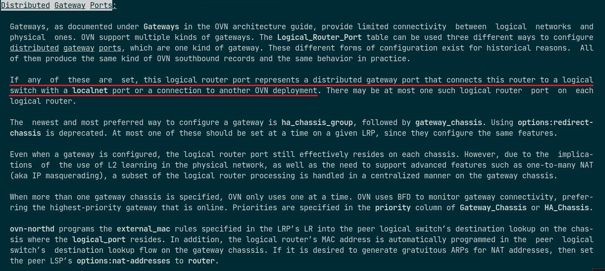

    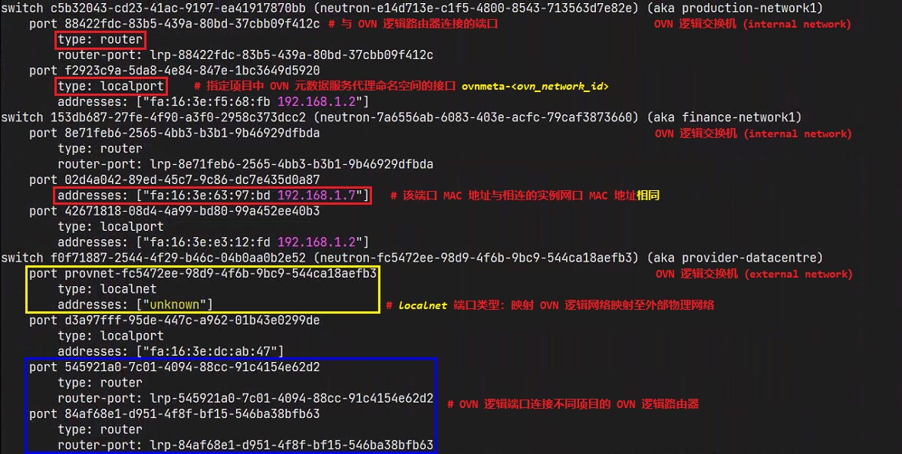

    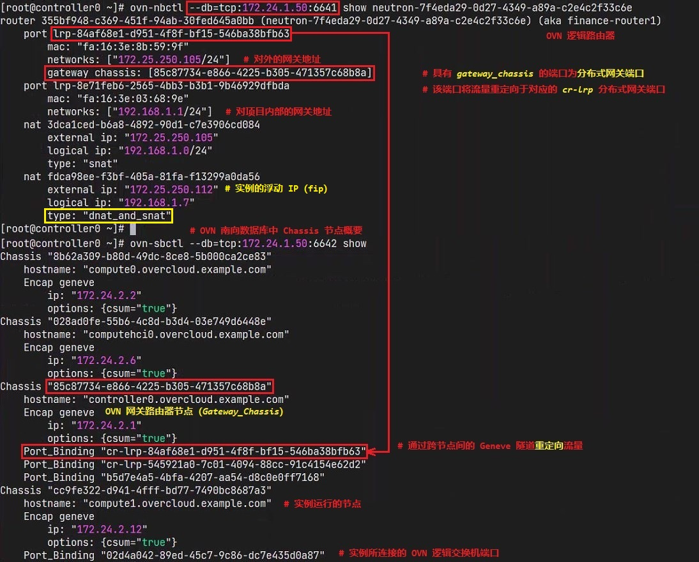
  
  - 若实例分配浮动 IP（fip），从实例内部到外部网络的互访流量均在实例所在的计算节点上实现（`dnat_and_snat`），OVN 逻辑路由器作为网关存在于每个计算节点的 OVS br-int 网桥中，流量不再经过 Gateway_Chassis。

    > 🔊 注意：后文的内容将详细分析 OVS 流表中所涉及到的以上过程！

- 供应商网络模式概要：
  - 该网络模式不再依赖于 OVN 的 `overlay` 网络功能，而是将实例直连 OVS br-int 网桥，并直接映射至外部所提供的物理 `underlay` 网络上。
  - 实例的 IP 地址由 OpenStack 创建的供应商网络的 IP 地址池所分配，该 IP 地址池由物理 underlay 网络提供。
  - 实例 IP 的自动分配依然由 OVN DHCP 服务提供，L3 路由需外部路由器提供。

## 🔥 5. **OVN 自服务网络与供应商网络拓扑示例**

- 🤘 RHOSP 13.0 & 16.1 多租户间 OVN 逻辑网络互连示例：

  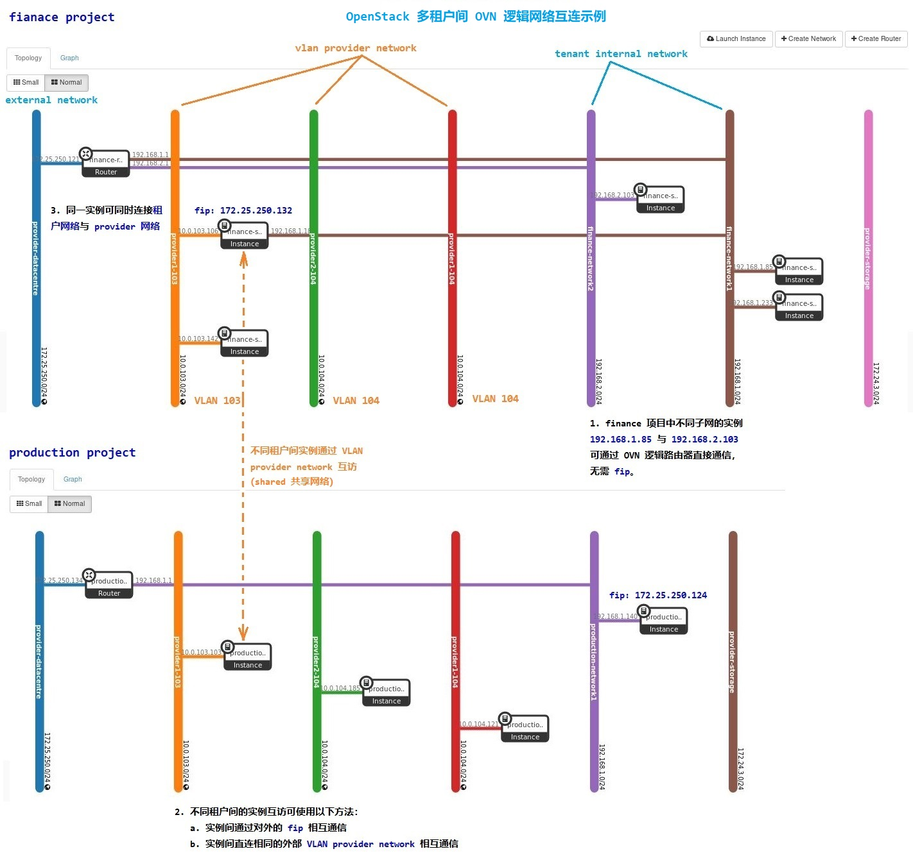

- 🤘 RHOSP 13.0 & 16.1 OVN 租户网络与供应商网络模式及流量类型示例：

  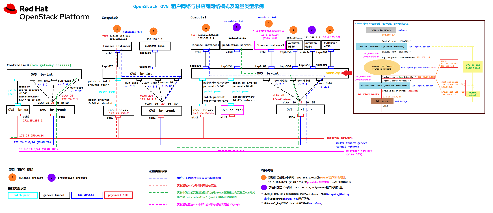

## 🧪 6.**OVN 自服务网络模式的 OVS 流表分析**

- 经由 OVN 南北向数据库处理的流量最终都会匹配到南北向控制节点与东西向计算节点的 OVS 流表，因此要了解 OVN 逻辑网络拓扑与各节点物理及虚拟网络拓扑间的关系需要理解各节点的 OVS br-int 网桥中的流表（`OpenFlow table`）。
- 因此，根据 "RHOSP 13.0 & 16.1 OVN 租户网络与供应商网络模式及流量类型示例" 中的流量类型进行如下流表分析：
  - 同一租户内不同实例的跨节点间 Geneve 隧道通信（图例中蓝色虚线表示）
  - 使用租户内部 IP 地址与 OVN 网关路由器节点对外部网络的访问（图例中绿色虚线表示）
  - 从外部直接访问计算节点以访问运行于计算节点之上的具有浮动 IP（fip）的实例（图例中红色虚线表示）
- OVS 流表在 OVN 逻辑网络中的部分功能：

  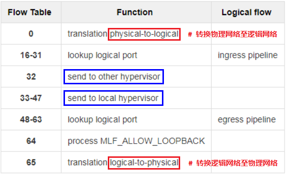

### 6.1 场景分析1：同一租户内不同实例的跨节点间 Geneve 隧道通信

如图所示，位于 finance 租户中的两个实例 finance-instance1 与 finance-instance2 分别位于 compute0 节点与 compute1 节点，两者间的通信依赖于 Geneve 隧道。

#### 6.1.1 **发送过程：compute0 节点**

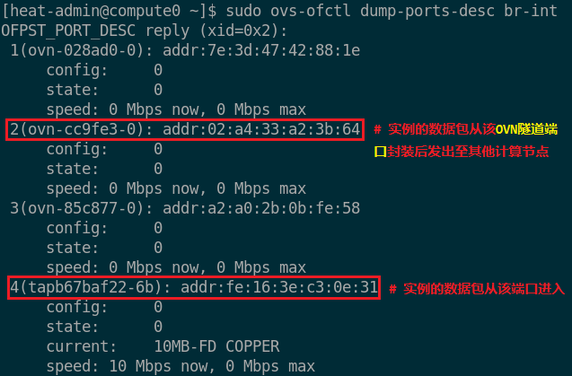

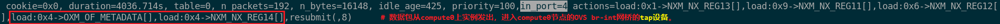

从实例发出的数据包进入 OVS br-int 网桥的端口 4 后，经过 table0 处理，进行物理网络至逻辑网络转换，该数据包通过 metadata 为 **`0x4`** 的 Datapath（逻辑交换机）上的 **`0x4`** 逻辑入端口进入 OVN 逻辑网络。


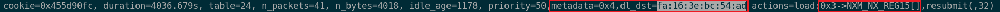

更改数据包在 Datapath（逻辑交换机）上的逻辑出端口 **`reg15`**。

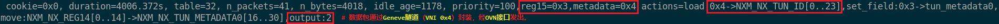

数据包通过 metadata 为 **`0x4`** 的 Datapath（逻辑交换机）的逻辑出端口 **`0x3`**，并进行 Geneve 隧道封装，最终通过 OVN 隧道端口从该计算节点发出。

#### 6.1.2 **接收过程：compute1 节点**

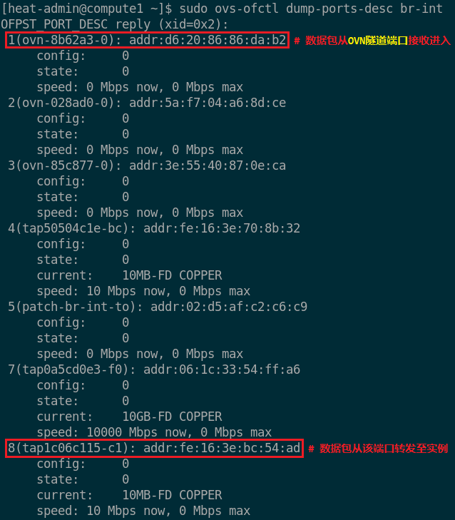

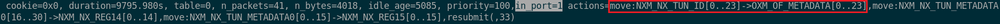

从 OVN 隧道端口接收其他计算节点发来的数据包，进行 Geneve 隧道解封装，并添加 Datapath（逻辑交换机）的 metadata。


数据包最终由 OVS br-int 网桥的端口 8 转发至目标实例。

#### 6.1.3 两节点间的 tcpdump 与 Wireshark 抓包分析

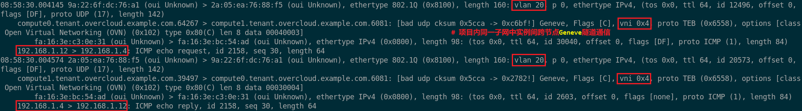

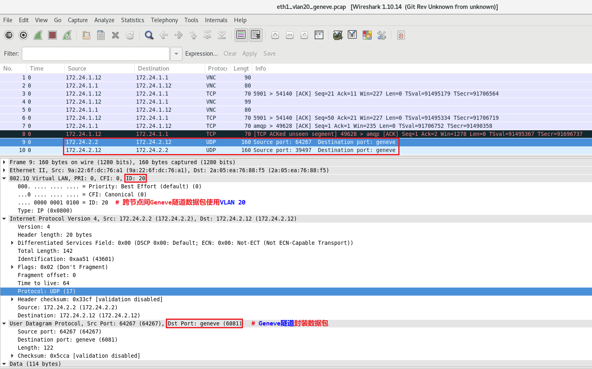

### 🚀 6.2 场景分析2：使用租户内部 IP 地址与 OVN 网关路由器节点对外部网络的访问

- 由于实例通过租户内 `DHCP` 自动分配的 IP 地址，未被分配浮动 IP（fip），因此无法通过外部网络访问该实例，只能从实例内部通过 OVN 网关路由器节点访问外部网络。
- 实例访问外部网络流量需经过其所在的 compute1 节点与 controller0 节点（OVN 网关路由器节点）。
- 若要理解整个 OVN 逻辑网络的流量流向，需理清 OVN 逻辑交换机、路由器、逻辑端口在 OVS br-int 流表中的索引号，因此，需定位 OVN 南向数据库中的 `Datapath_Binding` 表与 `Port_Binding` 表中的信息。
- 如下所示，实例所在的 OVN 逻辑网络概要：

  ```bash
  # ----- OVN 北向数据库：OVN 逻辑交换机、OVN 逻辑路由器概要 ----- #
  $ ovn-nbctl --db=tcp:172.24.1.52:6641 show
    ...
    switch 49e6b8c6-9518-4008-8f21-0cec5a14f3af (neutron-e6a61a45-ff39-4eb1-aac2-8e0ac624f7e5) (aka finance-network1)
        port abf6278c-3423-4b74-b5d2-4b5e8fb61f97
            type: localport
            addresses: ["fa:16:3e:f6:f4:7f 192.168.1.2"]
        port 3446de15-64ba-4010-bc16-a95296434bd5
            addresses: ["fa:16:3e:5a:58:2a 192.168.1.154"]
        port 3212a613-0433-43d5-aeed-eb5121cc1234
            type: router
            router-port: lrp-3212a613-0433-43d5-aeed-eb5121cc1234
    switch 3a35f933-277e-4f34-b913-4bde7f8a1128 (neutron-275c889d-ef54-4a38-88ff-a7cedee11506) (aka provider-datacentre)
        port 0416a971-ac51-4a5d-80a7-c95d2e397506
            type: router
            router-port: lrp-0416a971-ac51-4a5d-80a7-c95d2e397506
        port 521a09b2-f35d-4de2-8088-e421fe2395b9
            type: localport
            addresses: ["fa:16:3e:2e:64:cb"]
        port provnet-275c889d-ef54-4a38-88ff-a7cedee11506
            type: localnet
            addresses: ["unknown"]
    router a24077ec-d2c3-42f1-a81f-ed5fce6bc8d4 (neutron-8662d54e-0954-4239-ad75-2a7dad0e377b) (aka finance-router1)
        port lrp-3212a613-0433-43d5-aeed-eb5121cc1234
            mac: "fa:16:3e:94:2b:aa"
            networks: ["192.168.1.1/24"]
        port lrp-0416a971-ac51-4a5d-80a7-c95d2e397506
            mac: "fa:16:3e:d8:a1:f2"
            networks: ["172.25.250.139/24"]
            gateway chassis: [daeaae52-3df0-4531-a07d-0111be0edb42]
        nat 198ac241-3a33-4440-a666-0834c904bbc1
            external ip: "172.25.250.139"
            logical ip: "192.168.1.0/24"
            type: "snat"
    ...
  ```

  > 📌注意：
  >
  > 1. 在 ovs br-int 流表中的 `metadata` 字段对应每个 OVN 逻辑交换机或 OVN 逻辑路由器在 OVN 南向数据库 `Datapath_Binding` 数据路径表的 `tunnel_key` 属性，可根据 metadata 字段确定 flow 属于哪个 OVN 逻辑设备。
  > 2. 由于每个 OVN 逻辑设备均绑定一个数据路径，因此，若在 ovs br-int 流表中从 OVN 逻辑交换机逻辑出端口流出的数据包进入 OVN 逻辑路由器逻辑入端口时，metadata 字段将改变！
  >

  ```bash
  # ----- OVN 南向数据库：Datapath_Binding 数据路径绑定表 ----- #
  $ ovn-sbctl --db=tcp:172.24.1.52:6642 list Datapath_Binding
    _uuid               : 4aa0552d-8627-4136-8530-f1c28ce417f1
    external_ids        : {logical-switch="4e5e2601-c1e4-474c-a4e0-a0cc3d524b12", name=neutron-d71997c1-1670-4ebe-b6f7-2c4aa8dcbc7b, name2=lb-mgmt-net}
    tunnel_key          : 1

    _uuid               : c3da5aad-8659-491e-8a4d-291ccd651399
    external_ids        : {logical-switch="3a35f933-277e-4f34-b913-4bde7f8a1128", name=neutron-275c889d-ef54-4a38-88ff-a7cedee11506, name2=provider-datacentre}
    tunnel_key          : 2

    _uuid               : a0d4a875-adc7-4fcc-b672-61de8b148dbf
    external_ids        : {logical-switch="8311be4d-b6c3-4cfd-b1f8-b44b218510b1", name=neutron-dcf783e3-c104-4f21-99c3-0093364b4c81, name2=provider-storage}
    tunnel_key          : 3

    _uuid               : bb6ba376-b2ee-4608-93e8-fc8b6ab5fe15
    external_ids        : {logical-router="a24077ec-d2c3-42f1-a81f-ed5fce6bc8d4", name=neutron-8662d54e-0954-4239-ad75-2a7dad0e377b, name2=finance-router1}
    tunnel_key          : 6

    _uuid               : 6b2b21ef-c46b-4d0f-9f21-c729db444ce1
    external_ids        : {logical-switch="1f74dc81-abb3-4100-bba3-9acfd9a88844", name=neutron-d75263e1-754d-4276-a663-9188216f86e6, name2=production-network1}
    tunnel_key          : 5

    _uuid               : 68127ef3-0822-4c4a-aa66-6e4610318e81
    external_ids        : {logical-switch="49e6b8c6-9518-4008-8f21-0cec5a14f3af", name=neutron-e6a61a45-ff39-4eb1-aac2-8e0ac624f7e5, name2=finance-network1}
    tunnel_key          : 4
  ```

  ```bash
  $ ovn-sbctl --db=tcp:172.24.1.52:6642 Port_Binding
  # 查看每个 OVN 逻辑交换机与 OVN 逻辑路由器的逻辑端口信息
  ```

  > 📌注意：
  >
  > 1. 每个 OVN 逻辑入端口的 tunnel_key 对应 ovs br-int 流表中的 `reg14` 字段。
  > 2. 每个 OVN 逻辑出端口的 tunnel_key 对应 ovs br-int 流表中的 `reg15` 字段。
  >

  ```bash
  _uuid               : 1638f309-075a-468d-b022-4011c08ae02c
  chassis             : []
  datapath            : bb6ba376-b2ee-4608-93e8-fc8b6ab5fe15
  encap               : []
  external_ids        : {}
  gateway_chassis     : []
  ha_chassis_group    : []
  logical_port        : lrp-0416a971-ac51-4a5d-80a7-c95d2e397506
  mac                 : ["fa:16:3e:d8:a1:f2 172.25.250.139/24"]
  nat_addresses       : []
  options             : {ipv6_prefix="false", ipv6_prefix_delegation="false", peer="0416a971-ac51-4a5d-80a7-c95d2e397506"}
  parent_port         : []
  tag                 : []
  tunnel_key          : 2
  type                : patch
  virtual_parent      : []

  _uuid               : 0e998b8a-d349-4861-8391-0d8342dee2c4
  chassis             : ee5cff61-76b2-42d3-b27b-2645c5c94f38
  datapath            : bb6ba376-b2ee-4608-93e8-fc8b6ab5fe15
  encap               : []
  external_ids        : {}
  gateway_chassis     : []
  ha_chassis_group    : 0d5471be-e772-4d47-a399-6c96b96af1bb
  logical_port        : cr-lrp-0416a971-ac51-4a5d-80a7-c95d2e397506
  mac                 : ["fa:16:3e:d8:a1:f2 172.25.250.139/24"]
  nat_addresses       : []
  options             : {distributed-port=lrp-0416a971-ac51-4a5d-80a7-c95d2e397506}
  parent_port         : []
  tag                 : []
  tunnel_key          : 3
  type                : chassisredirect
  virtual_parent      : []

  _uuid               : f2f1309a-399a-435a-b8a1-d2a7519fcb53
  chassis             : []
  datapath            : c3da5aad-8659-491e-8a4d-291ccd651399
  encap               : []
  external_ids        : {"neutron:cidrs"="172.25.250.139/24", "neutron:device_id"="8662d54e-0954-4239-ad75-2a7dad0e377b", "neutron:device_owner"="network:router_gateway", "neutron:network_name"=neutron-275c889d-ef54-4a38-88ff-a7cedee11506, "neutron:port_name"="", "neutron:project_id"="", "neutron:revision_number"="4", "neutron:security_group_ids"=""}
  gateway_chassis     : []
  ha_chassis_group    : []
  logical_port        : "0416a971-ac51-4a5d-80a7-c95d2e397506"
  mac                 : [router]
  nat_addresses       : ["fa:16:3e:d8:a1:f2 172.25.250.139 is_chassis_resident(\"cr-lrp-0416a971-ac51-4a5d-80a7-c95d2e397506\")"]
  options             : {peer=lrp-0416a971-ac51-4a5d-80a7-c95d2e397506}
  parent_port         : []
  tag                 : []
  tunnel_key          : 3
  type                : patch
  virtual_parent      : []

  _uuid               : 0e829fd2-2fac-479d-85a7-2082ea859aa0
  chassis             : b1845743-6335-484d-956a-9b70ff75a2d8
  datapath            : 68127ef3-0822-4c4a-aa66-6e4610318e81
  encap               : []
  external_ids        : {"neutron:cidrs"="192.168.1.2/24", "neutron:device_id"=ovnmeta-e6a61a45-ff39-4eb1-aac2-8e0ac624f7e5, "neutron:device_owner"="network:dhcp", "neutron:network_name"=neutron-e6a61a45-ff39-4eb1-aac2-8e0ac624f7e5, "neutron:port_name"="", "neutron:project_id"="5d0b01fa01dc48d8b04e306d40edcaeb", "neutron:revision_number"="2", "neutron:security_group_ids"=""}
  gateway_chassis     : []
  ha_chassis_group    : []
  logical_port        : "abf6278c-3423-4b74-b5d2-4b5e8fb61f97"
  mac                 : ["fa:16:3e:f6:f4:7f 192.168.1.2"]
  nat_addresses       : []
  options             : {requested-chassis=""}
  parent_port         : []
  tag                 : []
  tunnel_key          : 1
  type                : localport
  virtual_parent      : []

  _uuid               : ef7cc2e2-b49e-4fea-9690-e81017cf8ee6
  chassis             : []
  datapath            : c3da5aad-8659-491e-8a4d-291ccd651399
  encap               : []
  external_ids        : {"neutron:cidrs"="", "neutron:device_id"=ovnmeta-275c889d-ef54-4a38-88ff-a7cedee11506, "neutron:device_owner"="network:dhcp", "neutron:network_name"=neutron-275c889d-ef54-4a38-88ff-a7cedee11506, "neutron:port_name"="", "neutron:project_id"="50e6fca93606496b8a6c043957e4cb1d", "neutron:revision_number"="1", "neutron:security_group_ids"=""}
  gateway_chassis     : []
  ha_chassis_group    : []
  logical_port        : "521a09b2-f35d-4de2-8088-e421fe2395b9"
  mac                 : ["fa:16:3e:2e:64:cb"]
  nat_addresses       : []
  options             : {requested-chassis=""}
  parent_port         : []
  tag                 : []
  tunnel_key          : 2
  type                : localport
  virtual_parent      : []

  _uuid               : 0fa8566b-8021-44da-bb27-bea20b75daa2
  chassis             : ee5cff61-76b2-42d3-b27b-2645c5c94f38
  datapath            : 4aa0552d-8627-4136-8530-f1c28ce417f1
  encap               : []
  external_ids        : {name=octavia-health-manager-controller0.overcloud.example.com-listen-port, "neutron:cidrs"="172.23.3.42/16", "neutron:device_id"="", "neutron:device_owner"="Octavia:health-mgr", "neutron:network_name"=neutron-d71997c1-1670-4ebe-b6f7-2c4aa8dcbc7b, "neutron:port_name"=octavia-health-manager-controller0.overcloud.example.com-listen-port, "neutron:project_id"="50e6fca93606496b8a6c043957e4cb1d", "neutron:revision_number"="5", "neutron:security_group_ids"=""}
  gateway_chassis     : []
  ha_chassis_group    : []
  logical_port        : "79ad0f7e-f219-4c5f-8799-ed75fdde5b5f"
  mac                 : ["fa:16:3e:cd:df:d4 172.23.3.42", unknown]
  nat_addresses       : []
  options             : {requested-chassis=controller0.overcloud.example.com}
  parent_port         : []
  tag                 : []
  tunnel_key          : 2
  type                : ""
  virtual_parent      : []

  _uuid               : 17ddcd4b-5dad-4419-a811-c93cb9a91eab
  chassis             : []
  datapath            : bb6ba376-b2ee-4608-93e8-fc8b6ab5fe15
  encap               : []
  external_ids        : {}
  gateway_chassis     : []
  ha_chassis_group    : []
  logical_port        : lrp-3212a613-0433-43d5-aeed-eb5121cc1234
  mac                 : ["fa:16:3e:94:2b:aa 192.168.1.1/24"]
  nat_addresses       : []
  options             : {ipv6_prefix="false", ipv6_prefix_delegation="false", peer="3212a613-0433-43d5-aeed-eb5121cc1234"}
  parent_port         : []
  tag                 : []
  tunnel_key          : 1
  type                : patch
  virtual_parent      : []

  _uuid               : 2665306c-a275-400e-bfde-3c8d21714927
  chassis             : []
  datapath            : c3da5aad-8659-491e-8a4d-291ccd651399
  encap               : []
  external_ids        : {}
  gateway_chassis     : []
  ha_chassis_group    : []
  logical_port        : provnet-275c889d-ef54-4a38-88ff-a7cedee11506
  mac                 : [unknown]
  nat_addresses       : []
  options             : {network_name=datacentre}
  parent_port         : []
  tag                 : []
  tunnel_key          : 1
  type                : localnet
  virtual_parent      : []

  _uuid               : 2f8ab86d-40a8-4658-972a-d3dc0babe196
  chassis             : []
  datapath            : a0d4a875-adc7-4fcc-b672-61de8b148dbf
  encap               : []
  external_ids        : {"neutron:cidrs"="172.24.3.200/24", "neutron:device_id"=ovnmeta-dcf783e3-c104-4f21-99c3-0093364b4c81, "neutron:device_owner"="network:dhcp", "neutron:network_name"=neutron-dcf783e3-c104-4f21-99c3-0093364b4c81, "neutron:port_name"="", "neutron:project_id"="50e6fca93606496b8a6c043957e4cb1d", "neutron:revision_number"="2", "neutron:security_group_ids"=""}
  gateway_chassis     : []
  ha_chassis_group    : []
  logical_port        : "0333b0c7-a3ee-4c03-bb59-994bc03a5e2f"
  mac                 : ["fa:16:3e:d6:9d:82 172.24.3.200"]
  nat_addresses       : []
  options             : {requested-chassis=""}
  parent_port         : []
  tag                 : []
  tunnel_key          : 2
  type                : localport
  virtual_parent      : []

  _uuid               : f4cd046d-4738-4f52-9654-95956b3ca5a1
  chassis             : []
  datapath            : a0d4a875-adc7-4fcc-b672-61de8b148dbf
  encap               : []
  external_ids        : {}
  gateway_chassis     : []
  ha_chassis_group    : []
  logical_port        : provnet-dcf783e3-c104-4f21-99c3-0093364b4c81
  mac                 : [unknown]
  nat_addresses       : []
  options             : {network_name=storage}
  parent_port         : []
  tag                 : 30
  tunnel_key          : 1
  type                : localnet
  virtual_parent      : []

  _uuid               : c5b9bd25-becf-4bce-a053-b694f25e3db9
  chassis             : []
  datapath            : 4aa0552d-8627-4136-8530-f1c28ce417f1
  encap               : []
  external_ids        : {"neutron:cidrs"="172.23.0.2/16", "neutron:device_id"=ovnmeta-d71997c1-1670-4ebe-b6f7-2c4aa8dcbc7b, "neutron:device_owner"="network:dhcp", "neutron:network_name"=neutron-d71997c1-1670-4ebe-b6f7-2c4aa8dcbc7b, "neutron:port_name"="", "neutron:project_id"="50e6fca93606496b8a6c043957e4cb1d", "neutron:revision_number"="2", "neutron:security_group_ids"=""}
  gateway_chassis     : []
  ha_chassis_group    : []
  logical_port        : "c2d0d0f4-8185-4cc4-a9f4-21008e49192c"
  mac                 : ["fa:16:3e:13:26:5c 172.23.0.2"]
  nat_addresses       : []
  options             : {requested-chassis=""}
  parent_port         : []
  tag                 : []
  tunnel_key          : 1
  type                : localport
  virtual_parent      : []

  _uuid               : ead38b06-ca3a-49d2-a23d-1153a2f6d799
  chassis             : []
  datapath            : 6b2b21ef-c46b-4d0f-9f21-c729db444ce1
  encap               : []
  external_ids        : {"neutron:cidrs"="192.168.1.2/24", "neutron:device_id"=ovnmeta-d75263e1-754d-4276-a663-9188216f86e6, "neutron:device_owner"="network:dhcp", "neutron:network_name"=neutron-d75263e1-754d-4276-a663-9188216f86e6, "neutron:port_name"="", "neutron:project_id"="5b51457605f64326a7fac5f66654045e", "neutron:revision_number"="2", "neutron:security_group_ids"=""}
  gateway_chassis     : []
  ha_chassis_group    : []
  logical_port        : "6dc02ff1-006b-4fe0-8290-fa2187531166"
  mac                 : ["fa:16:3e:48:a0:84 192.168.1.2"]
  nat_addresses       : []
  options             : {requested-chassis=""}
  parent_port         : []
  tag                 : []
  tunnel_key          : 1
  type                : localport
  virtual_parent      : []

  _uuid               : 737b22ee-149c-4eaa-ae06-e0529b73cf8c
  chassis             : []
  datapath            : 68127ef3-0822-4c4a-aa66-6e4610318e81
  encap               : []
  external_ids        : {"neutron:cidrs"="192.168.1.1/24", "neutron:device_id"="8662d54e-0954-4239-ad75-2a7dad0e377b", "neutron:device_owner"="network:router_interface", "neutron:network_name"=neutron-e6a61a45-ff39-4eb1-aac2-8e0ac624f7e5, "neutron:port_name"="", "neutron:project_id"="5d0b01fa01dc48d8b04e306d40edcaeb", "neutron:revision_number"="3", "neutron:security_group_ids"=""}
  gateway_chassis     : []
  ha_chassis_group    : []
  logical_port        : "3212a613-0433-43d5-aeed-eb5121cc1234"
  mac                 : [router]
  nat_addresses       : []
  options             : {peer=lrp-3212a613-0433-43d5-aeed-eb5121cc1234}
  parent_port         : []
  tag                 : []
  tunnel_key          : 2
  type                : patch
  virtual_parent      : []

  _uuid               : db65c687-19a8-4cac-8870-ffe7574f161d
  chassis             : b1845743-6335-484d-956a-9b70ff75a2d8
  datapath            : 68127ef3-0822-4c4a-aa66-6e4610318e81
  encap               : []
  external_ids        : {"neutron:cidrs"="192.168.1.154/24", "neutron:device_id"="b692bf70-8fac-4005-90af-96c1f38488f1", "neutron:device_owner"="compute:nova", "neutron:network_name"=neutron-e6a61a45-ff39-4eb1-aac2-8e0ac624f7e5, "neutron:port_name"="", "neutron:project_id"="5d0b01fa01dc48d8b04e306d40edcaeb", "neutron:revision_number"="6", "neutron:security_group_ids"="390b4a25-4acf-48d4-a720-65a04d8278d2"}
  gateway_chassis     : []
  ha_chassis_group    : []
  logical_port        : "3446de15-64ba-4010-bc16-a95296434bd5"
  mac                 : ["fa:16:3e:5a:58:2a 192.168.1.154"]
  nat_addresses       : []
  options             : {requested-chassis=compute1.overcloud.example.com}
  parent_port         : []
  tag                 : []
  tunnel_key          : 3
  type                : ""
  virtual_parent      : []
  ```

- 实例流量从 compute1 节点的 ovs br-int ovn 接口封装为 Geneve 隧道数据包的形式重定向至 controller0 节点（OVN 网关路由器节点），从实例发出的数据包在 ovs br-int 网桥中匹配的流表规则如下所示：

  ```bash
  student@workstation：
    $ source operator1-finance-rc
    $ openstack port list | grep fa:16:3e:94:2b:aa
      | 3212a613-0433-43d5-aeed-eb5121cc1234 | fa:16:3e:94:2b:aa | ip_address='192.168.1.1', subnet_id='b4df8042-184b-494f-8a72-2ec171327408'    | ACTIVE |
    # 查看实例所在的租户子网的对内网关地址

  root@compute1:
    $ ovs-ofctl dump-ports-desc br-int
      OFPST_PORT_DESC reply (xid=0x2):
      ...
      3(ovn-daeaae-0): addr:66:1c:e0:97:33:3c
          config:     0
          state:      0
          speed: 0 Mbps now, 0 Mbps max
      4(tap3446de15-64): addr:fe:16:3e:5a:58:2a
          config:     0
          state:      0
          current:    10MB-FD COPPER
          speed: 10 Mbps now, 0 Mbps max
      ...
    # 查看实例网口连接的 tap 设备与 ovn 隧道端口在 ovs br-int 网桥上的索引号   
  ```

  ```bash
  $ ovs-ofctl dump-flows br-int
    cookie=0xdb65c687, duration=34235.449s, table=0, n_packets=17759, n_bytes=1708588, idle_age=330, priority=100,in_port=4 actions=load:0x1->NXM_NX_REG13[],load:0x7->NXM_NX_REG11[],load:0x3->NXM_NX_REG12[],load:0x4->OXM_OF_METADATA[],load:0x3->NXM_NX_REG14[],resubmit(,8)
    # 从实例发出的数据包通过 4 号端口（in_port=4）进入 ovs br-int 网桥，从物理网络进入逻辑网络。
    # 由上述 OVN 南向数据库所知，数据包通过逻辑入端口（0x3）进入 OVN 逻辑交换机（metadata=0x4）。
    cookie=0x8bec76c5, duration=34235.440s, table=8, n_packets=17759, n_bytes=1708588, idle_age=330, priority=50,reg14=0x3,metadata=0x4,dl_src=fa:16:3e:5a:58:2a actions=resubmit(,9)
    # MAC 地址 fa:16:3e:5a:58:2a 为 实例网口 MAC，IP 地址 192.168.1.154 为实例 IP 地址。
    cookie=0x9262d250, duration=34235.439s, table=9, n_packets=17216, n_bytes=1684714, idle_age=330, priority=90,ip,reg14=0x3,metadata=0x4,dl_src=fa:16:3e:5a:58:2a,nw_src=192.168.1.154 actions=resubmit(,10)
    cookie=0x2264da97, duration=34235.436s, table=9, n_packets=1, n_bytes=342, idle_age=34184, priority=90,udp,reg14=0x3,metadata=0x4,dl_src=fa:16:3e:5a:58:2a,nw_src=0.0.0.0,nw_dst=255.255.255.255,tp_src=68,tp_dst=67 actions=resubmit(,10)
    cookie=0x6f980da0, duration=34235.440s, table=9, n_packets=700, n_bytes=58578, idle_age=340, priority=0,metadata=0x4 actions=resubmit(,10)
    cookie=0x2ee5013a, duration=34235.439s, table=10, n_packets=518, n_bytes=21756, idle_age=340, priority=90,arp,reg14=0x3,metadata=0x4,dl_src=fa:16:3e:5a:58:2a,arp_spa=192.168.1.154,arp_sha=fa:16:3e:5a:58:2a actions=resubmit(,11)
    cookie=0x5df244e1, duration=34235.443s, table=10, n_packets=17399, n_bytes=1721878, idle_age=330, priority=0,metadata=0x4 actions=resubmit(,11)
    cookie=0x8e0a6f42, duration=34235.440s, table=11, n_packets=17217, n_bytes=1685056, idle_age=330, priority=100,ip,metadata=0x4 actions=load:0x1->NXM_NX_XXREG0[96],resubmit(,12)
    cookie=0xe146b7bb, duration=34235.444s, table=12, n_packets=17917, n_bytes=1743634, idle_age=330, priority=0,metadata=0x4 actions=resubmit(,13) 
    cookie=0x5c4455c9, duration=34235.440s, table=13, n_packets=17217, n_bytes=1685056, idle_age=330, priority=100,ip,reg0=0x1/0x1,metadata=0x4 actions=ct(table=14,zone=NXM_NX_REG13[0..15])
    cookie=0xf7ee025, duration=34235.436s, table=13, n_packets=700, n_bytes=58578, idle_age=340, priority=0,metadata=0x4 actions=resubmit(,14) 
    cookie=0x9fac5dfc, duration=34235.436s, table=14, n_packets=44, n_bytes=4312, idle_age=33845, priority=65535,ct_state=-new+est-rel+rpl-inv+trk,ct_label=0/0x1,metadata=0x4 actions=resubmit(,15)
    cookie=0xc343943e, duration=34235.439s, table=14, n_packets=17034, n_bytes=1669320, idle_age=330, priority=2002,ct_state=-new+est-rpl+trk,ct_label=0/0x1,ip,reg14=0x3,metadata=0x4 actions=resubmit(,15)
    cookie=0xf4be381d, duration=34235.439s, table=14, n_packets=139, n_bytes=11424, idle_age=345, priority=2002,ct_state=+new-est+trk,ip,reg14=0x3,metadata=0x4 actions=load:0x1->NXM_NX_XXREG0[97],resubmit(,15)
    cookie=0xed768947, duration=34235.444s, table=14, n_packets=700, n_bytes=58578, idle_age=340, priority=0,metadata=0x4 actions=resubmit(,15) 
    ...
    cookie=0x5f0ed5ff, duration=34235.444s, table=27, n_packets=17215, n_bytes=1684378, idle_age=330, priority=50,metadata=0x4,dl_dst=fa:16:3e:94:2b:aa actions=load:0x2->NXM_NX_REG15[],resubmit(,32)
    # 数据包经过 OVN 逻辑交换机（metadata=0x4）的转发通过逻辑出端口（reg15=0x2）进入 OVN 逻辑路由器的对内网关接口（fa:16:3e:94:2b:aa）。
    cookie=0xe998b8a, duration=34235.449s, table=32, n_packets=17007, n_bytes=1664991, idle_age=330, priority=100,reg15=0x3,metadata=0x6 actions=load:0x6->NXM_NX_TUN_ID[0..23],set_field:0x3->tun_metadata0,move:NXM_NX_REG14[0..14]->NXM_NX_TUN_METADATA0[16..30],output:3
    # 进入 OVN 逻辑路由器（metadata=0x6）的数据包通过逻辑出端口（reg15=0x3, cr-lrp-0416a971-ac51-4a5d-80a7-c95d2e397506）出路由器，并通过 ovs br-int 网桥的 3 号 ovn 隧道端口封装 Geneve 隧道发出。
    # Geneve 隧道封装的数据包将重定向至 controller0 节点。

    # 总结：
    #   OVN 逻辑路由器的逻辑出端口 lrp-0416a971-ac51-4a5d-80a7-c95d2e397506 的分布式网关端口位于 controller0 节点，
    #   因此隧道流量将重定向至 controller0 节点。
  ```

- 为了验证以上结果，分别在 compute1 节点的 eth2 网口（对接 172.25.250.0/24 外部网络）与 vlan20 接口（Geneve 隧道网络）上抓包，结果显示无数据包通过 eth2 网口，而 vlan20 接口上监听到 Geneve 隧道流量。

  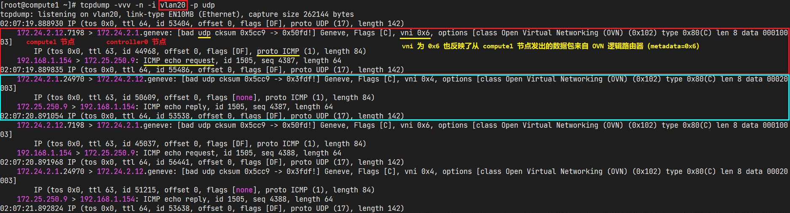

- 重定向的 Geneve 隧道数据包通过 controller0 节点 ovs br-int ovn 接口解封装进入 ovs br-int 网桥，数据包在 ovs br-int 网桥中匹配的流表规则：

  ```bash
  root@controller0:
    $ ovs-ofctl dump-ports-desc br-int
      OFPST_PORT_DESC reply (xid=0x2):
      ...
      3(ovn-b8bd46-0): addr:0a:d3:dc:0d:16:82
          config:     0
          state:      0
          speed: 0 Mbps now, 0 Mbps max
      ...
      6(patch-br-int-to): addr:56:ba:5f:65:dc:58
          config:     0
          state:      0
          speed: 0 Mbps now, 0 Mbps max
      ...
    # 查看接收 Geneve 隧道数据包的 ovn 隧道端口与数据包出 ovs br-int 网桥的端口索引号
  ```

  ```bash
  $ ovs-ofctl dump-flows br-int
    cookie=0x0, duration=34164.224s, table=0, n_packets=17007, n_bytes=1664991, idle_age=115, priority=100,in_port=3 actions=move:NXM_NX_TUN_ID[0..23]->OXM_OF_METADATA[0..23],move:NXM_NX_TUN_METADATA0[16..30]->NXM_NX_REG14[0..14],move:NXM_NX_TUN_METADATA0[0..15]->NXM_NX_REG15[0..15],resubmit(,33)
    # controller0 节点通过 3 号 ovn 隧道端口接收重定向的 Geneve 隧道数据包将其解封装。
    cookie=0xe998b8a, duration=34164.225s, table=33, n_packets=17007, n_bytes=1664991, idle_age=115, priority=100,reg15=0x3,metadata=0x6 actions=load:0x2->NXM_NX_REG15[],load:0x9->NXM_NX_REG11[],load:0x8->NXM_NX_REG12[],resubmit(,34)
    # 来自 OVN 逻辑路由器（metadata=0x6）的逻辑出端口（reg15=0x3，cr-lrp-0416a971-ac51-4a5d-80a7-c95d2e397506）的数据包将从逻辑出端口（reg=0x2，lrp-0416a971-ac51-4a5d-80a7-c95d2e397506）发出。
    cookie=0x0, duration=34164.225s, table=34, n_packets=73786, n_bytes=7542266, idle_age=115, priority=0 actions=load:0->NXM_NX_REG0[],load:0->NXM_NX_REG1[],load:0->NXM_NX_REG2[],load:0->NXM_NX_REG3[],load:0->NXM_NX_REG4[],load:0->NXM_NX_REG5[],load:0->NXM_NX_REG6[],load:0->NXM_NX_REG7[],load:0->NXM_NX_REG8[],load:0->NXM_NX_REG9[],resubmit(,40)
    cookie=0x7d0c87c1, duration=34164.195s, table=40, n_packets=34458, n_bytes=3409617, idle_age=115, priority=0,metadata=0x6 actions=resubmit(,41)
    cookie=0xd794c1c3, duration=34164.197s, table=41, n_packets=17007, n_bytes=1664991, idle_age=115, priority=153,ip,reg15=0x2,metadata=0x6,nw_src=192.168.1.0/24 actions=ct(commit,table=42,zone=NXM_NX_REG12[0..15],nat(src=172.25.250.139))
    # SNAT: 192.168.1.0/24 -> 172.25.250.139
    cookie=0x65382c1c, duration=34164.197s, table=41, n_packets=17451, n_bytes=1744626, idle_age=115, priority=0,metadata=0x6 actions=resubmit(,42)
    cookie=0x8b136393, duration=34164.197s, table=42, n_packets=34458, n_bytes=3409617, idle_age=115, priority=0,metadata=0x6 actions=resubmit(,43)
    cookie=0x31c0b926, duration=34164.195s, table=43, n_packets=17505, n_bytes=1685907, idle_age=115, priority=100,reg15=0x2,metadata=0x6 actions=resubmit(,64) 
    cookie=0x0, duration=34164.225s, table=64, n_packets=498, n_bytes=20916, idle_age=125, priority=100,reg10=0x1/0x1,reg15=0x2,metadata=0x6 actions=push:NXM_OF_IN_PORT[],load:0xffff->NXM_OF_IN_PORT[],resubmit(,65),pop:NXM_OF_IN_PORT[]
    cookie=0x2665306c, duration=34164.180s, table=65, n_packets=17515, n_bytes=1686327, idle_age=115, priority=100,reg15=0x1,metadata=0x2 actions=output:6
    # 数据包从 OVN 逻辑路由器（metadata=0x6）的逻辑出端口（reg15=0x2）转发至具有 localnet 端口类型的 OVN 逻辑交换机的逻辑出端口（reg15=0x1），数据包最终经由 ovs br-int 网桥的 6 号端口发出。
    # 6 号端口为 patch 口，与 ovs br-ex 网桥对接，实现 OVN 逻辑网络至物理网络的映射。
  ```

- 为了验证以上结果，分别在 controller0 节点的 eth2 网口（对接 172.25.250.0/24 外部网络）与 vlan20 接口（Geneve 隧道网络）上抓包，结果显示 vlan20 接口监听到了 Geneve 隧道流量，eth2 网口监听到与外网互访的流量。

  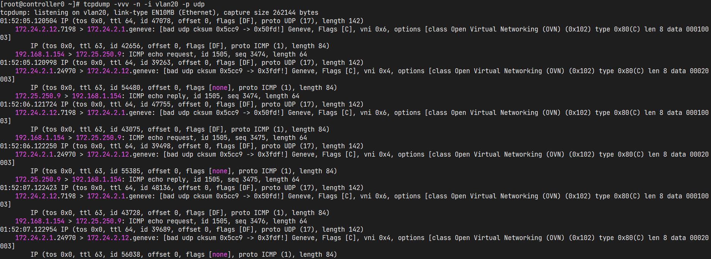

  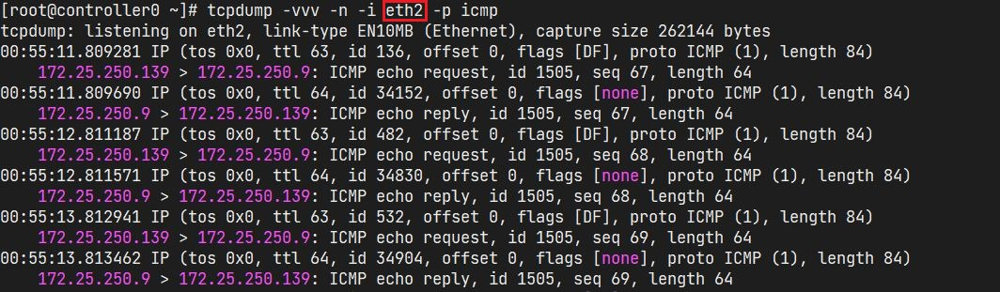

### 🔀 6.3 场景分析3：从外部直接访问计算节点以访问运行于计算节点之上的具有浮动 IP（fip）的实例

- `DNAT` 功能的实现：

  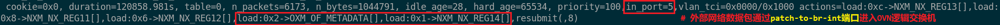

  外部网络数据包通过 OVS br-int 集成网桥 **`patch-to-br-int`** 端口进入 metadata 为 **`0x2`** 的 Datapath（逻辑交换机）上的 **`0x1`** 逻辑入端口。

  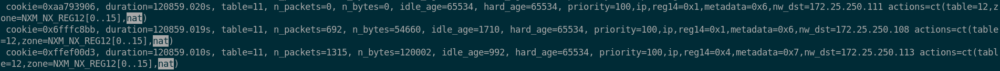

  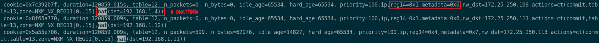

  

  数据包通过 OVS br-int 网桥的端口 4 转发至目标实例。

- 直接对实例所在的计算节点进行 tcpdump 与 Wireshark 抓包分析：

  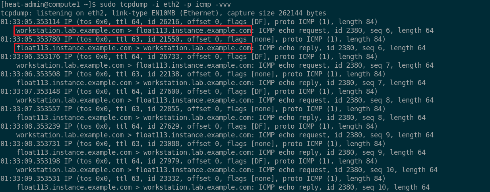

  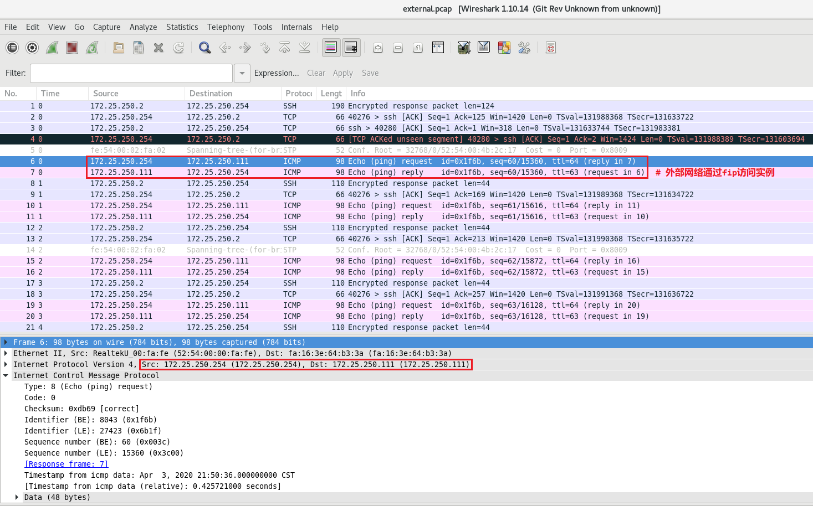

## 7. 参考文档

- [man 8 ovn-nbctl](https://man7.org/linux/man-pages/man8/ovn-nbctl.8.html#top_of_page)
- [Open vSwitch 官网](http://www.openvswitch.org/)
