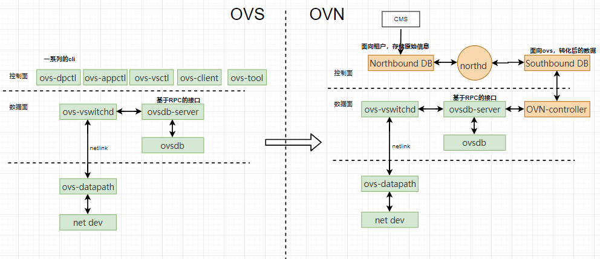
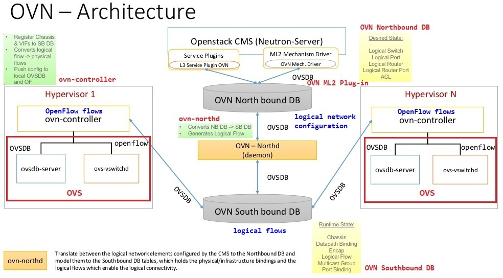
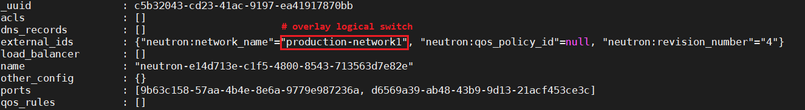
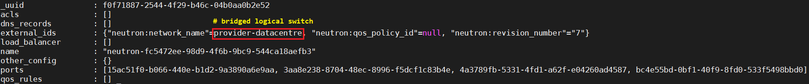
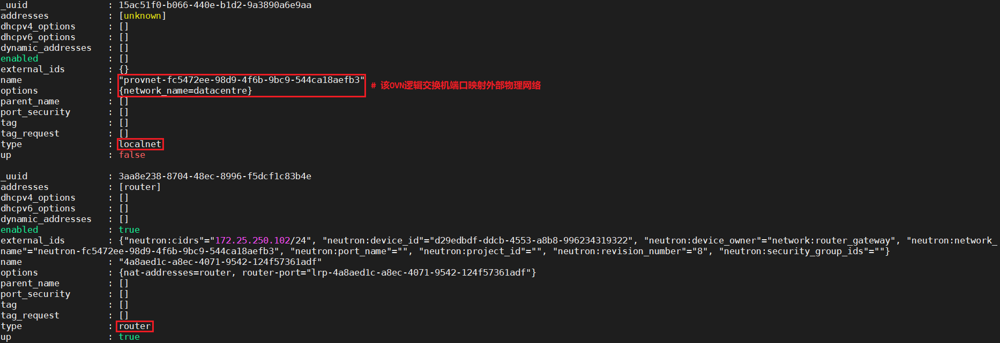
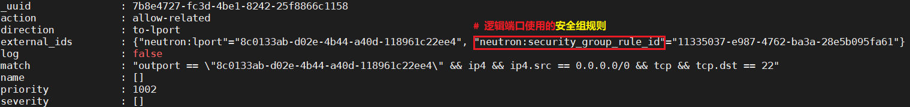
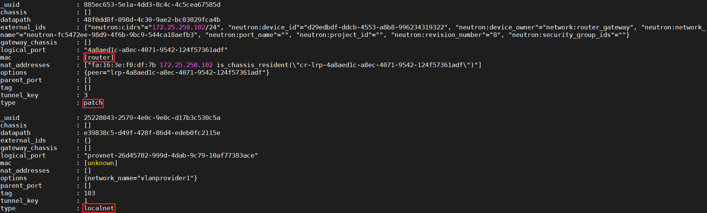
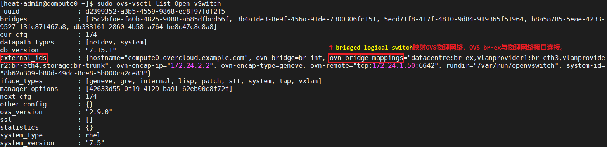
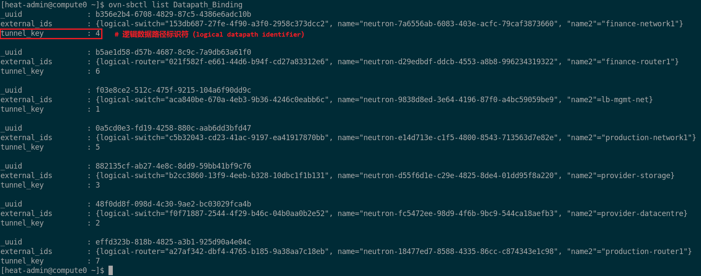

# OVN 实践：Open Virtual Network 概述与分析

## 文档目录

- [OVN 实践：Open Virtual Network 概述与分析](#ovn-实践open-virtual-network-概述与分析)
  - [文档目录](#文档目录)
  - [1. OVN 手册查询](#1-ovn-手册查询)
  - [2. Open Virtual Network（OVN）概述](#2-open-virtual-networkovn概述)
  - [3. OVN 特性](#3-ovn-特性)
  - [4. OVN 中的节点角色](#4-ovn-中的节点角色)
  - [5. OVN 架构解析](#5-ovn-架构解析)
  - [6. OVN 逻辑网络：logical network](#6-ovn-逻辑网络logical-network)
    - [6.1 OVN 逻辑端口类型](#61-ovn-逻辑端口类型)
  - [7. OVN 北向数据库：OVN Northbound DB](#7-ovn-北向数据库ovn-northbound-db)
    - [7.1 Northbound DB 中主要的表（table）](#71-northbound-db-中主要的表table)
  - [8. OVN 南向数据库：OVN Southbound DB](#8-ovn-南向数据库ovn-southbound-db)
    - [8.1 Southbound DB 中主要的表（table）](#81-southbound-db-中主要的表table)
  - [9. OVN Chassis](#9-ovn-chassis)
  - [10. OVN 隧道：OVN tunnel](#10-ovn-隧道ovn-tunnel)
    - [10.1 OVN 隧道封装时使用三种数据](#101-ovn-隧道封装时使用三种数据)
    - [10.2 Geneve 隧道字段说明](#102-geneve-隧道字段说明)
  - [11. Neutron 与 OVN 对比](#11-neutron-与-ovn-对比)
    - [11.1 Neutron L3 与 OVN L3 对比](#111-neutron-l3-与-ovn-l3-对比)
    - [11.2 Neutron 安全组与 OVN 安全组对比](#112-neutron-安全组与-ovn-安全组对比)
  - [12. 常用 OVS OpenFlow 相关命令](#12-常用-ovs-openflow-相关命令)
  - [13. 参考链接](#13-参考链接)

## 1. OVN 手册查询

```bash
$ man 7 ovn-architecture
#搜索 **`OpenFlow tables`** 关键字。
#搜索 `Architectural Physical Life Cycle of a Packet` 部分，其说明数据包在集成网桥中的物理生命周期。
#搜索 **`register number 11、12、13、14、15`**，即 OVS br-int 集成网桥寄存器信息。
```

OVN 相关 man 手册：

```bash
$ man ovn-nb
# 查看 OVN 北向数据库详细信息
$ man ovn-sb
# 查看 OVN 南向数据库详细信息
$ man ovn-nbctl
# 查看 OVN 北向数据库管理工具使用方法
$ man ovn-sbctl
# 查看 OVN 南向数据库管理工具使用方法
$ man 7 ovs-fields
# 查看 OpenFlow 流表（table）字段说明
```

> **注意**：以下的逻辑网络即为 OVN 逻辑网络

## 2. Open Virtual Network（OVN）概述

- `OVN` 是 Open vSwitch 社区在 2015 年 1 月份才宣布的一个子项目。
- OVN 使用 Open vSwitch 功能提供一个网络虚拟化方案，不同于一般的 SDN Controller，它主要专注于 L2、L3 和 Security Group，利用轻量级控制平面提高当前网络环境下 Open vSwitch 的效率。
- OVN 代码被放在 Open vSwitch 代码库，作为 Open vSwitch 的功能部分发布，2016 年 9 月 28 日随着 Open vSwitch 版本 **`2.6.0`** 发布第一个非实验版本。
- 目前为止，OVN 已经支持很多功能：
  - **Logical switches**：逻辑交换机，实现二层转发。
  - **`L2、L3、L4 ACLs`**：二到四层的 ACL，根据报文的 MAC 地址、IP 地址、端口号实现访问控制。
  - **Logical routers**：分布式逻辑路由器，实现三层转发。
  - **`NAT、LB`**：OVS 与 Conntrack 支持 NAT 及 LB。
  - **Multiple tunnel overlays**：支持多种隧道封装技术，如 `Geneve`、STT 和 VXLAN。
  - **TOR switch or software logical switch gateways**：支持使用硬件 `TOR switch` 或者软件 logical switch 当作网关来连接物理网络和虚拟网络。

    > **TOR** 介绍：https://support.huawei.com/enterprise/zh/doc/EDOC1100023543?section=j00c

  - **Container**：为虚拟机与虚拟机内的 Container 提供网络。

- OVN 运行平台仅要求能够运行 Open vSwitch，OVN 可以和 Linux、Docker、DPDK 还有 Hyper-V 兼容。
- OVN 可以和很多 CMS（Cloud Management System）集成到一起，如 Openstack Neutron。

## 3. OVN 特性

- 提供虚拟网络抽象（L2、L3、overlays 和物理网络的连通）、ARP 代答
- 完全分布式 DHCP、分布式 L3、NAT 和 LB、灵活的 ACL
- L2 软网关、L3 网关从逻辑网络到物理网络支持 TOR

## 4. OVN 中的节点角色

- OVN Central（OVN 中心节点）：
  - 对接云管理平台。
  - OVN 中心节点运行 OVN 北向数据库和 OVN 南向数据库。
  - OVN 北向数据库用于描述上层的逻辑网络组件，如逻辑交换机、逻辑端口等。
  - OVN 南向数据库，其将 OVN 北向数据库的逻辑网络数据格式转换为物理网络数据格式并进行存储。
- OVN Host（OVN 主机）：
  - 所有提供虚拟机或虚拟网络的节点。
  - OVN Host 运行 **`chassis controller`**，其上连 OVN 南向数据库并作为其记录的物理网络信息授权来源，下接 OVS 并成为其 `OpenFlow controller`。
- OVN 与 OVS 对比：

  

## 5. OVN 架构解析

- **OVN 架构示意**：

  

- OpenStack/CMS plugin 是 CMS 和 OVN 的接口，将 CMS 的配置转化成 OVN 的格式写到 `Nnorthbound DB` 中。
- Northbound DB 存储逻辑网络数据，与传统网络设备概念一致，如 logical switch、logical router、ACL 与 logical port。
- **`ovn-northd`** 守护进程类似于集中式控制器，将 Northbound DB 中的数据翻译后写到 `Southbound DB` 中。
- Southbound DB 保存的数据和 Northbound DB 语义完全不一样，主要包含 3 类数据：
  - 物理网络数据：HV（hypervisor）的 IP 地址、HV 的隧道封装格式。
  - 逻辑网络数据：报文如何在逻辑网络中转发。
  - 物理网络和逻辑网络的绑定关系：逻辑端口关联到哪个 HV 上。
- **`ovn-controller`** 守护进程是 OVN 中的 Agent，类似于 neutron-openvswitch-agent，运行在每个 HV 上。

  > **北向**：ovn-controller 将物理网络的信息写到 Southbound DB 中。
  >
  > **南向**：Southbound DB 保存的数据转化成 OpenFlow 流规则配到本地的 OVS 流表中，实现数据包的转发。

- **`ovs-vswitchd`** 和 **`ovsdb-server`** 是 OVS 的两个守护进程。

## 6. OVN 逻辑网络：logical network

- OVN 逻辑网络实现与物理网络相同的概念，但它们通过隧道或其他封装与物理网络隔离。
- 这允许逻辑网络具有单独的 IP 和其他地址空间，这些地址空间与用于物理网络的地址空间可以重叠并且互不冲突。
- 逻辑网络拓扑结构可以不考虑底层物理网络的拓扑结构。
- OVN 逻辑网络概念：
  - OVN 逻辑交换机（logical switch）：以太网交换机的逻辑版本。
  - OVN 逻辑路由器（logical router）：IP 路由器的逻辑版本，逻辑交换机与逻辑路由器可连接成复杂的拓扑结构。
  - OVN 逻辑数据路径（logical datapath）：OpenFlow 交换机的逻辑版本，逻辑交换机与逻辑路由器都作为逻辑数据路径实现。
  - **OVN 逻辑端口（logical port）**：逻辑交换机与逻辑路由器内外的连接点。

### 6.1 OVN 逻辑端口类型

- **`*`**：
  - VIF的逻辑端口
- **`localnet`**：
  - 逻辑交换机映射物理网络的端口类型（ovn-bridge-mapping）
  - 在 OVS br-int 集成网桥与底层物理网络接口附加到的独立 OVS 网桥（OVS br-ex）之间的 OVS patch 端口（patch peer）即是 localnet 端口
- **`patch`**：
  - 对等逻辑端口
  - 逻辑交换机与逻辑路由器之间的连接点
  - 在某些情况下，则是对等逻辑路由器之间的连接点
- **`localport`**：
  - OVN 角度：逻辑交换机与 VIF 之间的本地连接点
  - OVS 角度：network namespace 与 OVS br-int 集成网桥的端口（VIF）
  - **这类端口存在于每个 chassis（HV）上，并且来自它们的流量将永远不会穿过隧道。**
  - localport 端口仅生成目的地为本地目的地的流量，通常响应于其收到的请求。
  - 如，OpenStack Neutron 使用 ovnmeta 命名空间的 localport 端口将元数据提供给每个 HV 上的实例。
- **`router`**：逻辑交换机与逻辑路由器连接的端口

## 7. OVN 北向数据库：OVN Northbound DB

- Northbound DB 是 OVN 和 CMS 之间的接口，Northbound DB 保存 CMS 产生的数据。
- ovn-northd 守护进程监听数据库的内容变化，然后翻译并保存到 Southbound DB 中。

### 7.1 Northbound DB 中主要的表（table）

- **`Logical_Switch`**：
  - 逻辑交换机有两种类型：
    - 一种是 **`overlay logical switch`**，对应于 neutron network，每创建一个 neutron network，OVN 会在表中增加一行。

      

    - 另一种是 **`bridged logical switch`**，用于连接逻辑网络和物理网络，被 VTEP gateway 使用。

      

  - Logical_Switch 保存 logical port（指向表 `Logical_Port`）和应用其上的 ACL（指向表 `ACL`）。   

- **`Logical_Switch_Port`**：逻辑交换机的端口类型：localport、router、localnet、端口的 IP 和 MAC 地址、端口 UP 或 Down 的状态。

  

- **`ACL`**：每条ACL规则包含匹配的内容、方向、以及动作。

  

  > **注意**：每行代表一个应用到逻辑交换机上的 ACL 规则，若逻辑交换机上面的所有端口都没有配置安全组，那么该逻辑交换机上不应用 ACL。

- 其他相关的表：Logical_Router、Logical_Router_Port、NAT。

## 8. OVN 南向数据库：OVN Southbound DB

Southbound DB 处在 OVN 架构的中心，它是 OVN 中非常重要的一部分，与 OVN 的其他组件都有交互。

### 8.1 Southbound DB 中主要的表（table）

- **`Chassis`**：
  - 每行表示一个 `HV` 或 `VTEP` 网关，由东西向节点的 **`ovn-controller`** 或 **`ovn-controller-vtep`** 填充维护。
  - 该表包含 chassis 的名字和 chassis 支持的封装配置（指向表 `Encap`）。
  - 若 chassis 是 VTEP 网关，VTEP 网关上和 OVN 关联的逻辑交换机也保存在该表中。
- **`Encap`**：
  - 保存 tunnel 的类型和 tunnel endpoint IP 地址。
- **`Logical_Flow`**：
  - 每行表示一个 logical 流表。
  - 该表是 ovn-northd 根据 Nourthbound DB 中 L2、L3 层拓扑信息和 ACL 信息转换而来。
  - **ovn-controller 将该表中逻辑流表转换成 OVS 流表，配置到 HV 上的 OVS br-int 流表中。**
  - 逻辑流表主要包含：匹配的规则、匹配的方向、优先级、table ID 和执行的动作。
- **`Multicast_Group`**：
  - 每行代表一个组播组，组播报文和广播报文的转发由该表决定。
  - 该表保存了组播组所属的 Datapath、组播组包含的端口、以及代表 logical egress port 的 `tunnel_key`。
- **`Datapath_Binding`**：
  - 每行代表一个 Datapath 和逻辑网络的绑定关系，每个 logical switch 和 logical router 对应一行。 
  - **每个 Datapath 使用 tunnel_key 作为 logical datapath identifier（逻辑数据路径标识符）。**
- **`Port_Binding`**：
  - 每行包含的内容：
    - 端口所属的 chassis
    - 端口所属的 Datapath_Binding
    - logical port 的 MAC 和 IP 地址
    - **tunnel_key 作为 logical input/output port identifier（逻辑输入/输出端口标识符）**
    - 端口类型：localport、patch、localnet、chassisredirect。
  - 端口所处的 chassis 由 ovn-controller 或 ovn-controller-vtep 设置，其余的值由 ovn-northd 设置。

    

    > **注意**：逻辑端口与 chassis 的绑定关系可通过 `ovn-sbctl show` 命令输出中的 `Port_Binding` 确认，而 OVS 端口与逻辑端口的映射关系可通过 OVS Interface 数据库中 OVS 端口的 **`external_ids:iface-id`** 确认。

  - 物理网络的数据：表 Chassis、表 Encap
  - 逻辑网络的数据：表 Logical_Flow、表 Multicast_Group。
  - **逻辑网络与物理网络绑定关系的数据：表 Datapath_Binding、表 Port_Binding。**

## 9. OVN Chassis

- 当 ovn-controller 启动时，将读取本地 OVS 数据库 **`Open_vSwitch`** 表中的值：
  - **`external_ids:system-id`**：本地 OVN Chassis 名称。
  - **`external_ids:ovn-remote`**：远程 OVN 中心节点的 IP 地址与 OVN Southbound DB 的监听端口。
  - **`external_ids:ovn-encap-ip`**：隧道端点的 IP 地址（tunnel endpoint IP），可以为 HV 的某个网络接口的 IP 地址。
  - **`external_ids:ovn-encap-type`**：OVN 隧道封装类型，如 Geneve、STT 与 VXLAN 等。
- **然后 ovn-controller 将这些值写到 Southbound DB 中的表 Chassis 和表 Encap 中。**
- external_ids:ovn-encap-ip 和 external_ids:ovn-encap-type 是一对，每个隧道 IP 地址对应隧道封装类型。
- 若 HV 有多个接口可以建立隧道，可以在 ovn-controller 启动之前，把每对值填在 Open_vSwitch 表中。

  

## 10. OVN 隧道：OVN tunnel

- OVN 支持的隧道类型有三种：Geneve、STT、VXLAN。
- HV 与 HV 间的流量，只能用 Geneve 和 STT，HV 和 VTEP 网关间的流量除了用 Geneve 和 STT外，还能用 VXLAN。
- 这是为了兼容硬件 VTEP 网关，因为大部分硬件 VTEP 网关只支持VXLAN。
- 虽然 VXLAN 是数据中心常用的隧道技术，但是 **`VXLAN header`** 是固定的，只能传递一个 **`VNID`**（VXLAN network identifier）。
- 若在隧道中传递更多的信息，VXLAN 无法实现。
- 因此，OVN 选择了 Geneve 和 STT，Geneve 的头部有 option 字段，支持 TLV 格式，用户可以根据自己的需要进行扩展，而 STT 的头部可以传递 64-bit 的数据，比 VXLAN 的 24-bit 大很多。

### 10.1 OVN 隧道封装时使用三种数据

- **`logical datapath identifier`**（逻辑数据路径标识符）：
  - datapath 是 OVS 中的概念，数据包需要送到 datapath 进行处理。
  - 一个 datapath 对应一个OVN中的逻辑交换机或逻辑路由器，类似于 **`tunnel ID`**。
  - 该标识符长 24-bit，由 ovn-northd 分配，全局唯一，保存在 Southbound DB 的 **`Datapath_Binding`** 表的  **`tunnel_key`** 中。 

    

- **`logical input port identifier`**（逻辑入端口标识符）：
  - 该标识符长 15-bit，由 ovn-northd 分配，在每个 datapath 中唯一。   
  - 该标识符可用范围为 1-32767，0 预留给内部使用。
  - 该标识符保存在 Southbound DB 中的 **`Port_Binding`** 表的 **`tunnel_key`** 中。
- **`logical output port identifier`**（逻辑出端口标识符）：
  - 在逻辑入口管道的开始，该标识符被初始化为 0。
  - 该标识符长 16-bit，可用范围为 0-32767，和 logical input port identifier 含义一样。
  - 范围 `32768-65535` 给组播组使用。
  - 对于每个 logical port，input port identifier 和 output port identifier 相同。

    > **重要**：
    >
    > a. 对于每个进入 OVS br-int 集成网桥的数据包都具有以上三个属性。
    >
    > b. OVS 的隧道封装由 OpenFlow 流表实现，因此 ovn-controller 需将这三个标识符写到本地 HV 的 OpenFlow 流表中。
    >
    > c. logical datapath identifier 与 logical input port identifier 在入口方向被赋值，分别存在 **`OpenFlow metadata`** 字段和 Nicira 扩展寄存器 **`reg14`**（Nicira extensive register 14）中。
    >
    > d. 数据包经过 OVS 的 pipeline 处理后，若需要从指定端口发出，只需要将 logical output port identifier 写在 Nicira 扩展寄存器 **`reg15`**（Nicira extensive register 15）中。

### 10.2 Geneve 隧道字段说明

- **`Geneve header VNI`**：logical datapath identifier
- Option：logical input port identifier、logical output port identifier。
- TLV class：0xffff
- type：0
- value：1-bit 0、15-bit logical input port identifier、16-bit logical output port identifier
  - OVN 中的 tunnel 类型由 HV 上的 ovn-controller 来设置，并不由 CMS 指定。
  - OVN 中的 tunnel ID 由 OVN 分配。
  - 使用 Neutron 创建网络时指定 tunnel 类型和 tunnel ID（VNID）是无用的，OVN不做处理！

## 11. Neutron 与 OVN 对比

- Neutron 二层报文处理通过 OVS OpenFlow 流表实现，三层报文处理通过 Linux TCP/IP 协议栈实现。
- OVN 中数据的读写都是通过 **`OVSDB`** 协议实现，取代了 Neutron 中的消息队列机制。
- 使用 OVN 后，Neutron 中所有的 Agent 都不再需要，Neutron 只作为 `API server` 来处理用户的 REST 请求，其他的功能都由 OVN 实现，只需在 Neutron 中加一个 plugin 来调用配置 OVN。
- Plugin 使用 OVSDB 协议将用户的配置写在 Northbound DB 中，ovn-northd 监听到 Northbound DB 配置发生改变，然后将配置翻译到 Southbound DB 中，HV 上的 ovn-controller chassis controller 注意到 Southbound DB 数据的变化，再更新本地 HV 的流表，OVN 中的数据包处理都由 OVS OpenFlow 流表来实现。

### 11.1 Neutron L3 与 OVN L3 对比

- Neutron 的三层功能：路由、SNAT、Floating IP（也叫 DNAT）。
- 通过 Linux kernel 的 namespace 实现，每个虚拟路由器（vrouter）对应一个 namespace，利用 Linux TCP/IP 协议栈来做路由转发。
- OVN 支持原生的三层功能，无需借助 Linux TCP/IP 协议栈，用 OpenFlow 流表实现路由查找、ARP查找、TTL 和 MAC 地址的更改。
- OVN 使用分布式路由，东西向流量直接通过计算节点路由而无需经过网络节点，Floating IP 也在计算节点上实现，因此无需 Neutron L3 Agent。
- 未使用 OVN：
  - 跨子网内网通信时，需要将数据包都发送给网络节点进行路由转发，而且不同路由存在于不同的 namespace 中，因此，网络节点的性能压力较高，也会多一次隧道封装。
  - 外网通信时，都需要将数据包发送给网络节点，网络节点的网关 namespace 借助 Linux TCP/IP 协议栈完成工作。   
- 使用 OVN：
  - 可以采用 `DVR` 的方式，并且实现全部靠流表实现，性能也会有优势。
  - 依然可以通过 OVS 流表完成工作，所以对于支持 DPDK 也更容易。

### 11.2 Neutron 安全组与 OVN 安全组对比

- Neutron 中的 security group 是作用在实例对应的 Linux bridge 的 **`tap`** 设备上。
- 由于 OVS internal port 不能经过 Linux 网络协议栈，所以不能直接通过 iptables 来实现 security group，加上 OVS 2.4.0 以前都不支持 **`conntrack`**，若单独通过匹配报文字段来做，有些访问控制实现不了并且性能会受到影响。
- 因此，Neutron 给每个应用了 security group 的 port 创建 Linux bridge，Neutron tap port 连到 Linux bridge，然后创建一对 veth pair，一端连接 Linux bridge，另一端连接 OVS bridge（默认是br-int）。
- security group 中的 rule 通过 iptables 匹配到 netfilter 中，作用于 Neutron tap port。
- 创建 Linux bridge 的目的就是为了利用 iptables 来实现 security group。
- OVN 的 security group 每创建一个 Neutron port，只需要把 `tap port` 连到 OVS bridge（默认是 br-int），不用像现在 Neutron 那样创建那么多虚拟网络设备，大大减少了跳数。
- 更重要的是，OVN 的 security group 是用到了 OVS 的 **`conntrack`** 功能，可以直接根据 **`连接状态`** 进行匹配，而不是匹配 **`报文的字段`**，提高了流表的查找效率，还可以做有状态的防火墙和 NAT。

  > **conntrack**：Linux kernel netfiler 的一个功能，可以记录连接状态，是有状态访问控制和 NAT 的必备条件。
  >
  > OVS 的 conntrack 由 Linux kernel netfilter 模块来实现，调用 **`netfiler userspace netlink API`** 将报文发送给 Linux kernel 的 **`netfiler connection tracker`** 模块进行处理。
  >
  > 该模块给每个连接维护一个连接状态表（CT table），记录这个连接的状态，OVS 获取连接状态，OpenFlow 流可以匹配这些连接状态。

## 12. 常用 OVS OpenFlow 相关命令

```bash
$ sudo ovn-nbctl show
# 查看 OVN 逻辑网络拓扑架构
$ sudo ovn-sbctl list Datapath_Binding
# 查看 OVN 逻辑网络数据路径
# tunnel_key 为 Geneve 隧道的 VNI，在 OpenFlow table 中为 metadata。

$ sudo ovn-sbctl list Port_Binding
# 查看 OVN 逻辑网络端口信息
# tunnel_key 为 register 寄存器的取值，reg14 为逻辑入端口，reg15 为逻辑出端口。

$ sudo ovs-ofctl dump-ports-desc br-int
# 查看 OVS br-int 集成网桥的端口号
$ sudo ovs-ofctl dump-flows br-int
# 查看 OpenFlow 流表与 OVN 逻辑网络映射关系
```

## 13. 参考链接

- [云计算底层技术 - 使用 openvswitch](https://opengers.github.io/openstack/openstack-base-use-openvswitch/)
- [云计算底层技术 - openflow 在 OVS 中的应用](https://opengers.github.io/openstack/openstack-base-openflow-in-openvswitch/)
- [OVS 调试介绍](https://www.cnblogs.com/silvermagic/p/7666051.html)
- [OVN 架构](https://www.cnblogs.com/allcloud/p/8058906.html)
