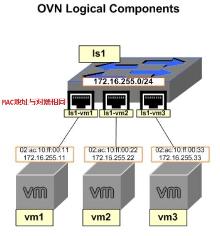
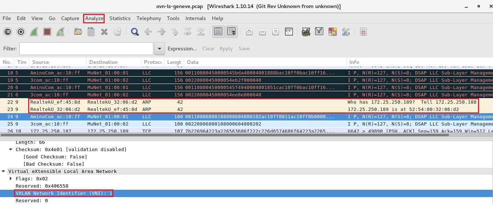

# OVN 实践：配置 OVN 逻辑交换机

## 文档目录

- [OVN 实践：配置 OVN 逻辑交换机](#ovn-实践配置-ovn-逻辑交换机)
  - [文档目录](#文档目录)
  - [文档说明](#文档说明)
  - [1. OVN架构部署](#1-ovn架构部署)
  - [2. 创建 OVN 逻辑网络](#2-创建-ovn-逻辑网络)
    - [2.1 在 ovn-central 节点上创建 OVN 逻辑交换机与逻辑端口](#21-在-ovn-central-节点上创建-ovn-逻辑交换机与逻辑端口)
    - [2.2 创建 Linux network namespace 连接 OVS bridge](#22-创建-linux-network-namespace-连接-ovs-bridge)
      - [2.2.1 ovn-host1 节点上创建 namespace](#221-ovn-host1-节点上创建-namespace)
      - [2.2.2 ovn-host2 节点上创建 namespace](#222-ovn-host2-节点上创建-namespace)
    - [2.3 测试 OVN 逻辑网络连通性](#23-测试-ovn-逻辑网络连通性)
    - [2.4 OVS 流规则分析示例](#24-ovs-流规则分析示例)
  - [3. 环境清理](#3-环境清理)
  - [4. 参考链接](#4-参考链接)

## 文档说明

- 关于 Open Virtual Network (OVN) 的架构与概述可参考 **Open Virtual Network（OVN）概述与分析**
- OS 版本：CentOS Linux release 7.4.1708 (Core)
- kernel 版本：3.10.0-693.el7.x86_64
- OVS 版本：openvswitch-2.11.0-4.el7.x86_64
- OVN 版本：openvswitch-ovn-central-2.11.0-4.el7.x86_64，openvswitch-ovn-host-2.11.0-4.el7.x86_64
- 实验节点资源概述：

  | Hostname    | CPU | RAM (GiB) | IP                | Role        |
  | ----------- | --- | --------- | ----------------- | ----------- |
  | ovn-central | 2   | 2         | 172.25.250.187/24 | ovn-central |
  | ovn-node1   | 2   | 2         | 172.25.250.188/24 | ovn-host    |
  | ovn-node2   | 2   | 2         | 172.25.250.189/24 | ovn-host    |

## 1. OVN架构部署

- [ovn-central 部署脚本示例](https://github.com/Alberthua-Perl/sc-col/blob/master/ovn-arch/deploy-ovn-central.sh)
- [ovn-host 部署脚本示例](https://github.com/Alberthua-Perl/sc-col/blob/master/ovn-arch/deploy-ovn-host.sh)

## 2. 创建 OVN 逻辑网络

- 此次创建的 OVN 逻辑网络拓扑：

  

- 通过 ip、ovs-vsctl、ovn-nbctl、ovn-sbctl 命令创建 OVS 与 OVN 相关的逻辑组件，其具体的数据转发规则由各个 ovn-host 节点的 OVS 流规则实现。

### 2.1 在 ovn-central 节点上创建 OVN 逻辑交换机与逻辑端口

```bash
$ sudo ovn-nbctl ls-add ls1
# 创建 OVN 逻辑交换机

$ sudo ovn-nbctl lsp-add ls1 ls1-vm1
# 创建 OVN 逻辑交换机端口
$ sudo ovn-nbctl lsp-set-addresses ls1-vm1 02:ac:10:ff:00:11
# 设置 OVN 逻辑交换机端口的 MAC 地址（该地址可随机生成）
$ sudo ovn-nbctl lsp-set-port-security ls1-vm1 02:ac:10:ff:00:11
# OVN 逻辑交换机端口只允许特定的源 MAC 地址数据包通过 

$ sudo ovn-nbctl lsp-add ls1 ls1-vm2
$ sudo ovn-nbctl lsp-set-addresses ls1-vm2 02:ac:10:ff:00:22
$ sudo ovn-nbctl lsp-set-port-security ls1-vm2 02:ac:10:ff:00:22
```

### 2.2 创建 Linux network namespace 连接 OVS bridge

- OVN 逻辑交换机的功能通过各个 ovn-host 节点的 OVS 流规则实现，需要先创建 OVS 各个逻辑组件以支持该功能。
- 此处使用 `namespace` 来模拟虚拟机与 OVS bridge 的连接，OVN 逻辑交换机分配的网段为 `172.16.255.0/24`。

#### 2.2.1 ovn-host1 节点上创建 namespace

```bash
$ sudo ip netns add vm1
# 创建 network namespace

$ sudo ovs-vsctl add-port br-int vm1 -- set Interface vm1 type=internal
# OVS bridge 上创建名为 vm1 的 OVS 端口，并设置该端口在 Interface 数据库中的 type 类型为 internal。
# 若存在其他已创建的端口（可由 ip link 命令创建）需使用 --may-exist 选项。

$ sudo ip link set vm1 netns vm1
# 将 vm1 端口添加至 vm1 namespace 中
$ sudo ip netns exec vm1 ip link set vm1 address 02:ac:10:ff:00:11
$ sudo ip netns exec vm1 ip address add 172.16.255.11/24 dev vm1
$ sudo ip netns exec vm1 ip link set vm1 up
# 设置 vm1 namespace 中 vm1 端口的 MAC 地址（必须与 OVN 逻辑交换机接口 MAC 地址相同）与 IP 地址

$ sudo ovs-vsctl set Interface vm1 external_ids:iface-id=ls1-vm1
# 将 OVS bridge 的 vm1 端口映射至 OVN 逻辑交换机端口上
# OVS 通知 OVN 相关的逻辑端口已上线，南北向流量上 OVN 向各节点的 chassis 控制器发送指令。
$ sudo ovs-vsctl list Interface | grep external_ids
```

若使用 ip link add <*veth_name*> type veth peer name <*veth_peer_name*> 命令创建的 `veth pair`，将其作为 OVS 端口添加至 OVS bridge 上时（ `--may-exist` 选项），无法设置其 type 类型为 `internal` 而不能正常通信，因此该场景中直接使用 vm1 接口同时连接namespace 与 OVS bridge。

若直接使用 KVM 虚拟机时，可在 KVM 虚拟机的 domain xml 定义文件中指定其 `tap` 设备关联的 OVS bridge 端口而建立联系。

#### 2.2.2 ovn-host2 节点上创建 namespace

```bash
$ sudo ip netns add vm2
$ sudo ovs-vsctl add-port br-int vm2 -- set Interface vm2 type=internal
$ sudo ip link set vm2 netns vm2
$ sudo ip netns exec vm2 ip link set vm2 address 02:ac:10:ff:00:22
$ sudo ip netns exec vm2 ip address add 172.16.255.22/24 dev vm2
$ sudo ip netns exec vm2 ip link set vm2 up
$ sudo ovs-vsctl set Interface vm2 external_ids:iface-id=ls1-vm2
```

### 2.3 测试 OVN 逻辑网络连通性

- 查看 ovn-central 节点上的 OVN 相关逻辑组件，其中各 ovn-host 节点间的东西向流量通过 `Geneve` 隧道封装通信。
- 各 ovn-host 节点的 `chassis` 控制器均可识别相应的 OVS 端口与 OVN 逻辑交换机或路由器端口的映射关系，端口绑定需正确才能使跨节点间的流量正常通信。

  ```bash
  [godev@ovn-central ~]$ sudo ovn-nbctl show
  switch b3b0c56a-bc76-4223-86f9-87d33d64c574 (ls1)
      port ls1-vm1
          addresses: ["02:ac:10:ff:00:11"]
      port ls1-vm2
          addresses: ["02:ac:10:ff:00:22"]
      port ls1-vm3
          addresses: ["02:ac:10:ff:00:33"]

  [godev@ovn-central ~]$ sudo ovn-sbctl show
  Chassis "978d59c9-48e4-40a5-9402-dc223d50b076"
      hostname: "ovn-central.domain12.example.com"
      Encap geneve
          ip: "172.25.250.187"
          options: {csum="true"}
  Chassis "971df564-e722-4804-a050-b5893a664d54"
      hostname: "ovn-node1.domain12.example.com"
      Encap geneve
          ip: "172.25.250.188"
          options: {csum="true"}
      Port_Binding "ls1-vm1"
      # OVS bridge vm1 端口与 OVN 逻辑交换机 ls1-vm1 端口映射绑定
      # 可查看 OVS Interface 数据库中相应端口的 external_ids:iface-id 选项以确定
  Chassis "46949570-4264-4038-91f6-27294a4ca9d3"
      hostname: "ovn-node2.domain12.example.com"
      Encap geneve
          ip: "172.25.250.189"
          options: {csum="true"}
      Port_Binding "ls1-vm2"
  ```

- 若在 ovn-host 节点上取消相应 OVS 端口与 OVN 逻辑端口的映射关系，将不在 ovn-sbctl show 命令查询结果中出现。

  ```bash
  $ sudo ovs-vsctl remove Interface <port> external_ids iface-id <ovn_logical_port>
  ```

- 从 ovn-host1 节点的 namespace 中 ping ovn-host2 节点的 namespace，两者通信正常，反之亦然。

  ```bash
  [godev@ovn-node1 ~]$ sudo ip netns exec vm1 ping -c3 172.16.255.22
  PING 172.16.255.22 (172.16.255.22) 56(84) bytes of data.
  64 bytes from 172.16.255.22: icmp_seq=1 ttl=64 time=2.47 ms
  64 bytes from 172.16.255.22: icmp_seq=2 ttl=64 time=0.794 ms
  64 bytes from 172.16.255.22: icmp_seq=3 ttl=64 time=1.18 ms

  --- 172.16.255.22 ping statistics ---
  3 packets transmitted, 3 received, 0% packet loss, time 2002ms
  rtt min/avg/max/mdev = 0.794/1.484/2.475/0.719 ms

  [godev@ovn-node2 ~]$ sudo ip netns exec vm2 ping -c3 172.16.255.11
  PING 172.16.255.11 (172.16.255.11) 56(84) bytes of data.
  64 bytes from 172.16.255.11: icmp_seq=1 ttl=64 time=2.53 ms
  64 bytes from 172.16.255.11: icmp_seq=2 ttl=64 time=0.659 ms
  64 bytes from 172.16.255.11: icmp_seq=3 ttl=64 time=0.601 ms

  --- 172.16.255.11 ping statistics ---
  3 packets transmitted, 3 received, 0% packet loss, time 2002ms
  rtt min/avg/max/mdev = 0.601/1.264/2.534/0.898 ms
  ```

- 可通过同样的方法在 ovn-host1 节点或 ovn-host2 节点上创建 vm3 namespace，以验证端口绑定与网络连通性。

### 2.4 OVS 流规则分析示例

如上所示，该场景中使用 Linux network namespace 来模拟 KVM 虚拟机接入 OVS bridge，并将其端口映射至 OVN 逻辑交换机端口的情况，测试各 ovn-host 节点间东西向流量的连通性。

如下所示，namespace 跨节点间的 Geneve 隧道封装通信的 OVS 流规则，其中只列举相关流规则条目：

```bash
[godev@ovn-node1 ~]$ sudo ovs-vsctl show
# 查看 OVS bridge 的端口概要信息
d3cfbc31-4cd1-45d5-a6d4-ddc4b3791859
    Bridge br-int
        fail_mode: secure
        Port "vm1"
            Interface "vm1"
                type: internal
        Port br-int
            Interface br-int
                type: internal
        Port "ovn-978d59-0"
            Interface "ovn-978d59-0"
                type: geneve
                options: {csum="true", key=flow, remote_ip="172.25.250.187"}
        Port "ovn-469495-0"
            Interface "ovn-469495-0"
                type: geneve
                options: {csum="true", key=flow, remote_ip="172.25.250.189"}
        # 与 ovn-node2 节点的通信将使用该端口进行 Geneve 隧道封装      
    ovs_version: "2.11.0"

[godev@ovn-node1 ~]$ sudo ovs-ofctl dump-ports-desc br-int
# 查看 OVS bridge 上各个端口在 OVS 流表中的索引号
OFPST_PORT_DESC reply (xid=0x2):
 1(ovn-469495-0): addr:ce:f9:b2:21:88:b7
     config:     0
     state:      0
     speed: 0 Mbps now, 0 Mbps max
 # 与 ovn-node2 节点通信 Geneve 隧道封装相关的端口  
 2(ovn-978d59-0): addr:92:75:d0:18:a0:8a
     config:     0
     state:      0
     speed: 0 Mbps now, 0 Mbps max
 3(vm1): addr:00:00:00:00:00:00
     config:     PORT_DOWN
     state:      LINK_DOWN
     speed: 0 Mbps now, 0 Mbps max
 # 从 vm1 namespace 的 egress 流量通过 vm1 端口进入 OVS bridge 作为 ingress 流量
 # 可在 OVS 流表中查找 in_port=3 来追踪流量
 LOCAL(br-int): addr:12:45:16:76:1e:45
     config:     PORT_DOWN
     state:      LINK_DOWN
     speed: 0 Mbps now, 0 Mbps max
```

```bash
[godev@ovn-node1 ~]$ sudo ovs-ofctl dump-flows br-int | less
cookie=0x0, duration=64911.540s, table=0, n_packets=16, n_bytes=1176, idle_age=35056, priority=100,in_port=3 actions=load:0x1->NXM_NX_REG13[],load:0x3->NXM_NX_REG11[],load:0x2->NXM_NX_REG12[],load:0x1->OXM_OF_METADATA[],load:0x1->NXM_NX_REG14[],resubmit(,8)
# OVS bridge vm1 端口映射至 OVN 逻辑交换机的 ls1-vm1 端口，该端口使用 ovn-sbctl list Port_Binding 命令查找可知 tunnel_key 为 1（0x1），即该端口为 OVN 逻辑交换机的逻辑入端口（0x1->NXM_NX_REG14[]）。
cookie=0x73c3222b, duration=64911.539s, table=8, n_packets=16, n_bytes=1176, idle_age=35056, priority=50,reg14=0x1,metadata=0x1,dl_src=02:ac:10:ff:00:11 actions=resubmit(,9)
# 处理来自于 vm1 namespace 的流量
cookie=0xbbec96f8, duration=64911.539s, table=9, n_packets=16, n_bytes=1176, idle_age=35056, priority=0,metadata=0x1 actions=resubmit(,10)
cookie=0x38f83bf2, duration=64911.539s, table=10, n_packets=7, n_bytes=294, idle_age=35056, priority=90,arp,reg14=0x1,metadata=0x1,dl_src=02:ac:10:ff:00:11,arp_sha=02:ac:10:ff:00:11 actions=resubmit(,11)
# ARP 请求流量
cookie=0xcf3dcb41, duration=64911.539s, table=10, n_packets=9, n_bytes=882, idle_age=35059, priority=0,metadata=0x1 actions=resubmit(,11)
...
cookie=0x70a14711, duration=64911.539s, table=24, n_packets=4, n_bytes=168, idle_age=39915, priority=100,metadata=0x1,dl_dst=01:00:00:00:00:00/01:00:00:00:00:00 actions=load:0xffff->NXM_NX_REG15[],resubmit(,32)
# ARP 请求流量
cookie=0x934a9269, duration=64911.539s, table=24, n_packets=12, n_bytes=1008, idle_age=35056, priority=50,metadata=0x1,dl_dst=02:ac:10:ff:00:22 actions=load:0x2->NXM_NX_REG15[],resubmit(,32)
# OVN 逻辑交换机端口 ls1-vm2 的 tunnel_key 为 2（0x2），即该端口为 OVN 逻辑交换机的逻辑出端口（0x2->NXM_NX_REG15[]）。
cookie=0x0, duration=41654.019s, table=32, n_packets=12, n_bytes=1008, idle_age=35056, priority=100,reg15=0x2,metadata=0x1 actions=load:0x1->NXM_NX_TUN_ID[0..23],set_field:0x2->tun_metadata0,move:NXM_NX_REG14[0..14]->NXM_NX_TUN_METADATA0[16..30],output:1
# 设置 Geneve 隧道的 VNI 为 1（0x1），数据包从 1 号端口（ovn-469495-0）封装并发出。
# move:NXM_NX_REG14[0..14]->NXM_NX_TUN_METADATA0[16..30]：将 OVN 逻辑入端口（0x1）设置为 Geneve 封装数据包中的元数据，其在目标节点上将被解析，见如下分析。
cookie=0x0, duration=41654.019s, table=32, n_packets=4, n_bytes=168, idle_age=39915, priority=100,reg15=0xffff,metadata=0x1 actions=load:0x1->NXM_NX_TUN_ID[0..23],set_field:0xffff->tun_metadata0,move:NXM_NX_REG14[0..14]->NXM_NX_TUN_METADATA0[16..30],output:1,resubmit(,33)
# ARP 请求流量
```

```bash
[godev@ovn-node2 ~]$ sudo ovs-ofctl dump-flows br-int | less
cookie=0x0, duration=145339.866s, table=0, n_packets=20, n_bytes=1512, idle_age=2017, hard_age=65534, priority=100,in_port=1 actions=move:NXM_NX_TUN_ID[0..23]->OXM_OF_METADATA[0..23],move:NXM_NX_TUN_METADATA0[16..30]->NXM_NX_REG14[0..14],move:NXM_NX_TUN_METADATA0[0..15]->NXM_NX_REG15[0..15],resubmit(,33)
# 将 Geneve 隧道数据包的 VNI 去除，并根据数据包中的 OVN 逻辑入端口与出端口的元数据设置本地的寄存器。
cookie=0x0, duration=56135.741s, table=33, n_packets=16, n_bytes=1344, idle_age=2017, priority=100,reg15=0x2,metadata=0x1 actions=load:0x1->NXM_NX_REG13[],load:0x3->NXM_NX_REG11[],load:0x2->NXM_NX_REG12[],resubmit(,34)
cookie=0x0, duration=56135.722s, table=33, n_packets=4, n_bytes=168, idle_age=54397, priority=100,reg15=0xffff,metadata=0x1 actions=load:0x1->NXM_NX_REG13[],load:0x2->NXM_NX_REG15[],resubmit(,34),load:0xffff->NXM_NX_REG15[]
...
cookie=0xfb68b625, duration=56135.722s, table=49, n_packets=4, n_bytes=168, idle_age=54397, priority=100,metadata=0x1,dl_dst=01:00:00:00:00:00/01:00:00:00:00:00 actions=resubmit(,64)
cookie=0xfefd14b0, duration=56135.722s, table=49, n_packets=16, n_bytes=1344, idle_age=2017, priority=50,reg15=0x2,metadata=0x1,dl_dst=02:ac:10:ff:00:22 actions=resubmit(,64)
cookie=0x0, duration=145339.895s, table=64, n_packets=20, n_bytes=1512, idle_age=2017, hard_age=65534, priority=0 actions=resubmit(,65)
cookie=0x0, duration=56135.741s, table=65, n_packets=20, n_bytes=1512, idle_age=2017, priority=100,reg15=0x2,metadata=0x1 actions=output:3
# 数据包从 vm2 namespace 的 vm2 端口进入
```

Geneve 隧道封装数据包抓包的原始数据，需使用 Analyze -> Decode As 进行协议转换，由于无 Geneve 协议，因此使用 VXLAN 协议代替。



## 3. 环境清理

为方便后续实验，需清除当前环境中创建的组件，如下所示：

```bash
godev@ovn-central:
$ sudo ovn-nbctl ls-del ls1
# 删除 OVN 逻辑交换机及其端口

godev@ovn-host1:
$ sudo ip netns del vm1
$ sudo ovs-vsctl --if-exists --with-iface del-port br-int vm1

godev@ovn-host2:
$ sudo ip netns del vm2
$ sudo ovs-vsctl --if-exists --with-iface del-port br-int vm2
# 删除 namespace 与 OVS bridge 及 namespace 关联的端口
```

## 4. 参考链接

- [OVN 简单部署](https://www.cnblogs.com/silvermagic/p/7666134.html)
- [介绍和安装 OVN](https://www.sdnlab.com/19157.html)
