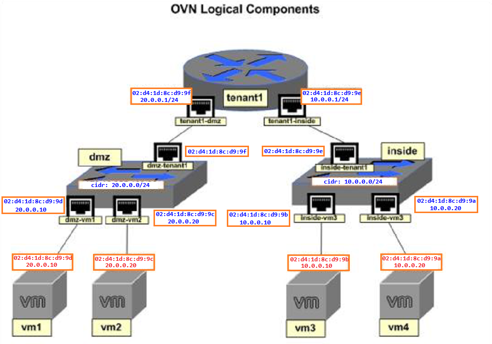

# OVN 实践：配置 OVN 逻辑路由器

## 文档说明

前一篇文档（配置 OVN 逻辑交换机）中部署与配置了 `overlay` 二层网络，基于该实验环境添加三层网络基本功能至 OVN 中，并且添加 OVN 原生的 **`DHCP`** 功能，自动分配 namespace 的 IP 地址。

## 1. 重构 OVN 逻辑组件

OVN 逻辑网络概要如下所示：

- 2 台 OVN 逻辑交换机：dmz、inside
- 1 台 OVN 逻辑路由器：tenant1（用于连接两台逻辑交换机）
- dmz 所在的 IP 地址段：20.0.0.0/24
- inside 所在的 IP 地址段：10.0.0.0/24
- 每个逻辑交换机上均对接 2 个 Linux network namespace（用以模拟虚拟机）

此次创建的 OVN 逻辑网络拓扑：

- 其中 vm1~4 namespace 的 IP 地址通过 OVN 原生的 `DHCP` 功能获得。
- OVN 成对逻辑端口间的 **`MAC`** 地址需相同。



## 2. 理解 OVN 逻辑路由器

此次实验中将创建 OVN 逻辑路由器，即分布式逻辑路由器（distributed logical router, **`DLR`**），DLR 不同于传统的路由器，由于其不是传统的物理设备，而是一种分布于各东西向节点上的逻辑设备，依赖各节点的 OVS 流规则实现，换言之，每个东西向节点上的 OVS 实例在 overlay 网络转发流量之前在本地模拟出 L3 的 OVN 逻辑路由器。

### 2.1 创建 OVN 逻辑交换机与逻辑路由器

在 ovn-central 节点上创建 OVN 逻辑交换机与路由器：

> **注意**：若使用 ovn-nbctl 或 ovn-sbctl 命令，均在 ovn-central 节点上执行。

```bash
$ sudo ovn-nbctl ls-add inside
$ sudo ovn-nbctl ls-add dmz
$ sudo ovn-nbctl lr-add tenant1
```

### 2.2 创建 OVN 逻辑路由器端口

```bash
$ sudo ovn-nbctl lrp-add tenant1 tenant1-dmz 02:d4:1d:8c:d9:9f 20.0.0.1/24
# 创建 OVN 逻辑路由器端口，并分配 MAC 与 IP 地址。
$ sudo ovn-nbctl lsp-add dmz dmz-tenant1
# 创建 OVN 逻辑路由器端口对应的逻辑交换机端口
$ sudo ovn-nbctl lsp-set-addresses dmz-tenant1 02:d4:1d:8c:d9:9f
# 设置 OVN 逻辑交换机端口 MAC 地址，与对应的逻辑路由端口 MAC 地址相同。
$ sudo ovn-nbctl lsp-set-type dmz-tenant1 router
# 设置 OVN 逻辑交换机端口的类型为 router（与路由器连接）
$ sudo ovn-nbctl lsp-set-options dmz-tenant1 router-port=tenant1-dmz
# 设置 OVN 逻辑交换机端口对应的逻辑路由端口

$ sudo ovn-nbctl lrp-add tenant1 tenant1-inside 02:d4:1d:8c:d9:9e 10.0.0.1/24
$ sudo ovn-nbctl lsp-add inside inside-tenant1
$ sudo ovn-nbctl lsp-set-addresses inside-tenant1 02:d4:1d:8c:d9:9e
$ sudo ovn-nbctl lsp-set-type inside-tenant1 router
$ sudo ovn-nbctl lsp-set-options inside-tenant1 router-port=tenant1-inside

$ sudo ovn-nbctl show
switch ba781994-02df-4d7b-9930-daf63fd38261 (inside)
    port inside-tenant1
        type: router
        addresses: ["02:d4:1d:8c:d9:9e"]
        router-port: tenant1-inside
switch 27f4ac32-6970-446d-b9ec-30eac09788fd (dmz)
    port dmz-tenant1
        type: router
        addresses: ["02:d4:1d:8c:d9:9f"]
        router-port: tenant1-dmz
router 2d930814-6bcc-4eea-a160-1a962b926476 (tenant1)
    port tenant1-dmz
        mac: "02:d4:1d:8c:d9:9f"
        networks: ["20.0.0.1/24"]
    port tenant1-inside
        mac: "02:d4:1d:8c:d9:9e"
        networks: ["10.0.0.1/24"]
```

### 2.3 创建 OVN 逻辑交换机端口

```bash
$ sudo ovn-nbctl lsp-add dmz dmz-vm1
# 创建 OVN 逻辑交换机端口
$ sudo ovn-nbctl lsp-set-addresses dmz-vm1 "02:d4:1d:8c:d9:9d 20.0.0.10"
# 设置与 namespace 相连的 OVN 逻辑交换机端口的 MAC 地址与 IP 地址。
$ sudo ovn-nbctl lsp-set-port-security dmz-vm1 "02:d4:1d:8c:d9:9d 20.0.0.10"
# 设置 OVN 逻辑交换机端口安全性

$ sudo ovn-nbctl lsp-add dmz dmz-vm2
$ sudo ovn-nbctl lsp-set-addresses dmz-vm2 "02:d4:1d:8c:d9:9c 20.0.0.20"
$ sudo ovn-nbctl lsp-set-port-security dmz-vm2 "02:d4:1d:8c:d9:9c 20.0.0.20"

$ sudo ovn-nbctl lsp-add inside inside-vm3
$ sudo ovn-nbctl lsp-set-addresses inside-vm3 "02:d4:1d:8c:d9:9b 10.0.0.10"
$ sudo ovn-nbctl lsp-set-port-security inside-vm3 "02:d4:1d:8c:d9:9b 10.0.0.10"

$ sudo ovn-nbctl lsp-add inside inside-vm4
$ sudo ovn-nbctl lsp-set-addresses inside-vm4 "02:d4:1d:8c:d9:9a 10.0.0.20"
$ sudo ovn-nbctl lsp-set-port-security inside-vm4 "02:d4:1d:8c:d9:9a 10.0.0.20"

$ sudo ovn-nbctl show
# 查看当前 OVN 逻辑网络拓扑架构
switch ba781994-02df-4d7b-9930-daf63fd38261 (inside)
    port inside-tenant1
        type: router
        addresses: ["02:d4:1d:8c:d9:9e"]
        router-port: tenant1-inside
    port inside-vm4
        addresses: ["02:d4:1d:8c:d9:9a 10.0.0.20"]
    port inside-vm3
        addresses: ["02:d4:1d:8c:d9:9b 10.0.0.10"]
switch 27f4ac32-6970-446d-b9ec-30eac09788fd (dmz)
    port dmz-tenant1
        type: router
        addresses: ["02:d4:1d:8c:d9:9f"]
        router-port: tenant1-dmz
    port dmz-vm1
        addresses: ["02:d4:1d:8c:d9:9d 20.0.0.10"]
    port dmz-vm2
        addresses: ["02:d4:1d:8c:d9:9c 20.0.0.20"]
router 2d930814-6bcc-4eea-a160-1a962b926476 (tenant1)
    port tenant1-dmz
        mac: "02:d4:1d:8c:d9:9f"
        networks: ["20.0.0.1/24"]
    port tenant1-inside
        mac: "02:d4:1d:8c:d9:9e"
        networks: ["10.0.0.1/24"]
```

### 2.4 设置 OVN 逻辑网络 DHCP

```bash
$ sudo ovn-nbctl create DHCP_Options cidr=20.0.0.0/24 \
  options="\"server_id\"=\"20.0.0.1\" \"server_mac\"=\"02:d4:1d:8c:d9:9f\" \"lease_time\"=\"36000\" \"router\"=\"20.0.0.1\""
# 创建 OVN 逻辑网络 DHCP 表，定义 20.0.0.0/24 网段。
# 该命令将直接返回 DHCP_Options 的 UUID
$ sudo ovn-nbctl create DHCP_Options cidr=10.0.0.0/24 \
  options="\"server_id\"=\"10.0.0.1\" \"server_mac\"=\"02:d4:1d:8c:d9:9e\" \"lease_time\"=\"36000\" \"router\"=\"10.0.0.1\""

$ sudo ovn-nbctl dhcp-options-list
# 查看 DHCP 表的 UUID 列表信息 
6c3eb6cb-3185-45f3-bdff-8ae1f5d618c5
07f7f43e-b530-4cc2-9a56-d9ff5810e45c

$ sudo ovn-nbctl dhcp-options-get-options 6c3eb6cb-3185-45f3-bdff-8ae1f5d618c5
# 查看指定 DHCP 表的选项设置
server_mac=02:d4:1d:8c:d9:9e
router=10.0.0.1
server_id=10.0.0.1
lease_time=36000

$ sudo ovn-nbctl dhcp-options-get-options 07f7f43e-b530-4cc2-9a56-d9ff5810e45c
server_mac=02:d4:1d:8c:d9:9f
router=20.0.0.1
server_id=20.0.0.1
lease_time=36000

$ sudo ovn-nbctl lsp-set-dhcpv4-options dmz-vm1 07f7f43e-b530-4cc2-9a56-d9ff5810e45c
# 对指定 OVN 逻辑交换机端口设置 DHCP_Options 表，使其自动分配 IP 地址至 namespace。
$ sudo ovn-nbctl lsp-set-dhcpv4-options dmz-vm2 07f7f43e-b530-4cc2-9a56-d9ff5810e45c
$ sudo ovn-nbctl lsp-set-dhcpv4-options inside-vm3 6c3eb6cb-3185-45f3-bdff-8ae1f5d618c5
$ sudo ovn-nbctl lsp-set-dhcpv4-options inside-vm4 6c3eb6cb-3185-45f3-bdff-8ae1f5d618c5
```

### 2.5 创建 namespace 以模拟虚拟机

在 ovn-node1 节点上创建 vm1~2 namespace：

```bash
$ sudo ip netns add vm1
$ sudo ovs-vsctl add-port br-int vm1 -- set Interface vm1 type=internal
$ sudo ip link set vm1 netns vm1
$ sudo ip netns exec vm1 ip link set vm1 address 02:d4:1d:8c:d9:9d
# 设置 vm1 namespace 的 vm1 端口的 MAC 地址，与对应的 OVN 逻辑交换机端口相同。 
$ sudo ovs-vsctl set Interface vm1 external_ids:iface-id=dmz-vm1
$ sudo ip netns exec vm1 dhclient vm1
# 使用相应 OVN 逻辑网络的 DHCP_Options 表自动分配 IP 地址
$ sudo ip netns exec vm1 ip a s
# 自动分配的 IP 地址与 OVN 逻辑交换机端口的 IP 地址相同
1: lo: <LOOPBACK> mtu 65536 qdisc noop state DOWN qlen 1
    link/loopback 00:00:00:00:00:00 brd 00:00:00:00:00:00
8: vm1: <BROADCAST,MULTICAST,UP,LOWER_UP> mtu 1500 qdisc noqueue state UNKNOWN qlen 1000
    link/ether 02:d4:1d:8c:d9:9d brd ff:ff:ff:ff:ff:ff
    inet 20.0.0.10/24 brd 20.0.0.255 scope global dynamic vm1
       valid_lft 35995sec preferred_lft 35995sec
    inet6 fe80::d4:1dff:fe8c:d99d/64 scope link 
       valid_lft forever preferred_lft forever
     
$ sudo ip netns add vm2
$ sudo ovs-vsctl add-port br-int vm2 -- set Interface vm2 type=internal
$ sudo ip link set vm2 netns vm2
$ sudo ip netns exec vm2 ip link set vm2 address 02:d4:1d:8c:d9:9c
$ sudo ovs-vsctl set Interface vm2 external_ids:iface-id=dmz-vm2
$ sudo ip netns exec vm2 dhclient vm2
# 使用 dhclient 命令分配 IP 后，未能正常退出，需 kill 其进程再次进行分配。
dhclient(1538) is already running - exiting. 

This version of ISC DHCP is based on the release available
on ftp.isc.org.  Features have been added and other changes
have been made to the base software release in order to make
it work better with this distribution.

Please report for this software via the CentOS Bugs Database:
    http://bugs.centos.org/

exiting.
$ sudo kill -SIGTERM <dhclient_pid>
$ sudo ip netns exec vm2 dhclient vm2
$ sudo ip netns exec vm2 ip a s
```

在 ovn-node2 节点上创建 vm3~4 namespace：

```bash
$ sudo ip netns add vm3
$ sudo ovs-vsctl add-port br-int vm3 -- set Interface vm3 type=internal
$ sudo ip link set vm3 netns vm3
$ sudo ip netns exec vm3 ip link set vm3 address 02:d4:1d:8c:d9:9b
$ sudo ovs-vsctl set Interface vm3 external_ids:iface-id=inside-vm3
$ sudo ip netns exec vm3 dhclient vm3
$ sudo ip netns exec vm3 ip a s
1: lo: <LOOPBACK> mtu 65536 qdisc noop state DOWN qlen 1
    link/loopback 00:00:00:00:00:00 brd 00:00:00:00:00:00
8: vm3: <BROADCAST,MULTICAST,UP,LOWER_UP> mtu 1500 qdisc noqueue state UNKNOWN qlen 1000
    link/ether 02:d4:1d:8c:d9:9b brd ff:ff:ff:ff:ff:ff
    inet 10.0.0.10/24 brd 10.0.0.255 scope global dynamic vm3
       valid_lft 35989sec preferred_lft 35989sec
    inet6 fe80::d4:1dff:fe8c:d99b/64 scope link 
       valid_lft forever preferred_lft forever
     
$ sudo ip netns add vm4
$ sudo ovs-vsctl add-port br-int vm4 -- set Interface vm4 type=internal
$ sudo ip link set vm4 netns vm4
$ sudo ip netns exec vm4 ip link set vm4 address 02:d4:1d:8c:d9:9a
$ sudo ovs-vsctl set Interface vm4 external_ids:iface-id=inside-vm4
$ sudo ip netns exec vm4 dhclient vm4
dhclient(1564) is already running - exiting. 

This version of ISC DHCP is based on the release available
on ftp.isc.org.  Features have been added and other changes
have been made to the base software release in order to make
it work better with this distribution.

Please report for this software via the CentOS Bugs Database:
    http://bugs.centos.org/

exiting.
$ sudo kill -SIGTERM <dhclient_pid>
$ sudo ip netns exec vm4 dhclient vm4
$ sudo ip netns exec vm4 ip a s
```

### 2.6 测试 OVN 逻辑网络连通性

在 ovn-node1 节点的 vm1 上测试 OVN overlay 网络：

```bash
# ping 同网段网关正常通信
$ sudo ip netns exec vm1 ping -c3 20.0.0.1
PING 20.0.0.1 (20.0.0.1) 56(84) bytes of data.
64 bytes from 20.0.0.1: icmp_seq=1 ttl=254 time=0.386 ms
64 bytes from 20.0.0.1: icmp_seq=2 ttl=254 time=0.232 ms
64 bytes from 20.0.0.1: icmp_seq=3 ttl=254 time=0.175 ms

--- 20.0.0.1 ping statistics ---
3 packets transmitted, 3 received, 0% packet loss, time 2004ms
rtt min/avg/max/mdev = 0.175/0.264/0.386/0.090 ms

# ping 同网段的 namespace 正常通信
$ sudo ip netns exec vm1 ping -c3 20.0.0.20
PING 20.0.0.20 (20.0.0.20) 56(84) bytes of data.
64 bytes from 20.0.0.20: icmp_seq=1 ttl=64 time=0.311 ms
64 bytes from 20.0.0.20: icmp_seq=2 ttl=64 time=0.080 ms
64 bytes from 20.0.0.20: icmp_seq=3 ttl=64 time=0.084 ms

--- 20.0.0.20 ping statistics ---
3 packets transmitted, 3 received, 0% packet loss, time 1999ms
rtt min/avg/max/mdev = 0.080/0.158/0.311/0.108 ms

# ping 不同网段的 namespace 依然可正常通信
$ sudo ip netns exec vm1 ping -c3 10.0.0.10
PING 10.0.0.10 (10.0.0.10) 56(84) bytes of data.
64 bytes from 10.0.0.10: icmp_seq=1 ttl=63 time=1.51 ms
64 bytes from 10.0.0.10: icmp_seq=2 ttl=63 time=1.09 ms
64 bytes from 10.0.0.10: icmp_seq=3 ttl=63 time=1.57 ms

--- 10.0.0.10 ping statistics ---
3 packets transmitted, 3 received, 0% packet loss, time 2005ms
rtt min/avg/max/mdev = 1.097/1.396/1.576/0.215 ms

$ sudo ip netns exec vm1 ping -c3 10.0.0.20
PING 10.0.0.20 (10.0.0.20) 56(84) bytes of data.
64 bytes from 10.0.0.20: icmp_seq=1 ttl=63 time=1.03 ms
64 bytes from 10.0.0.20: icmp_seq=2 ttl=63 time=1.23 ms
64 bytes from 10.0.0.20: icmp_seq=3 ttl=63 time=1.41 ms

--- 10.0.0.20 ping statistics ---
3 packets transmitted, 3 received, 0% packet loss, time 2007ms
rtt min/avg/max/mdev = 1.031/1.224/1.410/0.154 ms
```

## 3. 参考链接

- [OVN 学习（二）](https://www.cnblogs.com/silvermagic/p/7666117.html)
- [如何配置 OVN 路由器](https://www.sdnlab.com/19200.html)
