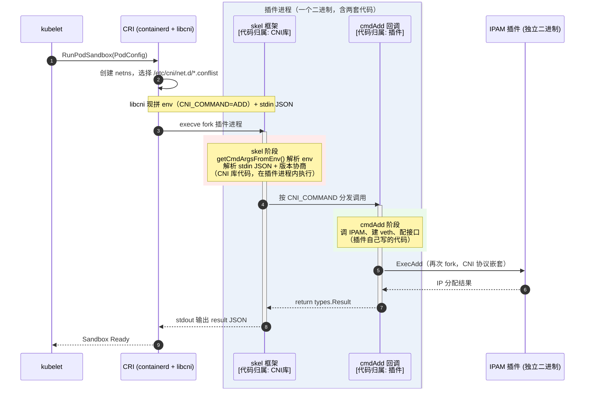

# OpenShift 网络原理与运维

## 文档说明

## 文档目录

## 容器网络接口规范（CNI specification）说明

CNI 真正解决的核心问题：如何把一个容器（pod）"插" 进网络里。

### CNI 规范本身解决的核心问题
  
CNI 只是一份接口规范（ADD / DEL / CHECK 命令 + JSON 网络配置 + IPAM 插件协议），它定义的是 runtime（kubelet/containerd）与网络插件之间的契约，而 **不规定网络如何实现**。对应的核心职责：

- 接口创建：在容器 netns 里建网卡（通常是 veth pair，一端在容器、一端落在宿主网络）。
- IPAM：给 pod 分配 IP 地址和路由（由独立的 IPAM 插件如 host-local、static 或 DHCP 完成）。
- 连通性保证：让 pod 的流量能进入宿主机网络栈，并按规则转发。

跨节点通信不在 CNI 规范强制范围内 —— 规范只要求插件返回结果（interfaces、IPs、routes、dns），至于 pod 在 node2 上怎么找到 node1 上的 pod，是具体 CNI 插件的实现选型。

### 跨节点通信是插件的实现层问题

不同插件对 "跨节点" 给出了不同的解决方案，这恰好说明它是 CNI 之上的设计选择：

| 插件 | 跨节点方案 |
| ----- | ----- |
| Flannel | VXLAN 覆盖网络（UDP 封装），节点间只要 IP 可达 |
| Calico | 默认 BGP 路由宣告（underlay），或 IPIP/VXLAN 模式 |
| OVN-Kubernetes | 基于 OVN 的逻辑交换机 + Geneve 隧道，逻辑拓扑与物理解耦 |

### 同节点通信反而是更 "基础" 的部分

一个插件首先要解决 pod ↔ 同节点 pod、pod ↔ 宿主机、pod ↔ Service/kubelet 的本地连通，才轮得到跨节点。CNI 的重要职责：IPAM、veth 接入、本机网桥/流表。

- OpenShift 中的 CNI 模型：

  OpenShift 4.12 起默认 CNI 已是 OVN-Kubernetes（OpenShiftSDN 已废弃）。它的模型恰好能说明分层：

  - **CNI 层（kubelet 调用）**：ovn-kubernetes 的 CNI 二进制把 pod 接口接入 OVN 逻辑交换机，分配 pod IP。
  - **跨节点层**：OVN 控制器在每个节点建 Geneve 隧道，逻辑流量经隧道到目标节点，完全覆盖物理拓扑。
  - **策略层**：NetworkPolicy 由 OVN ACL 实现 —— 这也是 CNI 之上附加的能力，同样不属于 CNI 规范。

## CNI 如何工作？

CNI 通过容器引擎（如 CRI-O 或 Containerd）与 CNI 插件之间的交互来运行。容器引擎并不直接管理网络，而是当 Pod 被创建或删除时，调用 CNI 插件。

### CNI 请求的生命周期遵循特定的顺序

- 1️⃣ 容器引擎为 Pod 创建一个网络命名空间。
- 2️⃣ 引擎在 `/etc/cni/net.d/` 目录中识别 CNI 配置文件。
- 3️⃣ 引擎会调用 CNI 插件，并传递特定的环境变量和 JSON 配置。

### 🧬 **CRI、CNI 与 CNI 插件之间的调用时序图**

| 组件 | 代码归属（谁写的） | 运行时位置（在哪执行） |
| ----- | ----- | ----- |
| **skel** | CNI 官方库（`containernetworking/cni/pkg/skel`） | **编译进插件二进制**，随插件进程启动 |
| **cmdAdd** | 插件作者自己写的 | 插件进程内，被 skel 分发调用 |

关键点：Go 库没有独立进程。skel 是静态链接进 /opt/cni/bin/xxx 的 —— 所以用户看到的 "插件进程" 里其实跑着两部分代码：CNI 库提供的框架（skel）+ 插件自己的业务（cmdAdd）。



## OVN-Kubernetes CNI 组件状态

```bash
$ oc get clusteroperators network
```

## 参考链接

- [CNI - the Container Network Interface | GitHub](https://github.com/containernetworking/cni)
