# 🌐 OpenShift 网络原理与运维

## 文档目录

- [🌐 OpenShift 网络原理与运维](#-openshift-网络原理与运维)
  - [文档目录](#文档目录)
  - [1. 文档说明](#1-文档说明)
  - [2. Service (svc) 资源对象](#2-service-svc-资源对象)
    - [2.2 service 资源对象的特性](#22-service-资源对象的特性)
    - [2.3 service 在 Kubernetes 中的底层实现](#23-service-在-kubernetes-中的底层实现)
    - [2.4 service 的 4 大类型](#24-service-的-4-大类型)
      - [2.4.1 **ClusterIP** 类型](#241-clusterip-类型)
      - [2.4.2 **NodePort** 类型](#242-nodeport-类型)
      - [2.4.3 **LoadBalancer** 类型](#243-loadbalancer-类型)
      - [2.4.4 **ExternalIPs** 类型](#244-externalips-类型)
    - [2.5 service 与 pod 的关联方式](#25-service-与-pod-的关联方式)
    - [2.6 service 与服务发现](#26-service-与服务发现)
    - [2.7 service 与实现跨节点通信的 CNI 插件的关系](#27-service-与实现跨节点通信的-cni-插件的关系)
      - [2.7.1 OCP3 中的实现方法](#271-ocp3-中的实现方法)
      - [2.7.2 OCP4 中的实现方法](#272-ocp4-中的实现方法)
  - [3. Route 资源对象](#3-route-资源对象)
    - [3.1 流量转发原理](#31-流量转发原理)
    - [3.2 Route 与 MetalLB 支持的流量类型](#32-route-与-metallb-支持的流量类型)
    - [3.3 Route 与 Ingress 的大一统](#33-route-与-ingress-的大一统)
      - [3.3.1 核心差异对比](#331-核心差异对比)
      - [3.3.2 选型决策说明](#332-选型决策说明)
      - [3.3.3 关键细节](#333-关键细节)
  - [4. 容器网络接口规范（CNI specification）](#4-容器网络接口规范cni-specification)
    - [4.1 CNI 规范本身解决的核心问题](#41-cni-规范本身解决的核心问题)
    - [4.2 跨节点通信是 CNI 插件的实现层问题](#42-跨节点通信是-cni-插件的实现层问题)
  - [5. CNI 如何工作？](#5-cni-如何工作)
    - [5.1 CNI 请求的生命周期遵循特定的顺序](#51-cni-请求的生命周期遵循特定的顺序)
    - [🧬 5.2 **CRI、CNI 与 CNI 插件之间的调用时序图**](#-52-cricni-与-cni-插件之间的调用时序图)
    - [⚗️ 5.3 **OVN-Kubernetes 调用时序说明**](#️-53-ovn-kubernetes-调用时序说明)
  - [6. OVN-Kubernetes CNI 组件状态](#6-ovn-kubernetes-cni-组件状态)
  - [7. Multus CNI 插件 \& 其他 CNI 插件](#7-multus-cni-插件--其他-cni-插件)
    - [7.1 基础概述](#71-基础概述)
    - [🔥 7.2 OpenShift 集群网络类型](#-72-openshift-集群网络类型)
  - [参考链接](#参考链接)
  - [待完善问题](#待完善问题)

## 1. 文档说明

此文档基于 OpenShift 4.18 集群撰写及测试

## 2. Service (svc) 资源对象

### 2.2 service 资源对象的特性

- 由于 pod 经常因某些故障而重启，每次重启后其 IP 地址都将改变，因此使用 service 将一个或一组相同的 pod 进行关联。
- service 为 pod 提供统一的入口 IP 地址，该入口地址默认为 service 的虚拟 IP 地址（`ClusterIP`）。
- service 提供反向代理与负载均衡的功能，默认以 `Round Robin` 轮询的方式将流量转发至 pod。  

### 2.3 service 在 Kubernetes 中的底层实现

- service 提供三种代理模式：
  - **userspace：**
    - 早期的代理模式，由于性能较差该模式已废弃不再使用。
  - **iptables：**
    - OpenShift 当前默认的代理模式
    - 但是，该模式只能支持简单的负载均衡能力，若需实现复杂的负载均衡算法需引入其他方式。
  - **ipvs：**
    - 该模式自 `Kubernetes v1.11` 版本开始已达到 GA（一般可用性）水平，并在之后的版本中成为默认的 service 代理模式。
    - Kubernetes 既可使用 iptables 实现流量的转发规则，也可使用 ipvs 实现流量的负载均衡能力。
- service 资源由 `kube-proxy` 组件实现，其虚拟 IP 地址存在于每个节点的 iptables NAT 表中，使用 `iptables -t nat -nvL` 命令即可查看指定的 ClusterIP。
- 因此，目前开源社区使用 `eBPF` 技术为基础，开发的 `Cilium` CNI 插件可不使用 service 以实现其功能，在流量转发方面性能得到极大的提升。
- OCP3 中的 service 网段与 pod 网段的定义示意：

  

- OCP4 中的 service 网段与 pod 网段的定义示意：使用 **OVN-Kubernetes** 插件

  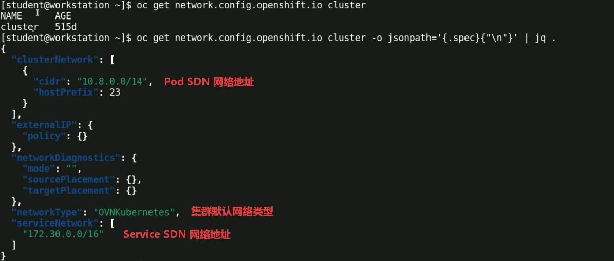

  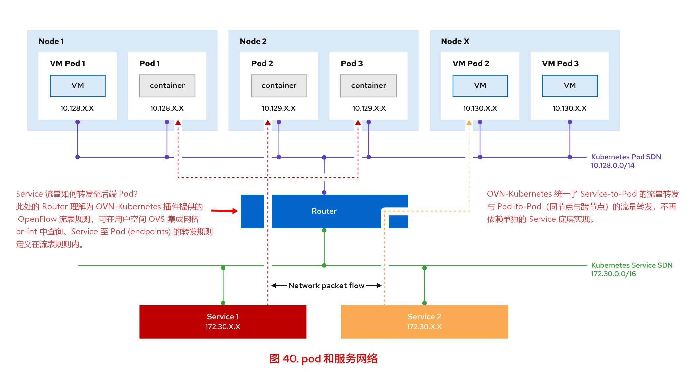

### 2.4 service 的 4 大类型

#### 2.4.1 **ClusterIP** 类型

为 service 分配⼀个内部 IP 地址，且该地址只能从集群内部访问。

#### 2.4.2 **NodePort** 类型

在节点 IP 地址的端⼝上公开服务，端⼝在所有集群节点上公开，每个节点将流量重定向到服务的端点（pod）。

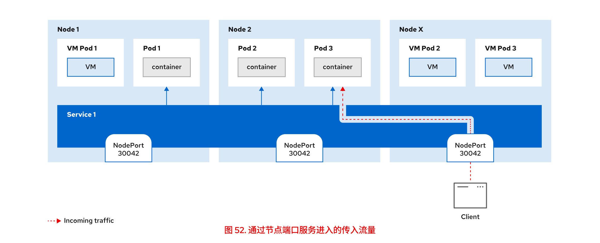

```yaml
# NodePort 类型
apiVersion: v1
kind: Service
metadata:
  name: database
  namespace: prod2
spec:
  type: NodePort    #service 类型指定
  selector:
    vmtype: linux
  ports:
    - protocol: TCP
      port: 3306
      targetPort: 3306
      nodePort: 30336
      #nodePort 参数提供端⼝号，OpenShift 必须在所有集群节点上开放这个端⼝。
      #所选的端⼝必须在所有节点上可⽤，并处于 30000 到 32767 范围内。若不提供 nodePort 参数，OpenShift 会选择⼀个可⽤的端⼝。
```

虽然 NodePort 服务类型可以⽤于 TCP 和 UDP 流量，但红帽不建议这样做，原因如下：

- 必须在集群外部公开集群节点的 IP 地址。节点 IP 暴露存在安全⻛险。
- ⽆法选择默认范围（30000 到 32767）以外的端⼝。
- 在云环境中，集群节点的 IP 地址可能不是永久的。例如，云基础架构可能会添加或删除节点，以使集群适应负载。
- NodePort 服务可能需要额外的⽹络配置，以启⽤对端⼝的外部访问。

💥 使用 NodePort 类型 service 的资源定义文件更改后再创建 ClusterIP 类型 service 时，需删除其中的 `spec.externalTrafficPolicy` 字段，否则创建失败！
  
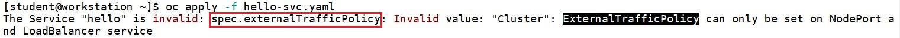

#### 2.4.3 **LoadBalancer** 类型

指示 Kubernetes 与运⾏集群的云提供程序交互，置备负载平衡器，并为应⽤提供可从外部访问的 IP 地址。这种类型构建在 NodePort 类型之上，其通过云供应商提供的负载均衡器将服务暴露到集群外部，因此 LoadBalancer 一样具有 NodePort 和 ClusterIP。而在裸金属环境中使用 **MetalLB Operator** 来实现这种服务类型。<br>

🧬 MetalLB 的工作原理：

- 预先安装 MetalLB Operator，该 operator 将创建 metallb-system 项目。
- 该项目中运行的 Pod 如下所示：

  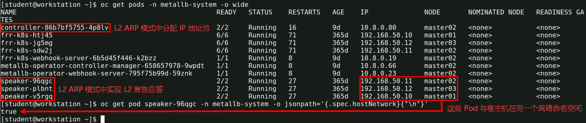

- MetalLB 的 L2 ARP 模式中，必须保证 MetalLB Operator 分配的地址池 IP 地址和宿主机节点的 IP 地址在同一个二层网络中。如上图，宿主机节点的 br-ex 网口 IP 为 192.168.50.X/24，因此，MetalLB 分配的地址池也在此二层网络中，从集群外部即可访问此二层网络。
- Controller Pod 分配的地址池中 VIP 的 ARP 应答由 Speaker Pod 完成，具体的工作机制如下：
  - 选主（Leader Election）：在每个节点上都运行着 Speaker Pod。为了避免多个节点同时抢答同一个 VIP 导致网络冲突，Speaker 之间会进行选举。针对某个特定的 Service VIP，只会有一个节点的 Speaker Pod 成为 Leader（主节点）。
  - 接管网卡与响应 ARP：选出的 Leader Speaker Pod 会通过底层网络驱动（通常是直接操作宿主机的内核网络栈或 eBPF）接管该 VIP。当局域网内的客户端发送 ARP 请求（询问“谁是 192.168.1.240？”）时，只有这个 Leader 节点上的 Speaker 会响应，并将自己宿主机的 MAC 地址作为应答发回。
  - 引导流量：客户端收到 ARP 应答后，就会将发往该 VIP 的流量直接发送到 Leader 节点的 MAC 地址上。随后，节点上的 OVN-Kubernetes（或其他 CNI）接管流量，将其转发给后端的 Pod。
  - 因此，在整个 L2 ARP 模式中，Controller 只负责 “发牌”（分配 IP），而真正的网络宣告和 ARP 应答工作，全权交由 Speaker Pod 来执行。

MetalLB 中的多个自定义资源（CR）：

```bash
$ oc project metallb-system
#切换至 metallb-system 项目

$ oc get metallb
NAME      AGE
metallb   5d
#MetalLB Operator 部署的 MetalLB 实例

$ oc get ipaddresspool    #查看
NAME                        AUTO ASSIGN   ...   ADDRESSES
gls-metallb-ipaddresspool   true          ...   [“192.168.50.20-192.168.50.40”]
#MetalLB 的 IP 地址池包含 192.168.50.20 到 192.168.50.40 范围内的地址

$ oc get l2advertisement
NAME                          IPADDRESSPOOLS                  ...
gls-metallb-l2advertisement   [“gls-metallb-ipaddresspool”]   ...
#MetalLB 为 gls-metallb-ipaddresspool IP 地址池中的负载平衡器 IP 地址创建第 2 层公告
```

MetalLB 的使用示例：SSH over LoadBalancer 实现外部登录虚拟机 + 外部访问虚拟机中的 MySQL 数据库

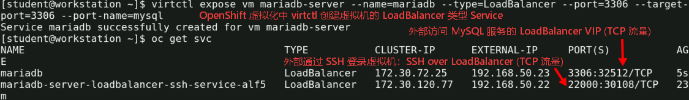

#### 2.4.4 **ExternalIPs** 类型

将服务映射到 DNS 名称

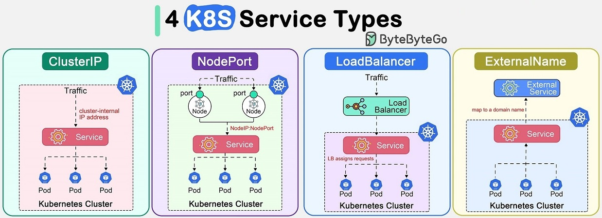

### 2.5 service 与 pod 的关联方式

service 通过 `selector` 与具有相同 `label` 的 pod 关联，将固定的 IP 地址与 pod 解耦，提高 pod 部署的灵活性，OCP 可根据 scheduler 调度器将 pod 部署至不同的 node 节点上，根据 ReplicationController (OCP3) 或 Deployment (OCP4) 部署相应副本数量的 pod，保证 pod 的服务高可用，此类 pod 应用一般为无状态类型服务。

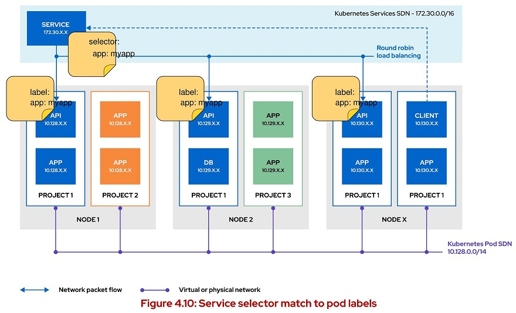

> 💥 无论 OCP 集群使用 `ovs-subnet` 或 `ovs-multitenent` 类型的 SDN 插件，同一项目的 pod 间可直接通信，无需使用 service！

### 2.6 service 与服务发现

service 作为前端 pod 访问后端 pod 的入口点，实现服务发现。服务发现的实现方式如下：

1️⃣ **service 环境变量：**

- 前端应用 pod 使用后端应用的 `service 环境变量` 来发现后端应用 pod
- 对于项目内的每个 service，将自动定义环境变量，并注入到同一项目中的所有 pod 中。
- service 环境变量的服务发现方式：
  - *svc_name*_SERVICE_HOST：service 的 IP 地址
  - *svc_name*_SERVICE_PORT：service 的 TCP 端口号

  > 💥 使用 service 环境变量实现服务发现时，必须先创建后端 service，再创建启动前端 pod，才能实现后端 service 环境变量的注入。

2️⃣ **SkyDNS（OCP4 中已淘汰）：**

- OCP3 中通过 `SkyDNS` 的 `SRV 记录` 实现前端应用对后端应用的服务发现。
- `SkyDNS` 服务发现方式：
  - SkyDNS 进程集成于 OpenShift master 与 node 进程中，无需进一步额外配置。
  - SkyDNS 将每个 service 动态分配一个 `FQDN` 格式的 `SRV 记录`：*svc_name*.*project_name*.svc.cluster.local

   > ✅ 在 pod 中使用 DNS 查询来实现服务发现，可在 pod 启动后再查找相应的 service。

3️⃣ **CoreDNS（主流方式）：**

- OCP4 中通过名为 dns 的 `ClusterOperator` 部署 `CoreDNS`，CoreDNS 是 CNCF 毕业的成熟的云原生领域域名解析系统。
- 集群中各个 pod 可通过其 `/etc/resolv.conf` 中的 nameserver 实现服务发现，其中 nameserver 的 IP 地址为 CoreDNS pod 的 `service IP`。
- 每个 pod 都可通过 CoreDNS 查询动态分配的 service 与 `FQDN` 格式的 `SRV 记录`，每条 SRV 记录中的 FQDN 对应一条 A 记录，而 A 记录中的 IP 地址即为一组 pod 的 service IP。其中 SRV 记录的 FQDN 格式为 *svc_name*.*project_name*.svc.cluster.local。通过这种方式不同 pod 间可发现其他 pod 中的服务。以下示例为 web-server pod 可通过 DNS 查询发现 gcw 应用的 service IP：

  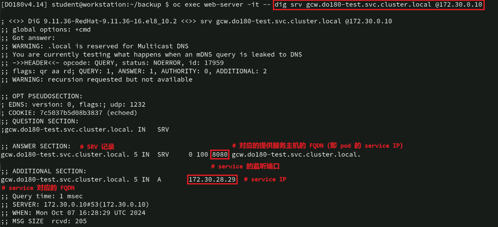

  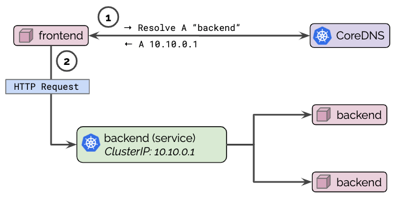

### 2.7 service 与实现跨节点通信的 CNI 插件的关系

- service 的虚拟 IP 地址与 pod 的 IP 地址面向 OCP 集群内部，OCP 集群外部不可访问，若使外部能够访问，需要使用 `route` 资源进行暴露。

#### 2.7.1 OCP3 中的实现方法

- OCP3 中建议将 service 整合入 DeploymentConfig 中，而 Kubernetes 中建议将 service 定义在 Deployment 中。
- 💥 service 从逻辑层面解决了 service 与 pod 间的网络通信问题，而 pod 与 pod 间的跨节点间通信必须使用 CNI 插件加以解决。
- OCP3 中默认使用 `OVS` 作为 SDN 插件，其共有 3 种工作类型，包括 `ovs-subnet`、`ovs-multitenent` 与 `ovs-networkpolicy`。
- 其中 ovs-subnet 将所有项目的 pod 置于扁平化（flat）网络中，彼此之间均能通信。
- ovs-multitenant 使用 `VNID` 实现不同项目间的 pod 二层隔离，其使用 VXLAN 隧道打通 pod 间在各节点之间的联系。
- 🚀 OCP3 OVS 网络拓扑示意：

  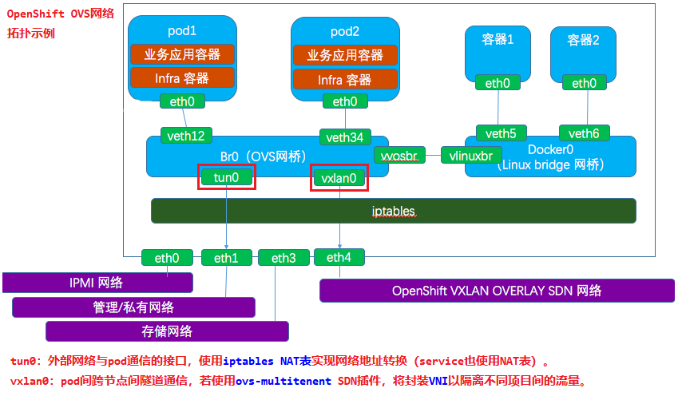

  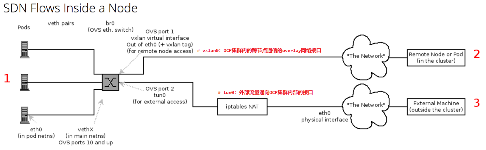
  
- OCP3 同一节点上 pod 间的通信示意：

  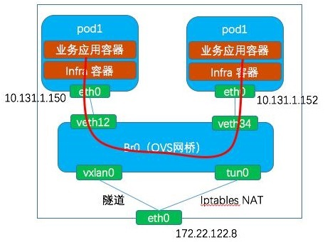

- 🚀 OCP3 OVS 流表分析示意：

  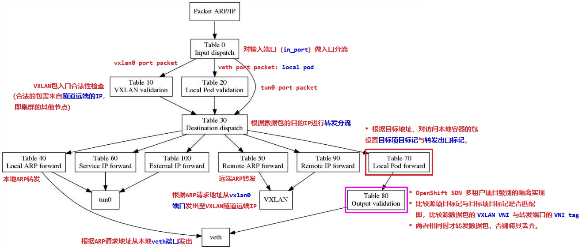
  
- 🚀 OCP3 中访问使用 `NodePort` service 类型的 pod 跨节点流量分析：
  以下为 iptables NAT 表与 OVS 流表部分条目，并且 OCP3 集群使用 ovs-subnet SDN 插件，无 `networkpolicy` 策略存在。

  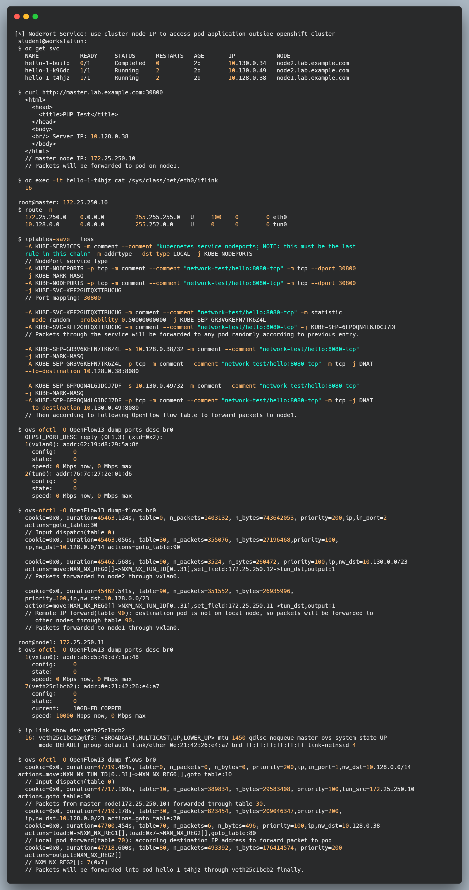

#### 2.7.2 OCP4 中的实现方法

- OCP4 中的 SDN 插件版本演进关键时间线：
  - OpenShift 4.11 默认地位确立：从 4.11 版本开始，OVN-Kubernetes 成为新安装集群的默认网络插件。
  - OpenShift 4.14 正式弃用：OpenShift SDN 从 4.14 版本起被正式标记为弃用（Deprecated），但现有集群仍可继续使用。
  - OpenShift 4.15 新安装通道关闭：从 4.15 开始，OpenShift SDN 不再是新安装时可选的网络插件，这意味着新集群只能选择 OVN-Kubernetes。
  - **OpenShift 4.17 彻底移除**：OpenShift SDN 在 4.17 版本中被完全删除，不再受支持。因此，任何仍在使用 OpenShift SDN 的集群，必须在升级到 4.17 之前完成迁移。
- OCP4 中可同时使用 `Multus CNI` 元插件调用其他 CNI 插件使单 pod 同时具备多个网口，以同时满足集群的网络流量与需要较高网络性能的业务流量。
- 可参考官方文档 [Understanding multiple networks](https://docs.openshift.com/container-platform/4.6/networking/multiple_networks/understanding-multiple-networks.html)

## 3. Route 资源对象

### 3.1 流量转发原理
  
- 中文名称：路由
- Service 除了可将流量负载转发至端点（endpoint）Pod 内，还能实现前后端多个不同 Pod 间的通信。
- **在 OpenShift 的 Route 转发过程中，Router Pod（底层为 HAProxy）中的 Controller 逻辑进程（openshift-router 进程）会直接监听 Route 和 Service 的 Endpoints/EndpointSlices。它会将后端 Pod 的 IP 和端口动态写入 HAProxy 的配置文件，然后直接向 Pod IP 发起连接。流量完全绕过了 Service 的 ClusterIP。Service 在这里仅作为 Route 关联后端 Pod 集合的逻辑标签和声明式绑定（通过 Endpoints 提供真实的 Pod 列表），不参与实际的数据转发。**
- OCP3 集群外部对内部 pod 的访问默认需要使用 default 项目的 Router Pod 来实现；OCP4 集群使用 openshift-ingress 项目的 router-default-xxxx Pod 来实现。
- OCP3 或 OCP4 集群外部通过泛域名解析（wildcard）指向特定 Router Pod 所在节点（比如 infra 节点），这些 Pod 与 infra 节点使用相同网络命名空间。在整个集群前端可加负载均衡与高可用系统。
- Router 路由原理架构示例：

  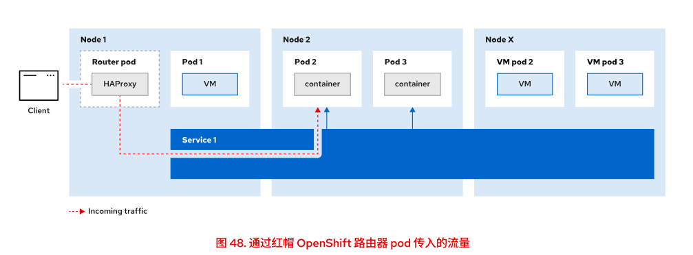

  

### 3.2 Route 与 MetalLB 支持的流量类型

OpenShift 默认的 Route / Ingress（HAProxy router）支持的流量类型：

- HTTP/HTTPS
- 非 HTTP 流量：采用 Route 的 `passthrough` 模式
  - SNI TLS：带 SNI 的 TLS 加密流量
  - 流量是 **TLS 加密流（有 SNI）**，Router 不解密，直接四层透传给后端 Pod。
  - ✅ 适用：自定义 TLS 协议（比如自建 TLS 加密的私有 TCP 协议）
  - ❌ 限制：**必须带 SNI**；纯 TCP、UDP、无 SNI 的加密流量，Route 无能为力，HAProxy router 是 L7 网关，没法通用四层转发。

  > 总结如下：<br>
  > 1️⃣ HTTP/HTTPS → Route / Ingress<br>
  > 2️⃣ 带 SNI 的 TLS 协议 → Route Passthrough<br>
  > 3️⃣ 剩下所有普通 TCP/UDP、无 SNI 协议 → LoadBalancer（MetalLB） / NodePort / ExternalIP<br>

MetalLB **不是网关 / 代理**，它只是 **LoadBalancer 类型 Service 的 IP 分配器 + 宣告器**：

- 工作在 L2（ARP）或者 BGP 模式，给 `spec.type: LoadBalancer` 的 Service 分配一个外部 VIP。
- 流量模型：外部 IP → 集群节点 → Service（iptables/IPVS） → 后端 Pod
- **四层直通，不解析协议**：TCP、UDP 都支持，MySQL、Redis、SFTP、游戏二进制协议都可以。
- 适用场景：**每个服务独立一个对外 VIP**，一个 VIP 对应一个后端业务。

> 对比 Route：Route 是 **共享统一入口（router 的 VIP），按域名 SNI 多路复用**，多个服务共用 80/443；
> MetalLB 的 LoadBalancer Service：**一个服务一个独立 VIP**，端口可以任意（3306、6379 等），没法做域名复用。

| 流量类型 | 推荐方案 | 说明 |
| ----- | ----- | ----- |
| HTTP / HTTPS | Edge / Reencrypt Route / Ingress | 七层路由、证书托管、域名分流 |
| TLS 协议（带 SNI，非 HTTP）| Passthrough Route | router 只看 SNI，不解密，加密流直传 Pod |
| 普通 TCP、UDP，无 SNI（MySQL/Redis 等）| LoadBalancer + MetalLB | 四层直通，独立 VIP，裸机首选 |

### 3.3 Route 与 Ingress 的大一统

- OCP4 中名为 `ingress` 的 ClusterOperator 提供 `ingress controller`。Kubernetes 中的 Ingress 包含两个重要组件，分别为 Ingress Controller 与 Ingress，而在 OpenShift 中 Ingress Controller 对应为 HAProxy Router Pod，而 Ingress 对应为 Route。
- 在 OpenShift 中，Route 和 Ingress 共享同一个底层数据平面（基于 HAProxy 的 Ingress Controller），但 Route 是 OpenShift 原生的、功能更丰富的选择，而 Ingress 则是为了跨 Kubernetes 平台的可移植性而存在的。

#### 3.3.1 核心差异对比

| 维度 | OpenShift Route | Kubernetes Ingress |
| ----- | ----- | ----- |
| 平台归属 | OpenShift 专有资源，API 为 route.openshift.io/v1 | Kubernetes 标准资源，API 为 networking.k8s.io/v1 |
| 核心优势 | 原生集成，无需额外配置即可使用，功能更丰富 | 跨平台兼容性好，可以运行在任何标准Kubernetes集群上 |
| TLS支持 | 原生支持 Edge、Passthrough、Re-encrypt 三种模式，配置直观 | 仅原生支持 Edge 终结。实现 Re-encrypt 或 Passthrough 需要 OpenShift 特有的注解，破坏了可移植性 |
| 流量管理 | 通过 haproxy.router.openshift.io/* 注解，支持加权后端（金丝雀发布）、超时、连接数限制等高级功能 | 功能相对基础，复杂的流量管理通常需依赖 Ingress Controller 的特定注解，标准API支持有限。 |
| 路径路由 | 每个 Route 对象默认仅支持一个路径前缀，灵活性受限 | 原生支持基于路径的多规则路由，更为灵活。 |

#### 3.3.2 选型决策说明

优先选择 OpenShift Route 的场景：

- 工作负载仅在 OpenShift 上运行，或希望充分利用平台原生特性。
- 需要开箱即用的 TLS 高级模式（Passthrough 用于端到端加密，Re-encrypt 用于在路由器处检查流量后再加密转发）。
- 需要进行蓝绿部署或金丝雀发布，利用 Route 的加权后端功能轻松实现流量拆分。
- 希望通过注解快速实现超时调整、IP 白名单等细粒度流量控制。

优先选择 Kubernetes Ingress 的场景：

- 跨平台可移植性是首要考虑，应用清单（Manifests）或 Helm Charts 需要同时部署到 OpenShift 和其他 Kubernetes 发行版（如 EKS, GKE, AKS）。
- 使用的Helm Chart 或 Operator 自动生成 Ingress 资源，为避免修改上游 Chart，直接使用 Ingress 更为便捷。
- 路由规则非常复杂，需要原生支持基于路径的多规则路由（尽管 OpenShift 的 Ingress 最终会转换为多个 Route，但编写时更符合标准）。

#### 3.3.3 关键细节

在 OpenShift 中创建 Ingress 对象时，它并不会被直接处理。OpenShift 的 ingress-to-route 控制器会自动将其转换成一个或多个 Route 对象。这意味着，使用 Ingress 相当于在 Route 之上增加了一层 “翻译”，这将继承 Route 的所有限制，并额外承担这层转换带来的开销。因此，除非有明确的可移植性需求，否则在 OpenShift 上直接使用 Route 是更直接、更高效的选择。

## 4. 容器网络接口规范（CNI specification）

CNI 真正解决的核心问题：如何把一个容器（pod）"插" 进网络里。

### 4.1 CNI 规范本身解决的核心问题
  
CNI 只是一份接口规范（ADD / DEL / CHECK 命令 + JSON 网络配置 + IPAM 插件协议），它定义的是 runtime（kubelet/containerd）与网络插件之间的契约，而 **不规定网络如何实现**。对应的核心职责：

- [x] 接口创建：在容器 netns 里建网卡（通常是 veth pair，一端在容器、一端落在宿主网络）。
- [x] IPAM：给 pod 分配 IP 地址和路由（由独立的 IPAM 插件如 host-local、static 或 DHCP 完成）。
- [x] 连通性保证：让 pod 的流量能进入宿主机网络栈，并按规则转发。

跨节点通信不在 CNI 规范强制范围内 —— 规范只要求插件返回结果（interfaces、IPs、routes、dns），至于 pod 在 node2 上怎么找到 node1 上的 pod，是具体 CNI 插件的实现选型。

### 4.2 跨节点通信是 CNI 插件的实现层问题

**首先**，CNI 的重要职责是 IPAM、veth 接入、本机网桥/流表。

**其次**，CNI 插件要解决的通信问题：

- [x] pod ↔ 同节点 pod
- [x] pod ↔ 宿主机
- [x] pod ↔ Service/kubelet 的本地连通
- [x] pod ↔ 跨节点 pod

不同 CNI 插件对 "跨节点" 给出了不同的解决方案，这恰好说明它是 CNI 之上的设计选择：

| 插件 | 跨节点方案 |
| ----- | ----- |
| Flannel | VXLAN 覆盖网络（UDP 封装），节点间只要 IP 可达 |
| Calico | 默认 BGP 路由宣告（underlay），或 IPIP/VXLAN 模式 |
| OVN-Kubernetes | 基于 OVN 的逻辑交换机 + Geneve 隧道，逻辑拓扑与物理解耦 |

从 *OpenShift 4.12* 起默认 CNI 已是 *OVN-Kubernetes*（OpenShiftSDN 已废弃）。它的模型恰好能说明分层：

- **CNI 层（kubelet 调用）**：ovn-kubernetes 的 CNI 二进制把 pod 接口接入 OVN 逻辑交换机，分配 pod IP。
- **跨节点层**：OVN 控制器在每个节点建 Geneve 隧道，逻辑流量经隧道到目标节点，完全覆盖物理拓扑。
- **策略层**：NetworkPolicy 由 OVN ACL 实现 —— 这也是 CNI 之上附加的能力，同样不属于 CNI 规范。

## 5. CNI 如何工作？

CNI 通过容器引擎（如 CRI-O 或 Containerd）与 CNI 插件之间的交互来运行。容器引擎并不直接管理网络，而是当 Pod 被创建或删除时，调用 CNI 插件。

### 5.1 CNI 请求的生命周期遵循特定的顺序

1️⃣ 容器引擎为 Pod 创建一个网络命名空间。<br>
2️⃣ 引擎在 `/etc/cni/net.d/` 目录中识别 CNI 配置文件。<br>
3️⃣ 引擎会调用 CNI 插件，并传递特定的环境变量和 JSON 配置。<br>

### 🧬 5.2 **CRI、CNI 与 CNI 插件之间的调用时序图**

| 组件 | 代码归属（谁写的） | 运行时位置（在哪执行） |
| ----- | ----- | ----- |
| **skel** | CNI 官方库（`containernetworking/cni/pkg/skel`） | **编译进插件二进制**，随插件进程启动 |
| **cmdAdd** | 插件作者自己写的 | 插件进程内，被 skel 分发调用 |

关键点：Go 库没有独立进程。skel 是静态链接进 /opt/cni/bin/xxx 的 —— 所以用户看到的 "插件进程" 里其实跑着两部分代码：CNI 库提供的框架（skel）+ 插件自己的业务（cmdAdd）。

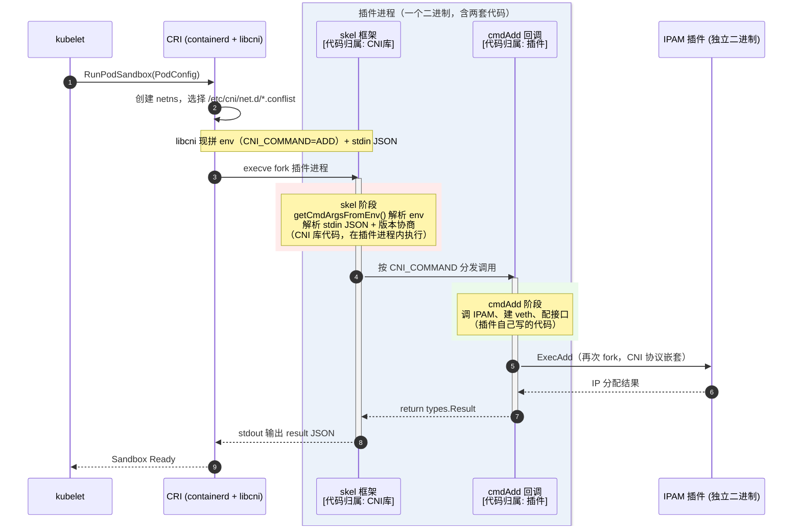

### ⚗️ 5.3 **OVN-Kubernetes 调用时序说明**

OVN-Kubernetes 有个重要特点：**CNI 插件二进制（ovn-k8s-cni-overlay）本身不干活，它只是客户端** —— 解析 ADD 后通过 Unix socket 把请求转发给常驻的 ovnkube-node pod 里的 CNI Server（ovnkube-node 主进程里的一个 *goroutine*），它内部包含的 `setupInterface()` 与 `ConfigureOVS()` 均运行在特权模式中。`setupInterface()` 可创建 veth 对及配置 pod 网络命名空间；`ConfigureOVS()` 使用 external_ids 将主机侧 veth 接口添加到 br-int 集成网桥上，在特权模式中以 libovsdb 实现。

```plaintext
ovnkube-node pod 内的 goroutine (ConfigureOVS)
    │ libovsdb（OVSDB 协议客户端，纯 RPC，无任何特权语义）
    ▼ unix domain socket
/run/openvswitch/db.sock   ← hostPath，就是宿主机 ovsdb-server 监听的 socket
    ▼
宿主机的 ovsdb-server（也在同 pod 的 ovsdb-server 容器里跑，管理宿主机内核 OVS）
    ▼ 事务提交
宿主机的 br-int 增加 Port/Interface 记录（含 external_ids）
    ▼
ovs-vswitchd 用 netlink 在内核创建/绑定端口 → 宿主机上 ip link 能看到 veth
```

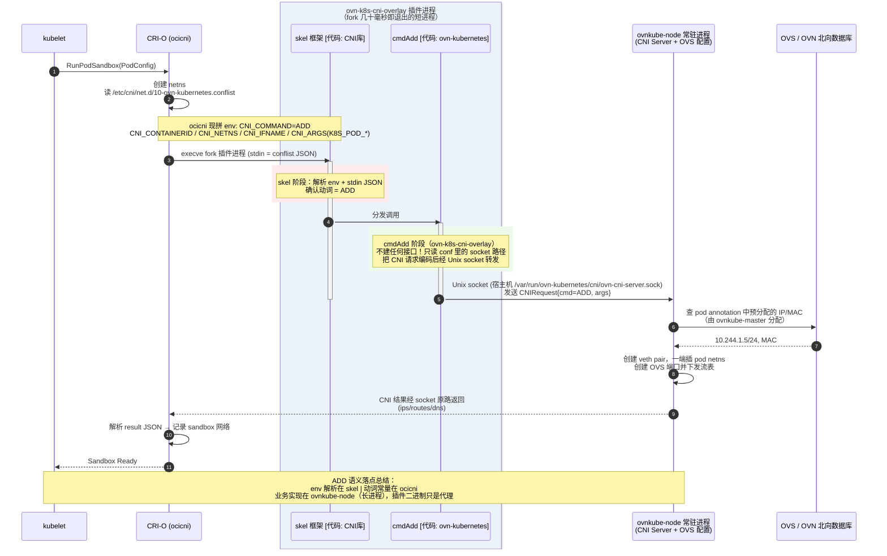

## 6. OVN-Kubernetes CNI 组件状态

与集群网络相关的 Operator：OCP4 集群提供 `Cluster Network Operator (CNO)` 配置集群网络，通过 CNO 加载与配置 CNI 插件。

```bash
$ oc get deployment/network-operator -n openshift-network-operator
#查看 CNO 部署的 deployment 与 pod
```

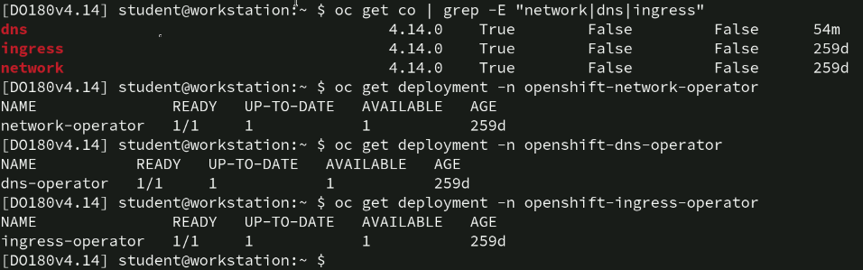

```bash
$ oc get clusteroperators network
#查看 network operator 状态

$ oc get network.config.openshift.io cluster -o yaml
$ oc get network.config/cluster -o yaml
# 以上命令等效
#查看集群部署的 pod SDN 与 service SDN 的网段范围

$ oc get node master01 -o yaml | grep node-subnets
    k8s.ovn.org/node-subnets: '{"default":["10.10.0.0/23"]}'
#master01 节点上 ovn-k8s-mp0 逻辑接口 IP 地址

$ oc get pods -n openshift-ovn-kubernetes
NAME                          READY    STATUS   ...
ovnkube-control-plane-5f...   2/2      Running  ...
ovnkube-control-plane-5f...   2/2      Running  ...
ovnkube-node-mdj5j            8/8      Running  ...
ovnkube-node-pqxqw            8/8      Running  ...
ovnkube-node-zj56j            8/8      Running  ...
#查看 OVN-Kubernetes 组件部署 Pod 状态
```

## 7. Multus CNI 插件 & 其他 CNI 插件

### 7.1 基础概述

在没有 Multus CNI 插件的场景中，集群中的 Pod 只能支持单个网络接口的 Pod 网络，集群管理流量与数据流量均使用此接口。而在一些对数据吞吐和延迟要求较高的场景中，这种方式不能满足需求。因此，可考虑在 Pod 上单独添加独立的网络接口以满足高性能、低延迟的要求，Multus CNI 插件（元插件）即可解决这种问题。

图示：Multus 元插件作用原理（Macvlan + SR-IOV）

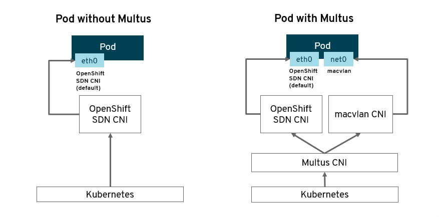


OpenShift 中默认已集成 Multus CNI 插件与其他 CNI 插件，包括 bridge、host-device、macvlan、ipvlan 等，但若要使用 SR-IOV 功能必须安装 SR-IOV Operator。

图示：Multus CNI 插件由 Network Operator 安装部署

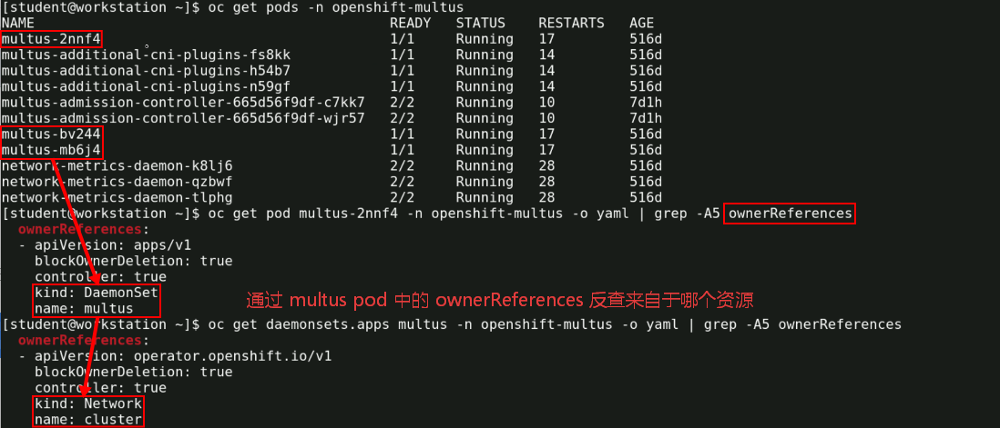

图示：集群节点预安装的多种 CNI 插件


```bash
$ for CRD in $(oc get crd | grep network | awk '{print $1}'); do echo "--- $CRD ---"; oc get crd $CRD -o yaml | grep -A4 ownerReferences; done
#查询各个 network CRD 的所属资源
```

### 🔥 7.2 OpenShift 集群网络类型

| 网络类型 | 默认集成 | 实现方式 | 关键资源 / 配置 | 外部访问方式 |
| ----- | ----- | ----- | ----- | ----- |
| **Service SDN 网络** | ✅ | OVN-Kubernetes（OVN Load\_Balancer 流表取代 kube-proxy，无 iptables/IPVS 规则） | Service、EndpointSlice；流表存于 OVN NB DB `Load_Balancer` 表 | ① **Ingress Controller（即 OpenShift Router，HAProxy）**：HTTP/HTTPS 七层路由，Routes 对象 <br> ② **LoadBalancer 类型 Service**：云上走 CCM 调云 LB；裸金属/虚机化走 **MetalLB**（L2/BGP）<br> ③ NodePort：直连节点端口 |
| **Pod SDN 网络** | ✅ | OVN-Kubernetes（Geneve 隧道 + OVS 流表；4.12 起默认，OpenShiftSDN 已废弃） | 节点子网分配、`k8s.ovn.org/pod-networks` 注解、br-int/br-ex、ovn-k8s-mp0 | 不直接对外：入向必须经过 Service；出向经 SNAT（可配 EgressIP 固定出口地址） |
| **UDN 网络** | ✅（4.17 Tech Preview → 4.18 GA） | OVN-Kubernetes 提供的 UserDefinedNetwork CRD（底层仍走 OVN 逻辑交换机/路由器） | UserDefinedNetwork CR、NetworkAttachmentDefinition；注解 `k8s.ovn.org/pod-networks` | Primary UDN：支持 Service（ClusterIP 由 OVN LB 提供，LoadBalancer 可用 MetalLB）；Secondary UDN：仅供集群内/二层互通，无外部访问能力 |
| **辅助网络** | ✅（Multus 元插件默认随集群安装） | Multus CNI（元插件）+ 各 CNI 插件：<br> ✅ ovn-k8s-cni-overlay（与 Pod 网络同栈）<br> ✅ bridge、host-device、macvlan、ipvlan <br> ❌ SR-IOV：默认不带，需额外安装 **SR-IOV Network Operator** | **NAD**（NetworkAttachmentDefinition）：定义附加网络 <br> **NNCP / NNCE**（NodeNetworkConfigurationPolicy/Enactment）：nmstate 节点网络配置 <br> Pod 注解 `k8s.v1.cni.cncf.io/networks` 引用 | 取决于插件：<br> macvlan/ipvlan/host-device → 直接共享节点物理接口所在网络 <br> bridge → 映射节点网桥 <br> SR-IOV → VF 直通物理网络 |

## 参考链接

- [CNI Website](https://www.cni.dev/)
- [CNI - the Container Network Interface | GitHub](https://github.com/containernetworking/cni)
- 🧬 [**Container Network Interface (CNI) Specification | GitHub**](https://github.com/containernetworking/cni/blob/spec-v1.0.0/SPEC.md)
- 📚 [OVN-Kubernetes network plugin | Red Hat Docs](https://docs.redhat.com/en/documentation/openshift_container_platform/4.20/html-single/ovn-kubernetes_network_plugin/index)
- [OpenShift 资源对象详解：Service | GitHub](https://github.com/Alberthua-Perl/tech-docs/blob/master/OpenShift%20%E9%9B%86%E7%BE%A4%E7%AE%A1%E7%90%86%E4%B8%8E%E5%BA%94%E7%94%A8%E5%AE%9E%E8%B7%B5/OpenShift%20%E8%B5%84%E6%BA%90%E5%AF%B9%E8%B1%A1%E8%AF%A6%E8%A7%A3/OpenShift%20%E8%B5%84%E6%BA%90%E5%AF%B9%E8%B1%A1%E8%AF%A6%E8%A7%A3.md#-11-service-svc-%E8%B5%84%E6%BA%90%E5%AF%B9%E8%B1%A1)
- 🧪 [**Pod Creation Workflow | OVN-Kubernetes Docs**](https://ovn-kubernetes.io/master/design/pod-creation-workflow/)

## 待完善问题

- Route 架构拓扑图绘制
- 在集群默认 Pod 网络中（OVN-Kubernetes CNI 插件实现），跨节点间 Pod 与 Pod 通信流量路径分析：
  - 如何确认 pod 上的网口与 br-int 集成网桥的对应关系？
  - OpenFlow 流表中 service 如何实现 endpoint 的负载均衡？
  - internal 类型的 ovn-k8s-mp0 接口如何跨内核空间与用户空间的 OVS br-int 网桥？OVS 中的代码如何实现？
- **UDN 作为主网络 + 独立 Pod 管理网络** 的双路径配置模式图
