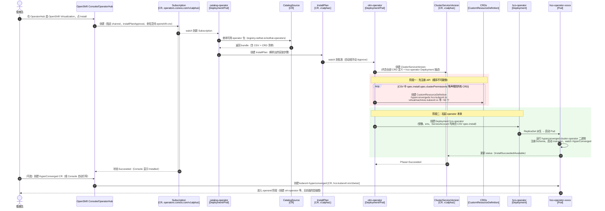
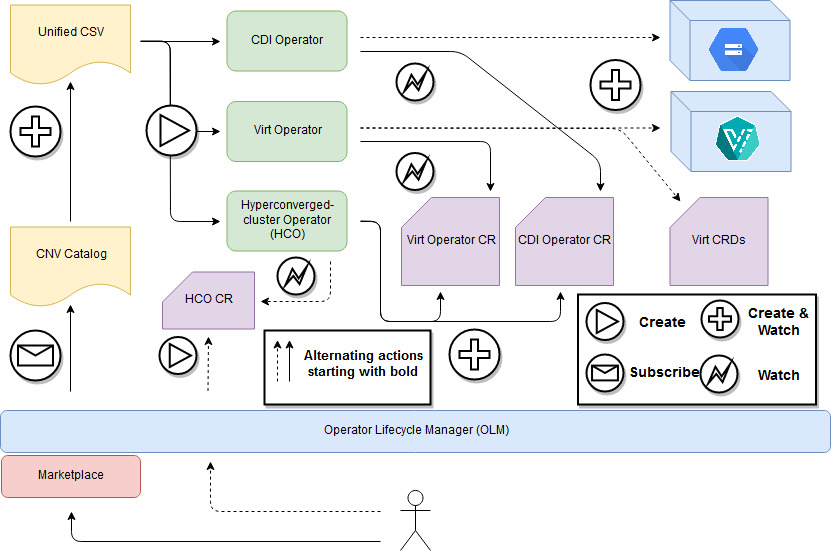
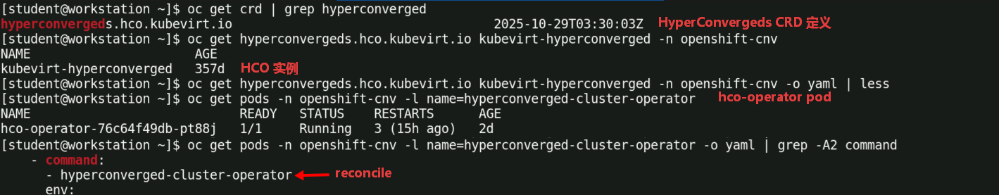
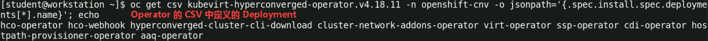
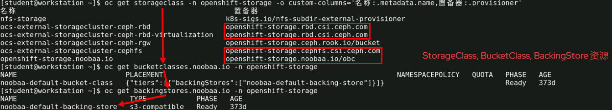
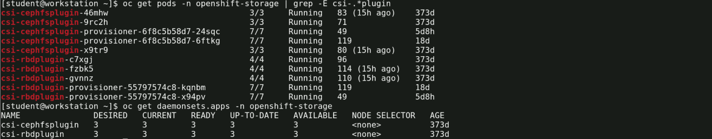
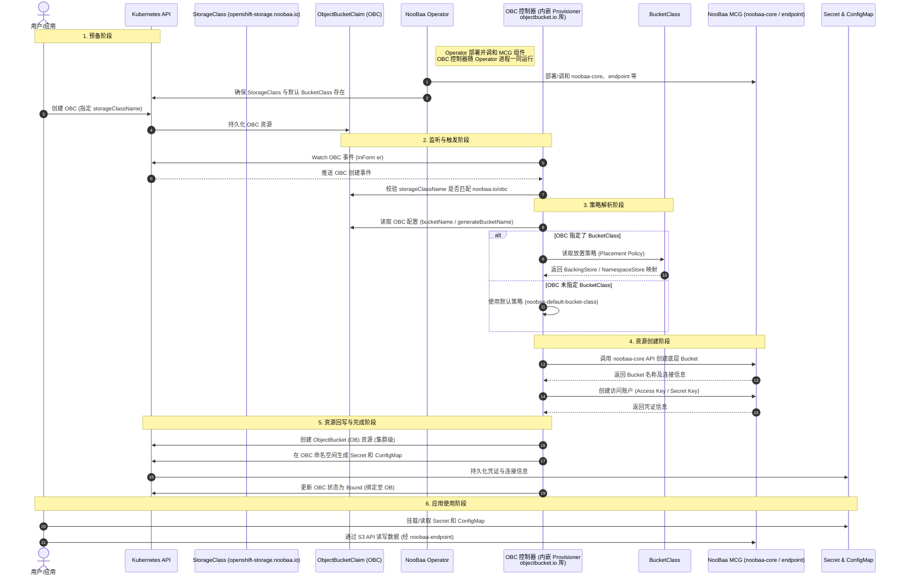
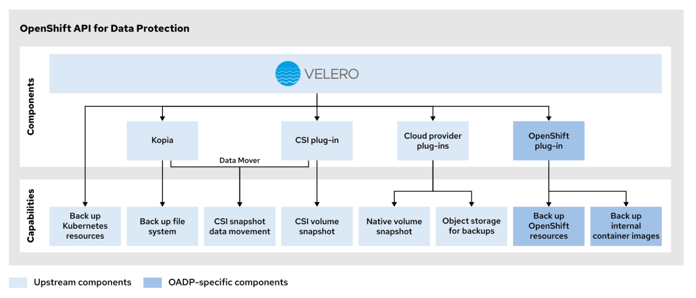
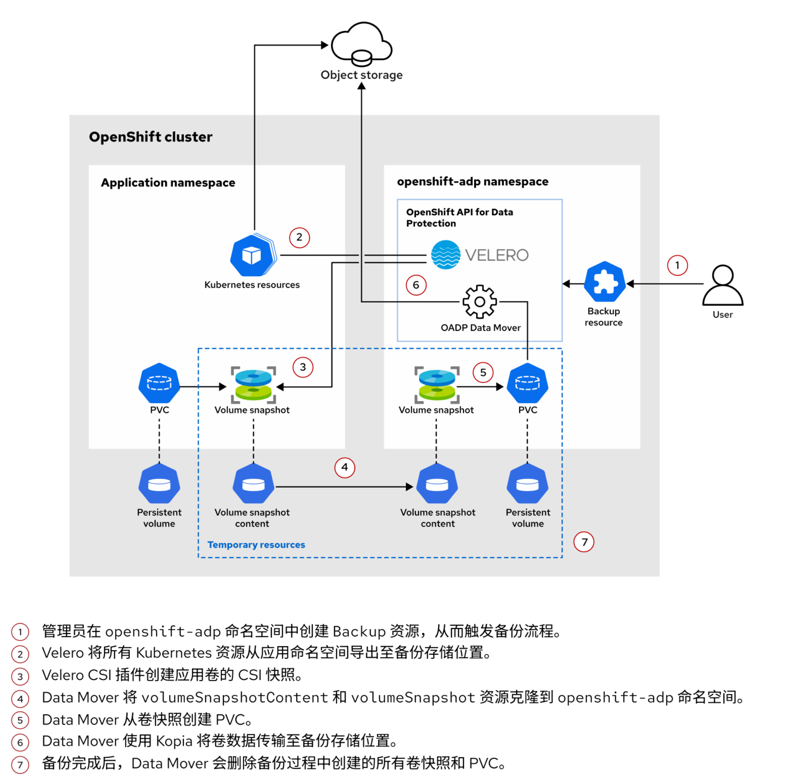

#  OpenShift 虚拟化与实践

## 文档说明

OpenShift 虚拟化基于 CNCF 项目 [KubeVirt](https://kubevirt.io/) 构建，此文档基于 Red Hat OpenShift Virtualization 4.18 版本撰写并测试。

## 文档目录

- [ OpenShift 虚拟化与实践](#-openshift-虚拟化与实践)
  - [文档说明](#文档说明)
  - [文档目录](#文档目录)
  - [1. OpenShift 虚拟化相关的 Operator](#1-openshift-虚拟化相关的-operator)
  - [2. OpenShift 虚拟化 Operator 组件](#2-openshift-虚拟化-operator-组件)
    - [2.1 Operator 安装：组件间的时序调用](#21-operator-安装组件间的时序调用)
    - [2.2 Operator 安装：HyperConverged 设计原理](#22-operator-安装hyperconverged-设计原理)
    - [2.3 Operator 安装：组件与资源间关系](#23-operator-安装组件与资源间关系)
  - [3. KubeVirt 顶层视角](#3-kubevirt-顶层视角)
  - [4. OpenShift 虚拟化资源管理](#4-openshift-虚拟化资源管理)
    - [4.1 虚拟机实例类型 \& 虚拟机偏好设置](#41-虚拟机实例类型--虚拟机偏好设置)
    - [4.2 Web 控制台：热插拔的 CPU 与内存](#42-web-控制台热插拔的-cpu-与内存)
    - [4.3 Web 控制台：更改虚拟机实例类型](#43-web-控制台更改虚拟机实例类型)
  - [5. virtctl 命令行使用](#5-virtctl-命令行使用)
  - [6. OpenShift 虚拟化的存储](#6-openshift-虚拟化的存储)
    - [6.1 ODF 中默认的 StorageClass 与 BucketClass](#61-odf-中默认的-storageclass-与-bucketclass)
    - [6.2 ODF 中存在的多种 provisioner](#62-odf-中存在的多种-provisioner)
    - [6.3 各类 provisioner 如何识别 openshift-storage 开头的标识符？](#63-各类-provisioner-如何识别-openshift-storage-开头的标识符)
  - [7. OADP 备份 KubeVirt 虚拟机](#7-oadp-备份-kubevirt-虚拟机)
    - [7.1 OADP 备份机制选型决策](#71-oadp-备份机制选型决策)
    - [7.2 OADP 备份核心概念解析](#72-oadp-备份核心概念解析)
    - [7.3 OADP 实现虚拟机备份的主要流程](#73-oadp-实现虚拟机备份的主要流程)
  - [参考文档](#参考文档)

## 1. OpenShift 虚拟化相关的 Operator

| Operator | 核心功能 | 主要管理对象 / CR | 命名空间 | 关键特点 |
| ----- | ----- | ----- | ----- | ----- |
| **Network Operator** (Cluster Network Operator) | 部署和管理集群的 CNI 网络插件（如 OVN-Kubernetes），控制 Pod 网络、IPsec 加密、MTU 等核心网络配置 | 集群网络配置（Network CR） | openshift-network-operator | 控制面组件，负责 “集群默认网络” 的搭建与运维 |
| **NMState Operator** | 对集群节点进行声明式的网络状态配置，支持创建网桥、绑定（bond）、VLAN 等，并定期上报节点网络状态 | NodeNetworkConfigurationPolicy (NNCP) <br> NodeNetworkConfigurationEnactment (NNCE) <br> NodeNetworkState (NNS) | openshift-nmstate | 面向节点主机的网络配置，常用于准备 Multus 二级网络或调整物理网卡设置 |
| **MTV Operator** (Migration Toolkit for Virtualization) | 将虚拟机从源环境（如 VMware vSphere）迁移到 OpenShift 虚拟化平台 | Provider <br> NetworkMapping <br> StorageMapping <br> Plan <br> Migration | openshift-mtv | 管理迁移工作流：定义连接、映射网络/存储、制定计划并执行 |
| **OADP Operator** (OpenShift API for Data Protection) | 为工作负载（包括虚拟机）提供备份与恢复能力，基于 Velero 实现，可备份应用资源、PV 和镜像 | DataProtectionApplication (DPA) <br> BackupStorageLocation <br> VolumeSnapshotLocation <br> Backup <br> Restore <br> Schedule <br> BackupRepository <br> Hooks | openshift-adp | 面向数据保护，需配置后端对象存储；支持 KubeVirt 插件以备份 VM |

**注意**：

openshift-network-operator (管理者)：这是 **Cluster Network Operator (CNO)** 所在的命名空间。CNO 是 OpenShift 的核心控制组件，负责在集群安装和运行期间，部署和管理底层的 CNI 网络插件（如 OVN-Kubernetes）及其相关组件。

openshift-ovn-kubernetes (运行组件)：这是 OVN-Kubernetes 网络插件本身运行的地方。CNO 将 OVN-Kubernetes 所需的 ovnkube-master、ovnkube-node 等核心 Pod 部署在这个命名空间中，由它们实际负责 Pod 网络的创建、路由和策略执行。

## 2. OpenShift 虚拟化 Operator 组件

### 2.1 Operator 安装：组件间的时序调用



### 2.2 Operator 安装：HyperConverged 设计原理



### 2.3 Operator 安装：组件与资源间关系

```plaintext
OLM (CSV/Subscription, OpenShift Virtualization Operator 的安装记录)
  └─► hco-operator [Deployment] → hco-operator-xxxxx [Pod]
        │ watch (hco-operator Pod 监视)
        ▼
  HyperConverged kubevirt-hyperconverged [CR, ns: openshift-cnv]    ← CR 即为 "实例"
        │ reconcile (hco-operator Pod 中的 hyperconverged-cluster-operator 二进制程序同时创建以下两类资源)
        ├─ A. 下游 operator 本身（它们的 Deployment 由 HCO 部署）：
        │     virt-operator                                [Deployment → ReplicaSet → Pod]
        │     cdi-operator                                 [Deployment → Pod]
        │     cluster-network-addons-operator              [Deployment → Pod]
        │     ssp-operator                                 [Deployment → Pod]
        │     hostpath-provisioner-operator                [Deployment → Pod]
        │
        └─ B. 供这些 operator 消费的 operand CR：
              KubeVirt kubevirt-kubevirt-hyperconverged    [CR]
              CDI cdi-kubevirt-hyperconverged              [CR]
              NetworkAddonsConfig cluster                  [CR, 集群级]
              SSP ssp-kubevirt-hyperconverged              [CR]
              HostPathProvisioner hostpath-provisioner     [CR]
                    │ 各 (A) 中 operator 再 reconcile 自己的 CR
                    ▼
              virt-api           [Deployment → Pod]    ← KubeVirt CR 驱动
              virt-controller    [Deployment → Pod]
              virt-handler       [DaemonSet → 每节点一个 Pod]
              cdi-apiserver / cdi-deployment / cdi-uploadproxy    [Deployment → Pod]
              multus-cni 等      [DaemonSet → Pod]
                    │ 用户创建 VirtualMachine    [CR]
                    ▼
              virt-launcher-<vmi>-xxxxx    [Pod] → 内含 qemu-kvm 进程（真正运行的 VM）
```

**Kubernetes controller 模式的统一句式：对象声明意图，控制器收敛现实。**<br>
Operator 中可根据上游 CR 实例可通过 reconcile 创建出下游 CR，如下所示：<br>
HyperConverged CR ──hco-operator──► KubeVirt CR ──virt-operator──► (virt-api 等 Deployment)



图示：HyperConverged 实例、hco-operator Pod、reconcile 之间的关系



图示：通过 OpenShift Virtualization Operator 中的 CSV 资源获取此清单中可部署的 Deployment 资源

## 3. KubeVirt 顶层视角

<center><image src="images/k8s-kubevirt-arch-view.png" style="width:80%"></center>

<center>图示：Kubernetes 与 KubeVirt 的协作关系</center>

<center><image src="images/virt-associated-components.png" style="width:80%"></center>

<center>图示：KubeVirt 各组件协同关系</center>

## 4. OpenShift 虚拟化资源管理

### 4.1 虚拟机实例类型 & 虚拟机偏好设置

```bash
$ oc get vmclusterinstancetypes
#获取集群中预定义的虚拟机实例类型

$ oc get vmcp    #集群级资源
$ oc get vmp     #命名空间级资源
#获取虚拟机偏好设置（CPU/内存/主机构建设置的预设模板）

$ oc get datasources -n openshift-virtualization-os-images
#获取可用的虚拟机可引导卷（已封装的黄金镜像）
```

关于虚拟机实例类型（InstanceTypes）与虚拟机偏好设置（Preferences）的联系与区别：

KubeVirt 把 VM 规格拆成了 "一硬一软" 两个对象：

| 比较维度 | InstanceType（`vmclusterinstancetypes`） | Preference（`vmcp`/`vmp`） |
| ----- | ----- | ----- |
| 管理内容 | **资源量**：vCPU 数量、内存数量 | **形态**：拓扑、机器型号、时钟、固件等 |
| 类比 | "买几核几G的机型" | "系统盘装 Windows 还是 Linux、开不开 hyperv" |
| 冲突处理 | 与 VM spec 显式字段冲突则拒绝创建 | 只填充**未显式指定**的字段，不覆盖用户显式值 |

注意：`oc get vmcp fedora -o jsonpath='{.spec.requirements}'` 返回 CPU 与内存所需的 **最低限额**，而 `oc get vmclusterinstancetypes m1.large -o jsonpath='{.spec.}'` 返回的 CPU 与内存只要大于等于前者的最低限额，即 virt-controller 可设置并运行虚拟机。

### 4.2 Web 控制台：热插拔的 CPU 与内存

- 只能为基于模板创建的虚拟机修改 CPU 和内存。 对于使⽤实例类型创建的虚拟机，⽆法通过此操作修改。
- OpenShift 会⽴即将这些更改应⽤到 `VirtualMachine` 对象，并触发**实时迁移**，将更改应⽤到正在运⾏的虚拟机实例。
- ⽆需重新启动虚拟机即可使这些更改⽣效。内核版本为 5.16 或更⾼版本的 Linux 客⼾机以及具有最新 `viomem` 驱动程序的 Windows 客⼾机⽀持实时迁移。
- 可以热插拔最多 4 倍于初始分配值的 CPU 和内存。 例如，初始配置为 1 个 vCPU 和 2 GB 内存的虚拟机，在⽆需重启的情况下最⾼可扩展⾄ 4 个 vCPU 和 8 GB 内存。

### 4.3 Web 控制台：更改虚拟机实例类型

- 只能为基于实例类型创建的虚拟机修改实例类型。对于使⽤模板创建的虚拟机，⽆法通过此⽅式修改。
- 与 CPU 和内存的热插拔情况类似，系统会触发**实时迁移**，从⽽将更改应⽤到运⾏中的虚拟机实例。

## 5. virtctl 命令行使用

```bash
$ virtctl fslist <vm-name> -n <namespace>
#查看可供 VMI 使⽤的⽂件系统列表

$ virtctl guestosinfo <vm-name> -n <namespace>
#查看有关 VMI 操作系统的客⼾机代理信息

$ virtctl expose vmi rhel9-mariadb --name backend --type ClusterIP --port 80 --target-port 8080
#创建名为 rhel9-mariadb 虚拟机的 service 资源

$ virtctl expose vm hello-web --name=hello-web --type=ClusterIP --port=80 --target-port=80
#创建名为 hello-web 虚拟机的 service 资源
```

运行临时测试 Pod：

```bash
$ oc run testdb -it --rm \
  --image=registry.ocp4.example.com:8443/redhattraining/mariadb:10.5 \
  --command -- mysql --connect-timeout=5 -u devuser -p'developer' \
  -h mariadb.network-services.svc.cluster.local sakila

$ oc run udn-test -it --rm \
  --image=image-registry.openshift-image-registry.svc:5000/openshift/tools
```

## 6. OpenShift 虚拟化的存储

### 6.1 ODF 中默认的 StorageClass 与 BucketClass

- 部署 ODF 时，Operator 会自动创建供对象存储使用的 openshift-storage.noobaa.io StorageClass。同时，一个默认的 BucketClass 也会被自动创建，它包含了指向默认 BackingStore 的数据放置策略。集群管理员后续创建 OBC 时，直接指定这个 StorageClass 即可。
- 在 NooBaa 相关的 StorageClass 定义中，provisioner 字段的值通常是 openshift-storage.noobaa.io/obc。这个值的作用是告诉 Kubernetes 的 OBC 控制器：“这个存储类申请的对象桶，应该由 NooBaa 的 OBC provisioner 来处理”。它是 NooBaa Operator 内置能力的一部分，随 NooBaa 核心组件一同就绪，并非一个需要额外单独部署的独立进程。

  

### 6.2 ODF 中存在的多种 provisioner

它们服务于以下不同类型的存储：

- **CSI 驱动**（用于块和文件存储）：
  - ODF 中真正对应 CSI 驱动的是 Ceph 的 RBD（块）和 CephFS（文件系统）置备器。它们的名称中会明确包含 csi 标识，如 `openshift-storage.rbd.csi.ceph.com` 和 `openshift-storage.cephfs.csi.ceph.com`，它们都作为 StorageClass 识别的 CSI 驱动标识符。Red Hat 文档也明确指出，RBD 和 CephFS 的动态置备请求是由 Red Hat Ceph Storage 的 CSI 驱动来处理的。
  - openshift-storage.rbd.csi.ceph.com 标识符：实际处理置备请求的是 `csi-rbdplugin-provisioner-* pod`，而 `csi-rbdplugin-* pod`（每个节点一个）主要负责在节点上挂载卷。
  - openshift-storage.cephfs.csi.ceph.com 标识符：与 RBD 类似，置备逻辑主要在 `csi-cephfsplugin-provisioner-* pod` 中，而 `csi-cephfsplugin-* pod`（每个节点一个）负责节点上文件系统的挂载。

  

- **NooBaa Provisioner**（用于对象存储）：
  - `openshift-storage.noobaa.io/obc` 是专门处理 **ObjectBucketClaim (OBC)** 的置备者。它的作用是调用 NooBaa 的多云网关能力来创建 S3 桶，而不是通过 CSI 接口来挂载卷。虽然同属 ODF 提供的存储能力，但它实现对象存储置备的方式与 CSI 驱动是两条不同的技术路径。
  - openshift-storage.noobaa.io/obc 标识符：这个 provisioner 标识符对应的处理机制不是一个独立的 "驱动进程" 运行在某个 noobaa pod 里。它是 NooBaa Operator 所管理的能力的一部分。当集群管理员创建 OBC 时，是 NooBaa 的 Operator/控制器逻辑感知到这个请求，然后调用 NooBaa 核心服务（noobaa-core-* pod）来创建实际的 S3 桶和账户。它不遵循 CSI 的插件模型。

  

总结比较：

| provisioner | 功能实现 |
| ----- | ----- |
| CSI provisioner（RBD/CephFS） | 遵循标准的 CSI 规范，有独立的 provisioner pod 和 node pod 分工，通过 Unix domain socket 与 kubelet 通信。 |
| NooBaa provisioner（OBC） | 是 OpenShift 对象存储接口（OBC API）的一个实现。它不挂载卷，而是与 NooBaa 的 S3 服务交互来创建桶。其"识别"发生在 Kubernetes 的 OBC 控制器层面，并由 NooBaa Operator 协调完成，而非由某个特定 pod 内的"驱动"识别。 |

### 6.3 各类 provisioner 如何识别 openshift-storage 开头的标识符？

这些 openshift-storage 开头的标识符，并非由某个程序去 “解析” 字符串前缀来识别。它的识别机制是：Kubernetes 的控制器会将 StorageClass 中声明的 provisioner 字段值，与外部 Provisioner 进程启动时注册的名称进行精确匹配。

1️⃣ **CSI Provisioner（RBD/CephFS）的识别机制**：

对于 openshift-storage.rbd.csi.ceph.com 这类 CSI 标识符，识别过程发生在 Kubernetes 的 PVC 控制器与外部 CSI Provisioner 之间：

- 控制器打标：当 PVC 使用某个 StorageClass 时，Kubernetes 的 PV 控制器会读取该 StorageClass 的 provisioner 字段，并将其写入 PVC 的一个特定 annotation（volume.beta.kubernetes.io/storage-provisioner）。
- Provisioner 监听与匹配：csi-rbdplugin-provisioner pod 或 csi-cephfsplugin-provisioner pod 启动时，会通过 --provisioner 参数声明自己的身份（例如 openshift-storage.rbd.csi.ceph.com）。这个进程会持续监听集群中的 PVC，只有当 PVC 上的 annotation 值精确等于自己启动时声明的名称，它才会接手处理这个 PVC 的置备请求。
- 前缀的由来：openshift-storage 这个前缀之所以出现，是因为 ODF/Rook 在部署 CSI 驱动时，默认使用 Operator 所在的命名空间作为驱动名称的前缀。它只是一个静态字符串，不参与动态的逻辑判断。

2️⃣ **NooBaa Provisioner 的识别机制**：

ODF 提供两种对象存储服务：多云对象⽹关（**NooBaa MCG**）和 Ceph RADOS 对象⽹关（**Ceph RGW**）。这两种服务均通过 aws 提供程序插件与 OADP 完全兼容。

对于 openshift-storage.noobaa.io/obc 处理方式如下：

- OBC 控制器（即 Provisioner）：它不是一个独立的 Pod，而是运行在 noobaa-operator Pod 中，作为 Pod 内进程内的一段代码，以逻辑模块内嵌其中。对外交互时它表现为 provisioner 身份（noobaa.io/obc），对内由 Operator 统一管理生命周期。当创建 ObjectBucketClaim 时，OBC 控制器会查看 OBC 所引用的 StorageClass，并确认其 provisioner 字段是否为 openshift-storage.noobaa.io/obc。
- 匹配后调用：一旦该字段匹配，NooBaa 的协调逻辑就会被触发，进而调用 NooBaa 核心服务（noobaa-core Pod）去创建实际的 S3 桶和账户。

  > noobaa-operator 这个 Deployment 部署的 noobaa-operator Pod 里跑着一个进程，它同时承担两个角色：<br>
  > 1️⃣ Operator 角色：管理 MCG 核心组件（noobaa-core、endpoint、DB 等）的部署与调和<br>
  > 2️⃣ OBC 控制器角色：通过内置的 objectbucket.io provisioner 库，watch 所有 OBC CR，执行 Provision/Delete 逻辑。

🧬 图示：集群管理员创建 OBC 时各组件的调用时序关系



**总结**：

在底层实际上是 Kubernetes 基于 **annotation 的过滤机制** 与 **Provisioner 进程基于自身注册名称的精确匹配** 相结合的结果。openshift-storage 只是 ODF 默认采用的一个命名前缀，用于避免与其他集群或组件的 provisioner 名称冲突。

## 7. OADP 备份 KubeVirt 虚拟机

<center></center>

<center>图示：基于 Velero 的 OADP（OpenShift API for Data Protection）备份框架</center>

<center></center>

<center>图示：OADP 备份 OpenShift 应⽤的流程</center>

### 7.1 OADP 备份机制选型决策

| 场景 / 存储类型 | CSI 快照 | Kopia FSB | 说明 |
| ----- | ----- | ----- | ----- |
| 云厂商块存储（EBS / Azure Disk / GCE PD） | ✅ 首选 | ✅ 可用 | CSI 驱动原生支持快照 |
| ODF / Ceph RBD（VM 根盘典型场景） | ✅ 首选 | ✅ 可用 | VolumeSnapshotClass 打 `velero.io/csi-volumesnapshot-class: "true"` 标签即可 |
| ODF / CephFS | ✅ 可用 | ✅ 可用 | 支持快照，RWX 共享时按需求选 |
| vSphere CSI | ✅ 首选 | ✅ 可用 | 注意快照保留在 datastore 内 |
| **NFS（外部挂载）** | ❌ 不支持 | ✅ **唯一选项** | NFS CSI 驱动普遍不支持快照，只能走文件级备份 |
| hostPath / Local Storage | ❌ 不支持 | ✅ **唯一选项** | hostPath 备份有限制，官方建议优先迁移到 PVC |
| emptyDir | ❌ 不支持 | ✅ 可用（需 opt-in） | 需确认数据有备份价值 |
| OpenShift Virtualization VM 根盘 | ✅ 首选 | ✅ 可用 | kubevirt 插件 + CSI；需 guest agent / fsfreeze 保证应用一致性 |
| VM 内的 NFS 数据卷 | ❌ 不支持 | ✅ **唯一选项** | 上一轮讨论的场景，opt-in 注解指定卷 |

### 7.2 OADP 备份核心概念解析

| 资源名称 | 含义解析 | 类比对象 |
| ----- | ----- | ----- |
| **`StorageClass`** | 它是集群管理员定义的 “存储类别”，描述了某种存储的供给方式。当用户创建 PVC 时，通过指定 StorageClass，系统才知道用哪种后端（如 ODF 的 Ceph RBD/CephFS）和参数来动态创建 PV。它只负责 “卷” 的创建，不直接参与快照的创建过程。 | —— |
| **`Provision`**（置备器） | 严格来说，Provision 不是一个独立的 Kubernetes 资源对象，而是一个动作/过程。它指的是当 PVC 被创建时，CSI 驱动根据 StorageClass 的定义，在存储后端自动创建实际卷并生成对应 PV 的过程。在 ODF 中，这意味着 Ceph 集群里实际创建了一个块设备或文件系统。 | —— |
| **`VolumeSnapshot`** | 这是用户/开发者发起的快照请求，类似于 PVC。它是命名空间级资源，通过它告诉集群：“我想给某个 PVC 拍个快照”。它本身不存储数据，只是一个 “订单”。 | PVC（命名空间级资源） |
| **`VolumeSnapshotContent`** | 集群级资源，类似于 PV。它代表存储后端上真实存在的快照数据。它记录了快照的 CSI 驱动、后端快照句柄（Handle）以及它绑定到了哪个 VolumeSnapshot。它由集群管理员（预置备）或快照控制器（动态制备）创建。 | PV（集群级资源） |
| **`VolumeSnapshotClass`** | 它是快照的 “类别” 定义，类似于 StorageClass 之于卷。它告诉 CSI 驱动（如 ODF 的 openshift-storage.rbd.csi.ceph.com）在创建快照时使用什么参数（例如是否使用特定池）以及删除策略（DeletionPolicy）：是 Delete（删快照时连底层数据一起删）还是 Retain（保留底层数据）。 | StorageClass（集群级资源） |

### 7.3 OADP 实现虚拟机备份的主要流程

- 安装 OADP Operator，等待就绪。
- 定义 ObjectBucketClaim (OBC) 资源创建后端使用的 Bucket 资源作为备份存储位置。
- openshift-adp 项目中创建 Secret，在此 Secret 中设置访问 Bucket 的 Access Key 与 Secret Key（OBC 资源中可见）。
- openshift-adp 项目中创建 DataProtectionApplication (DPA) 资源，其中定义备份存储位置、访问用 Secret与 Bucket 等。
- 为需要备份的虚拟机与其他资源添加标签（Label）。
- openshift-adp 项目中定义 Backup 资源，利用标签完成资源备份。

如果虚拟机在备份创建前处于运⾏状态，Backup 资源会⾃动创建 pre 备份 hook，以在备份创建前冻结虚拟机；并创建 post 备份 hook，以在备份完成后解冻虚拟机。

## 参考文档

- **KubeVirt**
  - [Understanding OpenShift Virtualization (KubeVirt) Key Concepts & Best Practices](https://ivolve.io/blog/openshift-virtualization-guide/)
  - **推荐阅读** 👉 [Spawn a Virtual Machine in Kubernetes with kubevirt: A Deep Dive (2023)](https://arthurchiao.art/blog/kubevirt-create-vm/)
  - **推荐阅读** 👉 [Virtual Machines on Kubernetes: Requirements and Solutions (2023)](https://arthurchiao.art/blog/vm-on-k8s/)
  - [Lifecycle | KubeVirt user guide](https://kubevirt.io/user-guide/user_workloads/lifecycle/)
  - [**KubeVirt | GitHub**](https://github.com/kubevirt/kubevirt)
  - [**hyperconverged-cluster-operator | GitHub**](https://github.com/kubevirt/hyperconverged-cluster-operator)
  - [Creating VirtualMachines by using virtctl | KubeVirt user guide](https://kubevirt.io/user-guide/user_workloads/creating_vms/)
- **OpenShift 虚拟化**
  - [9.9. Manage virtual machine instances | Red Hat Docs](https://docs.redhat.com/en/documentation/openshift_container_platform/4.18/html-single/virtualization/virtual-machines#virt-manage-vmis)
  - [OpenShift Virtualization - Example Architectures](https://access.redhat.com/articles/7067871)
- **MTV & OADP**
  - [Chapter 1. About the Migration Toolkit for Virtualization | Red Hat Docs](https://docs.redhat.com/en/documentation/migration_toolkit_for_virtualization/2.0/html/installing_and_using_the_migration_toolkit_for_virtualization/about-mtv_mtv)
  - [KOPIA](https://kopia.io/)
  - [velero | GitHub](https://github.com/velero-io/velero)
  - [VELERO](https://velero.io/)
