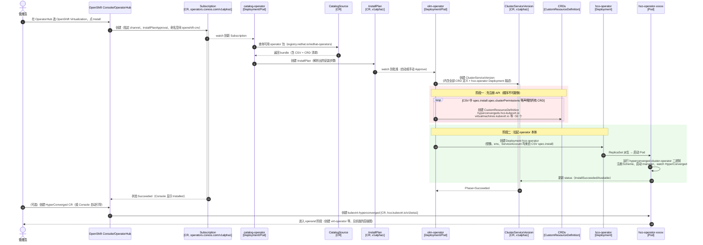
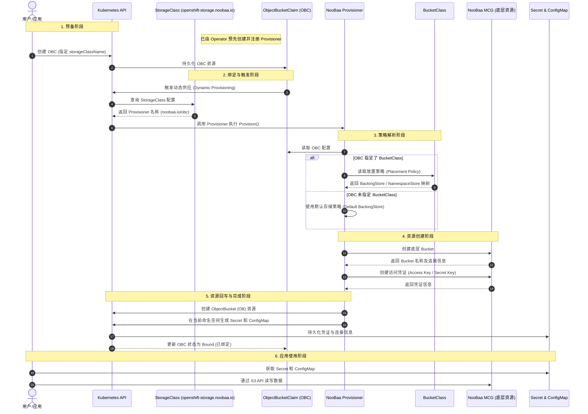

# 🦃 OpenShift 虚拟化与实践

## 文档说明

OpenShift 虚拟化基于 CNCF 项目 [KubeVirt](https://kubevirt.io/) 构建，此文档基于 Red Hat OpenShift Virtualization 4.18 版本撰写并测试。

## 文档目录

- [🦃 OpenShift 虚拟化与实践](#-openshift-虚拟化与实践)
  - [文档说明](#文档说明)
  - [文档目录](#文档目录)
  - [OpenShift Virtualization 相关的 Operator](#openshift-virtualization-相关的-operator)
  - [OpenShift Virtualization Operator 组件](#openshift-virtualization-operator-组件)
    - [Operator 安装：组件间的时序调用](#operator-安装组件间的时序调用)
    - [Operator 安装：HyperConverged 设计原理](#operator-安装hyperconverged-设计原理)
    - [Operator 安装：组件与资源间关系](#operator-安装组件与资源间关系)
  - [KubeVirt 顶层视角](#kubevirt-顶层视角)
  - [OpenShift 虚拟化资源管理](#openshift-虚拟化资源管理)
    - [虚拟机实例类型 \& 虚拟机偏好设置](#虚拟机实例类型--虚拟机偏好设置)
    - [Web 控制台：热插拔的 CPU 与内存](#web-控制台热插拔的-cpu-与内存)
    - [Web 控制台：更改虚拟机实例类型](#web-控制台更改虚拟机实例类型)
  - [virtctl 命令行使用](#virtctl-命令行使用)
  - [OpenShift 虚拟化的存储](#openshift-虚拟化的存储)
    - [StorageClass 与 VolumeSnapshotClass](#storageclass-与-volumesnapshotclass)
    - [对象存储使用](#对象存储使用)
  - [OADP 备份 KubeVirt 虚拟机](#oadp-备份-kubevirt-虚拟机)
  - [参考文档](#参考文档)

## OpenShift Virtualization 相关的 Operator

| Operator | 核心功能 | 主要管理对象 / CR | 命名空间 | 关键特点 |
| ----- | ----- | ----- | ----- | ----- |
| **Network Operator** (Cluster Network Operator) | 部署和管理集群的 CNI 网络插件（如 OVN-Kubernetes），控制 Pod 网络、IPsec 加密、MTU 等核心网络配置 | 集群网络配置（Network CR） | openshift-network-operator | 控制面组件，负责 “集群默认网络” 的搭建与运维 |
| **NMState Operator** | 对集群节点进行声明式的网络状态配置，支持创建网桥、绑定（bond）、VLAN 等，并定期上报节点网络状态 | NodeNetworkConfigurationPolicy (NNCP) <br> NodeNetworkConfigurationEnactment (NNCE) <br> NodeNetworkState (NNS) | openshift-nmstate | 面向节点主机的网络配置，常用于准备 Multus 二级网络或调整物理网卡设置 |
| **MTV Operator** (Migration Toolkit for Virtualization) | 将虚拟机从源环境（如 VMware vSphere）迁移到 OpenShift 虚拟化平台 | Provider <br> NetworkMapping <br> StorageMapping <br> Plan <br> Migration | openshift-mtv | 管理迁移工作流：定义连接、映射网络/存储、制定计划并执行 |
| **OADP Operator** (OpenShift API for Data Protection) | 为工作负载（包括虚拟机）提供备份与恢复能力，基于 Velero 实现，可备份应用资源、PV 和镜像 | DataProtectionApplication (DPA) <br> BackupStorageLocation <br> VolumeSnapshotLocation <br> Backup <br> Restore <br> Schedule <br> BackupRepository <br> Hooks | openshift-adp | 面向数据保护，需配置后端对象存储；支持 KubeVirt 插件以备份 VM |

**注意**：

openshift-network-operator (管理者)：这是 **Cluster Network Operator (CNO)** 所在的命名空间。CNO 是 OpenShift 的核心控制组件，负责在集群安装和运行期间，部署和管理底层的 CNI 网络插件（如 OVN-Kubernetes）及其相关组件。

openshift-ovn-kubernetes (运行组件)：这是 OVN-Kubernetes 网络插件本身运行的地方。CNO 将 OVN-Kubernetes 所需的 ovnkube-master、ovnkube-node 等核心 Pod 部署在这个命名空间中，由它们实际负责 Pod 网络的创建、路由和策略执行。

## OpenShift Virtualization Operator 组件

### Operator 安装：组件间的时序调用



### Operator 安装：HyperConverged 设计原理


### Operator 安装：组件与资源间关系

```plaintext
OLM (CSV/Subscription, OpenShift Virtualization Operator 的安装记录)
  └─► hco-operator [Deployment] → hco-operator-xxxxx [Pod]
        │ watch (hco-operator Pod 监视)
        ▼
  HyperConverged kubevirt-hyperconverged [CR, ns: openshift-cnv]    ← CR 即为 "实例"
        │ reconcile (hco-operator Pod 中的 hyperconverged-cluster-operator 二进制程序同时创建以下两类资源)
        ├─ A. 下游 operator 本身（它们的 Deployment 由 HCO 部署）：
        │     virt-operator                                [Deployment → ReplicaSet → Pod]
        │     cdi-operator                                 [Deployment → Pod]
        │     cluster-network-addons-operator              [Deployment → Pod]
        │     ssp-operator                                 [Deployment → Pod]
        │     hostpath-provisioner-operator                [Deployment → Pod]
        │
        └─ B. 供这些 operator 消费的 operand CR：
              KubeVirt kubevirt-kubevirt-hyperconverged    [CR]
              CDI cdi-kubevirt-hyperconverged              [CR]
              NetworkAddonsConfig cluster                  [CR, 集群级]
              SSP ssp-kubevirt-hyperconverged              [CR]
              HostPathProvisioner hostpath-provisioner     [CR]
                    │ 各 (A) 中 operator 再 reconcile 自己的 CR
                    ▼
              virt-api           [Deployment → Pod]    ← KubeVirt CR 驱动
              virt-controller    [Deployment → Pod]
              virt-handler       [DaemonSet → 每节点一个 Pod]
              cdi-apiserver / cdi-deployment / cdi-uploadproxy    [Deployment → Pod]
              multus-cni 等      [DaemonSet → Pod]
                    │ 用户创建 VirtualMachine    [CR]
                    ▼
              virt-launcher-<vmi>-xxxxx    [Pod] → 内含 qemu-kvm 进程（真正运行的 VM）
```

**Kubernetes controller 模式的统一句式：对象声明意图，控制器收敛现实。**<br>
Operator 中可根据上游 CR 实例可通过 reconcile 创建出下游 CR，如下所示：<br>
HyperConverged CR ──hco-operator──► KubeVirt CR ──virt-operator──► (virt-api 等 Deployment)


图示：HyperConverged 实例、hco-operator Pod、reconcile 之间的关系


图示：通过 OpenShift Virtualization Operator 中的 CSV 资源获取此清单中可部署的 Deployment 资源

## KubeVirt 顶层视角

<center><image src="images/k8s-kubevirt-arch-view.png" style="width:80%"></center>

<center>图示：Kubernetes 与 KubeVirt 的协作关系</center>

<center><image src="images/virt-associated-components.png" style="width:80%"></center>

<center>图示：KubeVirt 各组件协同关系</center>

## OpenShift 虚拟化资源管理

### 虚拟机实例类型 & 虚拟机偏好设置

```bash
$ oc get vmclusterinstancetypes
#获取集群中预定义的虚拟机实例类型

$ oc get vmcp    #集群级资源
$ oc get vmp     #命名空间级资源
#获取虚拟机偏好设置（CPU/内存/主机构建设置的预设模板）

$ oc get datasources -n openshift-virtualization-os-images
#获取可用的虚拟机可引导卷（已封装的黄金镜像）
```

关于虚拟机实例类型（InstanceTypes）与虚拟机偏好设置（Preferences）的联系与区别：

KubeVirt 把 VM 规格拆成了 "一硬一软" 两个对象：

| 比较维度 | InstanceType（`vmclusterinstancetypes`） | Preference（`vmcp`/`vmp`） |
| ----- | ----- | ----- |
| 管理内容 | **资源量**：vCPU 数量、内存数量 | **形态**：拓扑、机器型号、时钟、固件等 |
| 类比 | "买几核几G的机型" | "系统盘装 Windows 还是 Linux、开不开 hyperv" |
| 冲突处理 | 与 VM spec 显式字段冲突则拒绝创建 | 只填充**未显式指定**的字段，不覆盖用户显式值 |

注意：`oc get vmcp fedora -o jsonpath='{.spec.requirements}'` 返回 CPU 与内存所需的 **最低限额**，而 `oc get vmclusterinstancetypes m1.large -o jsonpath='{.spec.}'` 返回的 CPU 与内存只要大于等于前者的最低限额，即 virt-controller 可设置并运行虚拟机。

### Web 控制台：热插拔的 CPU 与内存

- 只能为基于模板创建的虚拟机修改 CPU 和内存。 对于使⽤实例类型创建的虚拟机，⽆法通过此操作修改。
- OpenShift 会⽴即将这些更改应⽤到 `VirtualMachine` 对象，并触发**实时迁移**，将更改应⽤到正在运⾏的虚拟机实例。
- ⽆需重新启动虚拟机即可使这些更改⽣效。内核版本为 5.16 或更⾼版本的 Linux 客⼾机以及具有最新 `viomem` 驱动程序的 Windows 客⼾机⽀持实时迁移。
- 可以热插拔最多 4 倍于初始分配值的 CPU 和内存。 例如，初始配置为 1 个 vCPU 和 2 GB 内存的虚拟机，在⽆需重启的情况下最⾼可扩展⾄ 4 个 vCPU 和 8 GB 内存。

### Web 控制台：更改虚拟机实例类型

- 只能为基于实例类型创建的虚拟机修改实例类型。对于使⽤模板创建的虚拟机，⽆法通过此⽅式修改。
- 与 CPU 和内存的热插拔情况类似，系统会触发**实时迁移**，从⽽将更改应⽤到运⾏中的虚拟机实例。

## virtctl 命令行使用

```bash
$ virtctl fslist <vm-name> -n <namespace>
#查看可供 VMI 使⽤的⽂件系统列表

$ virtctl guestosinfo <vm-name> -n <namespace>
#查看有关 VMI 操作系统的客⼾机代理信息

$ virtctl expose vmi rhel9-mariadb --name backend --type ClusterIP --port 80 --target-port 8080
#创建名为 rhel9-mariadb 虚拟机的 service 资源

$ virtctl expose vm hello-web --name=hello-web --type=ClusterIP --port=80 --target-port=80
#创建名为 hello-web 虚拟机的 service 资源
```

运行临时测试 Pod：

```bash
$ oc run testdb -it --rm \
  --image=registry.ocp4.example.com:8443/redhattraining/mariadb:10.5 \
  --command -- mysql --connect-timeout=5 -u devuser -p'developer' \
  -h mariadb.network-services.svc.cluster.local sakila

$ oc run udn-test -it --rm \
  --image=image-registry.openshift-image-registry.svc:5000/openshift/tools
```

## OpenShift 虚拟化的存储

### StorageClass 与 VolumeSnapshotClass


### 对象存储使用

OpenShift 数据基础（ODF）提供两种对象存储服务：多云对象⽹关（NooBaa MCG）和 Ceph RADOS 对象⽹关（Ceph RGW）。这两种服务均通过 aws 提供程序插件与 OADP 完全兼容。

ODF 的 NooBaa Operator 中 Provisioner（置备器）、StorageClass、BucketClass、ObjectBucketClass 之间的调用时序关系：



## OADP 备份 KubeVirt 虚拟机

<center><image src="images/OADP-arch.png" style="width:80%"></center>

图示：基于 Velero 的 OADP（OpenShift API for Data Protection）备份框架

## 参考文档

- 📚 [Understanding OpenShift Virtualization (KubeVirt) Key Concepts & Best Practices](https://ivolve.io/blog/openshift-virtualization-guide/)
- 😺 [**hyperconverged-cluster-operator | GitHub**](https://github.com/kubevirt/hyperconverged-cluster-operator)
- [Creating VirtualMachines by using virtctl | KubeVirt user guide](https://kubevirt.io/user-guide/user_workloads/creating_vms/)
- [Lifecycle | KubeVirt user guide](https://kubevirt.io/user-guide/user_workloads/lifecycle/)
- [9.9. Manage virtual machine instances | Red Hat Docs](https://docs.redhat.com/en/documentation/openshift_container_platform/4.18/html-single/virtualization/virtual-machines#virt-manage-vmis)
- [OpenShift Virtualization - Example Architectures](https://access.redhat.com/articles/7067871)
- [MetalLB on OpenShift OCP | MetalLB Docs](https://metallb.universe.tf/installation/clouds/#metallb-on-openshift-ocp)
- [Configuration | MetalLB Docs](https://metallb.universe.tf/configuration/)
