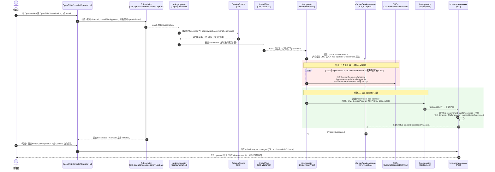
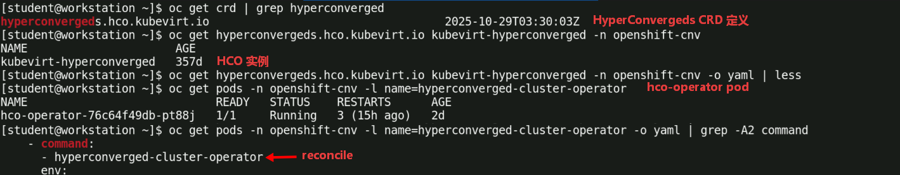
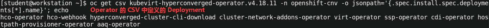

# OpenShift 虚拟化架构体系与实践

## 文档说明

此文档基于 Red Hat OpenShift Virtualization 4.18 版本撰写并测试。

## 文档目录

- [OpenShift 虚拟化架构体系与实践](#openshift-虚拟化架构体系与实践)
  - [文档说明](#文档说明)
  - [文档目录](#文档目录)
  - [OpenShift Virtualization Operator 组件](#openshift-virtualization-operator-组件)
    - [安装 Operator 过程中的时序调用](#安装-operator-过程中的时序调用)
    - [Operator 各组件与资源间关系](#operator-各组件与资源间关系)
  - [OpenShift 虚拟化资源管理](#openshift-虚拟化资源管理)
    - [虚拟机实例类型 \& 虚拟机偏好设置](#虚拟机实例类型--虚拟机偏好设置)
    - [Web 控制台：热插拔的 CPU 与内存](#web-控制台热插拔的-cpu-与内存)
    - [Web 控制台：更改虚拟机实例类型](#web-控制台更改虚拟机实例类型)
    - [virtctl 命令行使用](#virtctl-命令行使用)
  - [参考文档](#参考文档)

## OpenShift Virtualization Operator 组件

### 安装 Operator 过程中的时序调用



### Operator 各组件与资源间关系

```plaintext
OLM (CSV/Subscription, OpenShift Virtualization Operator 的安装记录)
  └─► hco-operator [Deployment] → hco-operator-xxxxx [Pod]
        │ watch (hco-operator Pod 监视)
        ▼
  HyperConverged kubevirt-hyperconverged [CR, ns: openshift-cnv]    ← CR 即为 "实例"
        │ reconcile (hco-operator Pod 中的 hyperconverged-cluster-operator 二进制程序同时创建以下两类资源)
        ├─ A. 下游 operator 本身（它们的 Deployment 由 HCO 部署）：
        │     virt-operator                                [Deployment → ReplicaSet → Pod]
        │     cdi-operator                                 [Deployment → Pod]
        │     cluster-network-addons-operator              [Deployment → Pod]
        │     ssp-operator                                 [Deployment → Pod]
        │     hostpath-provisioner-operator                [Deployment → Pod]
        │
        └─ B. 供这些 operator 消费的 operand CR：
              KubeVirt kubevirt-kubevirt-hyperconverged    [CR]
              CDI cdi-kubevirt-hyperconverged              [CR]
              NetworkAddonsConfig cluster                  [CR, 集群级]
              SSP ssp-kubevirt-hyperconverged              [CR]
              HostPathProvisioner hostpath-provisioner     [CR]
                    │ 各 (A) 中 operator 再 reconcile 自己的 CR
                    ▼
              virt-api           [Deployment → Pod]    ← KubeVirt CR 驱动
              virt-controller    [Deployment → Pod]
              virt-handler       [DaemonSet → 每节点一个 Pod]
              cdi-apiserver / cdi-deployment / cdi-uploadproxy    [Deployment → Pod]
              multus-cni 等      [DaemonSet → Pod]
                    │ 用户创建 VirtualMachine    [CR]
                    ▼
              virt-launcher-<vmi>-xxxxx    [Pod] → 内含 qemu-kvm 进程（真正运行的 VM）
```

> 说明：<br>
> **Kubernetes controller 模式的统一句式：对象声明意图，控制器收敛现实。**
>
> Operator 中可根据上游 CR 实例可通过 reconcile 创建出下游 CR，如下所示：<br>
> HyperConverged CR ──hco-operator──► KubeVirt CR ──virt-operator──► (virt-api 等 Deployment)

HyperConverged 实例、hco-operator Pod、reconcile 之间的关系：



通过 OpenShift Virtualization Operator 中的 CSV 资源获取此清单中可部署的 Deployment 资源：



创建虚拟机的各个组件：

<center><image src="images/virt-associated-components.png" style="width:80%"></center>

## OpenShift 虚拟化资源管理

### 虚拟机实例类型 & 虚拟机偏好设置

```bash
$ oc get vmclusterinstancetypes
#获取集群中预定义的虚拟机实例类型

$ oc get vmcp    #集群级资源
$ oc get vmp     #命名空间级资源
#获取虚拟机偏好设置（CPU/内存/主机构建设置的预设模板）

$ oc get datasources -n openshift-virtualization-os-images
#获取可用的虚拟机可引导卷（已封装的黄金镜像）
```

关于虚拟机实例类型（InstanceTypes）与虚拟机偏好设置（Preferences）的联系与区别：

KubeVirt 把 VM 规格拆成了 "一硬一软" 两个对象：

| 比较维度 | InstanceType（`vmclusterinstancetypes`） | Preference（`vmcp`/`vmp`） |
| ----- | ----- | ----- |
| 管理内容 | **资源量**：vCPU 数量、内存数量 | **形态**：拓扑、机器型号、时钟、固件等 |
| 类比 | "买几核几G的机型" | "系统盘装 Windows 还是 Linux、开不开 hyperv" |
| 冲突处理 | 与 VM spec 显式字段冲突则拒绝创建 | 只填充**未显式指定**的字段，不覆盖用户显式值 |

注意：`oc get vmcp fedora -o jsonpath='{.spec.requirements}'` 返回 CPU 与内存所需的 **最低限额**，而 `oc get vmclusterinstancetypes m1.large -o jsonpath='{.spec.}'` 返回的 CPU 与内存只要大于等于前者的最低限额，即 virt-controller 可设置并运行虚拟机。

### Web 控制台：热插拔的 CPU 与内存

- 只能为基于模板创建的虚拟机修改 CPU 和内存。 对于使⽤实例类型创建的虚拟机，⽆法通过此操作修改。
- OpenShift 会⽴即将这些更改应⽤到 `VirtualMachine` 对象，并触发**实时迁移**，将更改应⽤到正在运⾏的虚拟机实例。
- ⽆需重新启动虚拟机即可使这些更改⽣效。内核版本为 5.16 或更⾼版本的 Linux 客⼾机以及具有最新 `viomem` 驱动程序的 Windows 客⼾机⽀持实时迁移。
- 可以热插拔最多 4 倍于初始分配值的 CPU 和内存。 例如，初始配置为 1 个 vCPU 和 2 GB 内存的虚拟机，在⽆需重启的情况下最⾼可扩展⾄ 4 个 vCPU 和 8 GB 内存。

### Web 控制台：更改虚拟机实例类型

- 只能为基于实例类型创建的虚拟机修改实例类型。对于使⽤模板创建的虚拟机，⽆法通过此⽅式修改。
- 与 CPU 和内存的热插拔情况类似，系统会触发**实时迁移**，从⽽将更改应⽤到运⾏中的虚拟机实例。

### virtctl 命令行使用

```bash
virtctl fslist <vm-name> -n <namespace>
#查看可供 VMI 使⽤的⽂件系统列表
virtctl guestosinfo <vm-name> -n <namespace>
#查看有关 VMI 操作系统的客⼾机代理信息
```

## 参考文档
